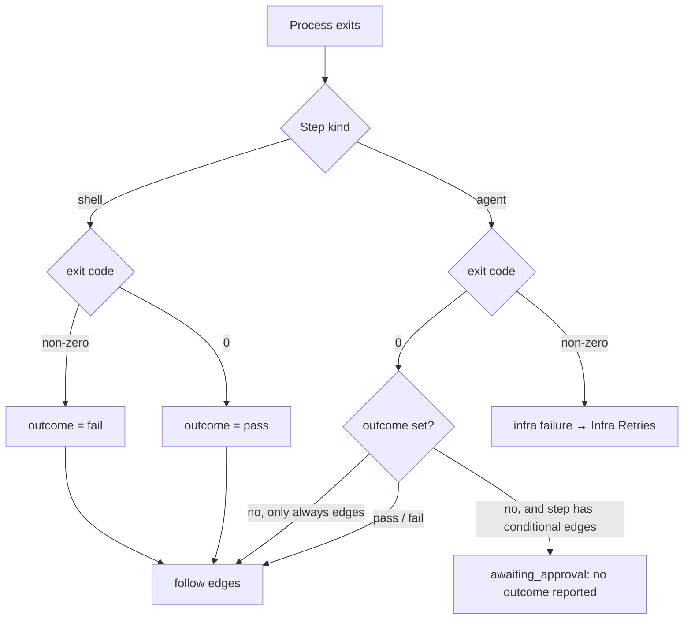

# Run Outcomes

The outcome is the only thing the engine takes from a run to choose a route. `step_instances.outcome` is *"'pass'|'fail'|null, drives conditional edges"* (PRD §5).

## Where an outcome comes from

| Step | Source of the outcome | Source wording |
|---|---|---|
| Shell (check) step | The exit code | *"The **exit code is the outcome**: 0 sets `pass`, anything else sets `fail`."* (PRD §7) |
| Agent step, JSON | A field in the produced artifact | *"An agent step sets its outcome by writing `{"outcome":"pass"\|"fail"}` into its artifact JSON"* (PRD §8) |
| Agent step, MCP | The `set_outcome` tool | *"**`set_outcome({ outcome, reason })`** — sets `pass` or `fail` for conditional edges. Code review calls this."* (PRD §9) |
| Provider result | `RunResult.outcome` | *"Drives conditional edges; read from the produced JSON or set_outcome."* (`agent-provider.ts`) |
| A human | Approve or reject at a gate | *"approve means pass, reject means fail"* (PRD §8) |

The runner reads the JSON form during the artifact scan: *"outcome read from the produced JSON (`{"outcome": …}`)"* (`03` §6); the drawio *Artifact scanner* card: *"reads {outcome}"*.

## Rules

> [!important] A missing outcome is never a pass
> *"If the step has an `on_pass` or `on_fail` edge and the run ended without setting an outcome, set the step instance to `awaiting_approval` with the reason "no outcome reported" and stop. I decide; approve means pass, reject means fail. Steps with only `always` edges need no outcome."* (PRD §8)
>
> *"**No default:** an unset outcome on a step with conditional edges goes to a human gate, never to `pass`"* (`03` §6). `RunResult.outcome`: *"Unset is NOT 'pass': the engine parks the step at a human gate."* (`agent-provider.ts`)

| Rule | Source wording |
|---|---|
| Human wins | *"Approve overrides the agent's `fail` outcome (human wins); reject sets `fail` + reason; reject with no `on_fail` edge fails the task."* (`02` §3; backlog 5.2, tagged **FIX**). The PRD is silent on approving over a `fail`; backlog 10.2 lists *"approve overrides outcome"* as a deviation. |
| A failing check is a result | *"A non-zero exit here is a result, not a run failure, so it follows the step's edges instead of blocking the task."* (PRD §7) |
| A failing agent process is not a verdict | *"A non-zero exit from an agent run is an **infrastructure failure**, never a verdict on the work, because work verdicts arrive as outcomes."* (PRD §7) |
| The review must decide | *"The seeded `/code-review` skill … must call `set_outcome`. It is told to look for failures, not to confirm the work."* (PRD §15) |

## Outcome versus exit code

Assembled from PRD §7 and §8. The run's own `state` (`succeeded` / `failed`) tracks the process; the outcome tracks the work. For a shell step that exits non-zero, which run state is recorded is not stated: PRD §7's completion rule says `failed`, its shell paragraph says the exit *"is a result, not a run failure"* ([[Execution Open Questions]] #57).

## Gaps

- **Which artifact holds the outcome** when a step produces more than one JSON file is not stated. *Proposal:* read `set_outcome` first, then the first produced JSON with an `outcome` key. Listed in [[Execution Open Questions]].
- **Both sources set.** If the agent calls `set_outcome` and writes a different value into its JSON, which wins is not stated.
- **The `reason`** passed to `set_outcome` has no column. Backlog 1.1 adds `step_instances.reason` *"(rejection/failure text shown on the card)"*; whether `set_outcome`'s reason lands there is not stated.

## Related

- [[Execution Index]]
- [[Advancement Rules]]
- [[Shell Step Execution]]
- [[Infra Retries]]
- [[Approval Gates]]
- [[Connections And Routes]]
