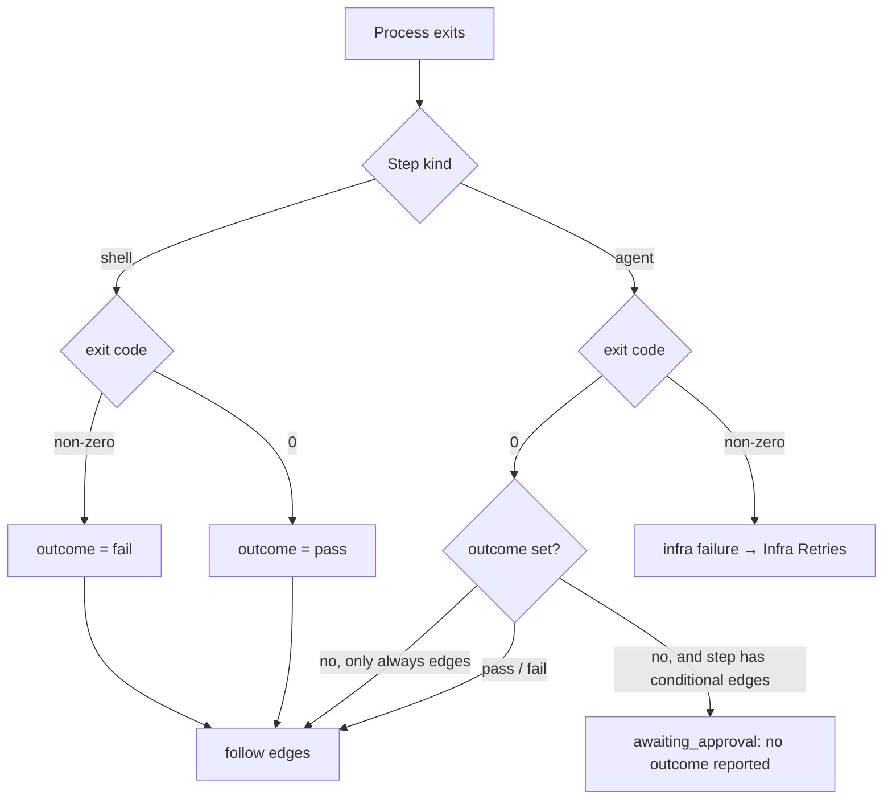

# Run Outcomes

The outcome is the only thing the engine takes from a run to choose a route. `step_instances.outcome` is *"'pass'|'fail'|null, drives conditional edges"* (PRD §5).

## Where an outcome comes from

| Step | Source of the outcome | Source wording |
|---|---|---|
| Shell (check) step | The exit code | *"The **exit code is the outcome**: 0 sets `pass`, anything else sets `fail`."* (PRD §7) |
| Agent step, JSON | A field in the produced artifact | *"An agent step sets its outcome by writing `{"outcome":"pass"\|"fail"}` into its artifact JSON"* (PRD §8) |
| Agent step, MCP | The `set_outcome` tool | *"**`set_outcome({ outcome, reason })`** — sets `pass` or `fail` for conditional edges. Code review calls this."* (PRD §9) |
| Provider result | `RunResult.outcome` | *"Drives conditional edges; read from the produced JSON or set_outcome."* (`agent-provider.ts`) |
| Provider event | The normalized `result` event's `outcome?` | `{ type: 'result'; usage: Usage; outcome?: 'pass' \| 'fail' }` (`events.ts`, `01-ports.md`). Which side fills it, adapter or runner, is open ([[Agent Providers Open Questions]] #10, [[Agent Run Handle And Result]]). |
| A human | Approve or reject at a gate | *"approve means pass, reject means fail"* (PRD §8) |

The runner reads the JSON form during the artifact scan: *"outcome read from the produced JSON (`{"outcome": …}`)"* (`03` §6); the drawio *Artifact scanner* card: *"reads {outcome}"*.

As built in run-flow (2026-10-23), a shell step's outcome is its exit code, except that exit 126 or 127 or a death by a signal is a setup failure, not a `fail`: `exit code 127: command not found`, `exit code 126: the command cannot run`, `killed by SIGKILL`. Such a run waits at a *run failed* gate (Claude's call, 2026-10-23, open to Alex's review; see [[Run Flow Reference#Rules this command settles]]). An agent step's outcome is what it reported with `set_outcome`, else the provider's `RunResult.outcome`, else none (the run-flow plan, Execution #7); the JSON form is on the plan's Left out list. `set_outcome` is offered only to agent steps whose routes or gate read the verdict, those with an `on_pass` or `on_fail` route or `gate: approval`; an outcome any other agent step reports is ignored (Claude's call, 2026-10-23, open to Alex's review).

## Rules

> [!important] A missing outcome is never a pass
> *"If the step has an `on_pass` or `on_fail` edge and the run ended without setting an outcome, set the step instance to `awaiting_approval` with the reason "no outcome reported" and stop. I decide; approve means pass, reject means fail. Steps with only `always` edges need no outcome."* (PRD §8)
>
> *"**No default:** an unset outcome on a step with conditional edges goes to a human gate, never to `pass`"* (`03` §6). `RunResult.outcome`: *"Unset is NOT 'pass': the engine parks the step at a human gate."* (`agent-provider.ts`)
>
> Feature map §4: *"**Silence isn't success** — If an agent finishes without saying whether it passed, the engine doesn't assume it did. The step stops and asks you."* The drawio *Life of one step* (I) counts it among the stops: the engine *"escalates when the loop is spent, stuck, or silent."*

| Rule | Source wording |
|---|---|
| Human wins | *"Approve overrides the agent's `fail` outcome (human wins); reject sets `fail` + reason; reject with no `on_fail` edge fails the task."* (`02` §3; backlog 5.2, tagged **FIX**). Feature map §4 (*"your decision overrides whatever the agent concluded"*) and drawio harness concept 8 (*"Your call overrides the agent's."*) agree. The PRD is silent on approving over a `fail`; backlog 10.2 lists *"approve overrides outcome"* as a deviation ([[Execution Open Questions]] #64). |
| A failing check is a result | *"A non-zero exit here is a result, not a run failure, so it follows the step's edges instead of blocking the task."* (PRD §7) |
| A failing agent process is not a verdict | *"A non-zero exit from an agent run is an **infrastructure failure**, never a verdict on the work, because work verdicts arrive as outcomes."* (PRD §7) |
| The review must decide | *"The seeded `/code-review` skill … must call `set_outcome`. It is told to look for failures, not to confirm the work."* (PRD §15) |

As built in run-flow (2026-10-23):

- **Silence.** A step with an `on_pass` or `on_fail` route and no outcome waits at a gate, `no outcome reported`. An agent run that left a declared output unwritten waits at `did not write: <types>`, outcome or not (the run-flow plan).
- **Human wins.** Approve sets `pass` and Reject sets `fail`, over the agent's verdict (the run-flow plan, Execution #64). Reject is offered only when the step has an `on_fail` route, so it never fails a flow; only a person's *Fail the flow* does.
- **A failing agent process.** An agent run that ends with an error keeps no outcome, even one it reported. The error is the provider's (an `is_error` result included, even at exit 0), `exit code <n>`, a limit hit, or `timed out after <n> minutes`. Nothing below the engine retries it, so run-flow's engine itself marks the run wasted and opens a *run failed* gate on the step, `run failed: <error>`. Retry there keeps the attempt number, so `max_attempts` still counts only work (the run-flow plan). See [[Infra Retries]].

## Outcome versus exit code

Assembled from PRD §7 and §8. The run's own `state` (`succeeded` / `failed`) tracks the process; the outcome tracks the work. For a shell step that exits non-zero, which run state is recorded is not stated: PRD §7's completion rule says `failed`, its shell paragraph says the exit *"is a result, not a run failure"* ([[Execution Open Questions]] #57). As built in run-flow (2026-10-23), a run record has no `state`: a failing check ends with `outcome: 'fail'` and no `error`, a result rather than a run failure ([[Execution State Machines]]).

## Gaps

- **Which artifact holds the outcome** when a step produces more than one JSON file is not stated. *Proposal:* read `set_outcome` first, then the first produced JSON with an `outcome` key. Listed in [[Execution Open Questions]] #7. As built in run-flow (2026-10-23), no artifact does: `set_outcome` first, then the provider's result (the run-flow plan, Execution #7).
- **Both sources set.** If the agent calls `set_outcome` and writes a different value into its JSON, which wins is not stated (#7). As built in run-flow (2026-10-23), `set_outcome` wins over the provider's result.
- **The `reason`** passed to `set_outcome` has no column. Backlog 1.1 adds `step_instances.reason` *"(rejection/failure text shown on the card)"*; whether `set_outcome`'s reason lands there is not stated ([[Execution Open Questions]] #8). The same holds for PRD §8's gate reason *"no outcome reported"*: PRD §5's `step_instances` has no column to hold it. As built in run-flow (2026-10-23), the reason is kept on the run record (`reason` in `state.json`) and in `<NNN>-<step>.outcome.json`, and gate reasons quote it (`approval needed; it reported fail: <reason>`, `failed (<reason>), and no edge handles a failure`); it does not reach a rework run. A gate's own reason, `no outcome reported` included, is kept on the step's `gate`.

## Related

- [[Execution Index]]
- [[Advancement Rules]]
- [[Shell Step Execution]]
- [[Infra Retries]]
- [[Approval Gates]]
- [[Connections And Routes]]
