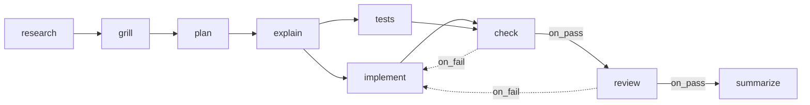

# Seeded Flow Execution

How the engine runs the seeded *Software delivery* flow (PRD §15). The flow as a design is in [[Seeded Flows]]; this note follows it at run time.

## The steps

| key | kind | advance | requires | produces |
|---|---|---|---|---|
| `research` | ai (`scout`) | auto | — | `research_brief` |
| `grill` | ai (`/grill-me`) | auto | `research_brief` | `questions`, `answers` |
| `plan` | ai (`architect` + `/plan-implementation`) | auto | `research_brief`, `answers` | `plan` |
| `explain` | ai (`/explain-simply`) | **approval** | `plan` | `explainer` |
| `implement` | ai (`developer` + `/ponytail`) | auto | `plan` | `implementation_notes` |
| `tests` | ai (`tester`) | auto | `plan` | `test_notes` |
| `check` | shell (project `check_command`) | auto | — | `check_output` |
| `review` | ai (`reviewer` + `/code-review`) | **approval** | `implementation_notes`, `test_notes`, `check_output` | `review` |
| `summarize` | ai (`scribe`) | auto | `review` | `summary` |

(PRD §15, models and efforts omitted.)

## The edges

*"Then `check → review` on `on_pass` and `check → implement` on `on_fail` (the mechanical loop: the model never gets reviewed on code that doesn't pass). Then `review → summarize` on `on_pass`, and `review → implement` on `on_fail` (the review loop)."* (PRD §15)

## A clean run

Illustrative, assembled from PRD §8, §9 and §15. No source walks the seeded flow beat by beat.

| Beat | Engine | State after |
|---|---|---|
| Start | `research` is the entry step (listed first in PRD §15, which marks no `is_entry`); `start_run` | research running |
| research done | `always` → `grill` | grill running |
| grill asks | `ask_user_batch`; may park after 20 min | `awaiting_answers` |
| answers in | resume `start_run` | grill running → done |
| plan done | → `explain` | explain running |
| explain done | `advance_mode = approval` | `awaiting_approval` |
| Approve | fan-out: `implement` ∥ `tests` | two runs, two slots |
| both done | join at `check` | check running (shell, $0) |
| check exit 0 | `on_pass` → `review` | review running |
| review `set_outcome(pass)` | approval step | `awaiting_approval` |
| Approve | → `summarize` | summarize running |
| summarize done | no outgoing edges, nothing active | task `done` |

As built in run-flow (2026-10-23), the seeded flow runs these beats as listed. The seeded flow's steps and edges pass `validateFlow`, and `research` goes first because no route points to it. One beat differs: `grill`'s questions are answered while its run waits, with no parking. Each approval gate reads `approval needed`, plus `; it reported pass: <reason>` when the agent reported a verdict.

## The two loops

| Loop | Trigger | Rework target | Budget | Early stop |
|---|---|---|---|---|
| Mechanical | `check` exits non-zero | `implement` | `implement.max_attempts` (3) | same fingerprint twice |
| Review | `review` sets `fail`, or you reject | `implement` | the same 3 | none: *"Review failures get no fingerprint"* |

*"In the seeded flow, a failed `check` and a failed `review` both spend `implement`'s attempts."* (PRD §8)

As built in run-flow (2026-10-23), the review loop starts only when a person rejects. `review` is an approval step, so its own `fail` only shows at its gate (`approval needed; it reported fail: <reason>`), and Approve passes the work over it (the run-flow plan, Execution #64, #71). The mechanical loop stops early when `check` fails with the same fingerprint as its previous failure, even with a pass in between.

After a rework: `implement` runs again with the failing artifact in its read-first list; `check`, `review` and `summarize` are downstream of it and reset; `tests` is a sibling and stays done. See [[Rework Loop]] and [[Fan-Out And Join]]. As built in run-flow (2026-10-23), `review` and `summarize` are deleted and recreated when routes reach them again. `check` is a join that `tests` already fed from outside the reset, so it comes back `pending` and waits for the new `implement` run (Claude's call, 2026-10-23, open to Alex's review; see [[Run Flow Reference#Rules this command settles]]).

## Points to watch

- **`grill` produces `questions` and `answers`**, so a run that parks and resumes still has to write both files. The resume prompt must repeat them (backlog 3.2). As built in run-flow (2026-10-23), nothing parks; a `grill` run that leaves either file unwritten stops at a gate, `did not write: <types>`.
- **`review` needs no fingerprint** but must call `set_outcome` (PRD §15). Under PRD §8's ordering, a review that sets no outcome first stops at its own approval gate. The approval rule runs first (*"set the step instance to `awaiting_approval` and stop. It advances only when I click Approve."*); the no-outcome check sits inside `advance_task`, which runs only after Approve. PRD §8 says *"approve means pass"* only of the no-outcome gate. If Approve writes `pass` (`02` §3, feature map §4), a silent review shows as an ordinary gate, never as *"no outcome reported"*. Read literally, the PRD gates it twice: once for approval, then again with "no outcome reported" ([[Execution Open Questions]] #64, #71). See [[Advancement Rules]]. As built in run-flow (2026-10-23), a silent review is gated once: its gate reads `approval needed`, and the decision there is the outcome (the run-flow plan, Execution #5, #71).
- **`check` runs no prompt at all.** *"A `kind='shell'` step runs no model"* (PRD §7). It depends on `implement` and `tests` through edges only.
- **`implement` is a join by definition** (three incoming edges), though its loop-back edges never block it in practice; see [[Fan-Out And Join]]. As built in run-flow (2026-10-23), it is not a join: only forward routes make one (the run-flow plan, Execution #4).

## The sources' own proof

PRD §14, M5: *"Proof it works: a deliberately failing test in the scratch repo sends the seeded flow from `check` back to `implement` with the raw log, and a run that sets no outcome stops at a gate instead of passing."*

*Inference:* the seeded flow alone cannot show the second half as a distinct *"no outcome reported"* gate. `check` is a shell step, so it always has an outcome, and `review`, the only AI step with conditional edges, is an approval step whose own gate hides a missing outcome (see *Points to watch*). A run that sets no outcome does still stop at a gate, just not one labelled as such ([[Execution Open Questions]] #71). As built in run-flow (2026-10-23), the gate's reason still shows it: a silent review's gate reads `approval needed` with nothing after it, where one that reported reads `approval needed; it reported pass: <reason>`.

PRD §15: *"Seed the scratch project's `check_command` with something that exists in the scratch repo."* The seeded skills are *"real local plugin dirs under FlowBoard's `./skills/` … so M5 is testable without any GitHub access."*

## In the mockups

The monitor and task-detail mockups use a shorter flow (`research`, `plan`, `build` ∥ `tests`, `review`, `summarize`) with **no check step**. See [[Monitor Sample Data]] and [[Sample Task Auth Refactor]].

## Related

- [[Execution Index]]
- [[Seeded Flows]]
- [[Advancement Rules]]
- [[Rework Loop]]
