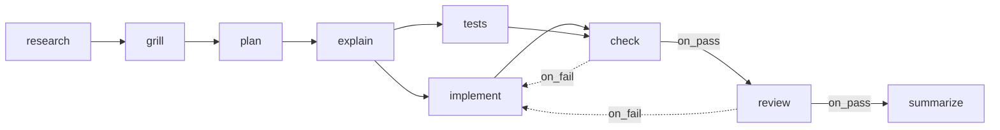

# Seeded Flow Execution

How the engine runs the seeded *Software delivery* flow (PRD §15). The flow as a design is in [[Seeded Flows]]; this note follows it at run time.

## The steps

| key | kind | advance | requires | produces |
|---|---|---|---|---|
| `research` | ai (`scout`) | auto | — | `research_brief` |
| `grill` | ai (`/grill-me`) | auto | `research_brief` | `questions`, `answers` |
| `plan` | ai (`architect` + `/plan-implementation`) | auto | `research_brief`, `answers` | `plan` |
| `explain` | ai (`/explain-simply`) | **approval** | `plan` | `explainer` |
| `implement` | ai (`developer` + `/ponytail`) | auto | `plan` | `implementation_notes` |
| `tests` | ai (`tester`) | auto | `plan` | `test_notes` |
| `check` | shell (project `check_command`) | auto | — | `check_output` |
| `review` | ai (`reviewer` + `/code-review`) | **approval** | `implementation_notes`, `test_notes`, `check_output` | `review` |
| `summarize` | ai (`scribe`) | auto | `review` | `summary` |

(PRD §15, models and efforts omitted.)

## The edges

*"Then `check → review` on `on_pass` and `check → implement` on `on_fail` (the mechanical loop: the model never gets reviewed on code that doesn't pass). Then `review → summarize` on `on_pass`, and `review → implement` on `on_fail` (the review loop)."* (PRD §15)

## A clean run

Illustrative, assembled from PRD §8, §9 and §15. No source walks the seeded flow beat by beat.

| Beat | Engine | State after |
|---|---|---|
| Start | `research` is the entry step; `start_run` | research running |
| research done | `always` → `grill` | grill running |
| grill asks | `ask_user_batch`; may park after 20 min | `awaiting_answers` |
| answers in | resume `start_run` | grill running → done |
| plan done | → `explain` | explain running |
| explain done | `advance_mode = approval` | `awaiting_approval` |
| Approve | fan-out: `implement` ∥ `tests` | two runs, two slots |
| both done | join at `check` | check running (shell, $0) |
| check exit 0 | `on_pass` → `review` | review running |
| review `set_outcome(pass)` | approval step | `awaiting_approval` |
| Approve | → `summarize` | summarize running |
| summarize done | no outgoing edges, nothing active | task `done` |

## The two loops

| Loop | Trigger | Rework target | Budget | Early stop |
|---|---|---|---|---|
| Mechanical | `check` exits non-zero | `implement` | `implement.max_attempts` (3) | same fingerprint twice |
| Review | `review` sets `fail`, or you reject | `implement` | the same 3 | none: *"Review failures get no fingerprint"* |

*"In the seeded flow, a failed `check` and a failed `review` both spend `implement`'s attempts."* (PRD §8)

After a rework: `implement` runs again with the failing artifact in its read-first list; `check`, `review` and `summarize` are downstream of it and reset; `tests` is a sibling and stays done. See [[Rework Loop]] and [[Fan-Out And Join]].

## Points to watch

- **`grill` produces `questions` and `answers`**, so a run that parks and resumes still has to write both files. The resume prompt must repeat them (backlog 3.2).
- **`review` needs no fingerprint** but must call `set_outcome` (PRD §15). If it does not, it parks with *"no outcome reported"*. Because `review` is also an approval step, that gate and the no-outcome gate look the same.
- **`check` has no `requires`**, so its prompt-part-2 list is empty. It joins on `implement` and `tests` through edges only.
- **The join at `implement`.** Read literally, PRD §8's join rule makes `implement` wait for `check` and `review`; see [[Fan-Out And Join]].

## In the mockups

The monitor and task-detail mockups use a shorter flow (`research`, `plan`, `build` ∥ `tests`, `review`, `summarize`) with **no check step**. See [[Monitor Sample Data]] and [[Sample Task Auth Refactor]].

## Related

- [[Execution Index]]
- [[Seeded Flows]]
- [[Advancement Rules]]
- [[Rework Loop]]
