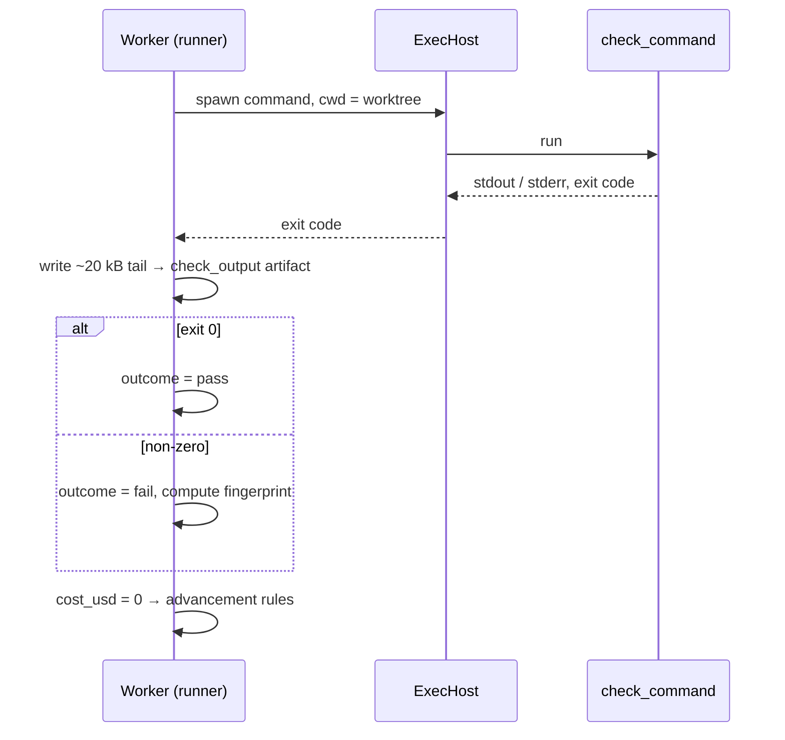

# Shell Step Execution

What happens at run time when a step has `kind = 'shell'`. Designing check steps is covered in [[Check Steps]].

## The rule

> *"A `kind='shell'` step runs no model. The runner executes `step.command` (or the project's `check_command`) in the task's worktree through the same execution host, so it inherits the sandbox. It writes stdout and stderr (tail, ~20 kB) to a `check_output` artifact. The **exit code is the outcome**: 0 sets `pass`, anything else sets `fail`. A non-zero exit here is a result, not a run failure, so it follows the step's edges instead of blocking the task. Shell runs cost nothing and record `cost_usd = 0`."* (PRD §7)

| Field | Source |
|---|---|
| `step_defs.command` | *"kind='shell' only; null = the project's check_command"* (PRD §5) |
| `projects.check_command` | *"e.g. 'pnpm lint && pnpm test'; what a shell check step runs"* (PRD §5) |
| `runs.fingerprint` | *"shell steps: normalized hash of a failing check_output"* (PRD §5) |

As built in run-flow (2026-10-23), a shell step is `shell: <command>` in the flow file, and the host runs `sh -c <command>` in the folder the run names with `--folder`. See [[Run Flow Reference#Shell steps]].

- **No `ExecHost`.** The check is spawned with Node's `spawn` directly, on the host, because `ExecHost` cannot kill a process group yet. A `ponytail:` comment in `cli/src/flow-exec.ts` marks the way back: the sandbox work must route checks through `ExecHost` again, with a group kill.
- **The verdict.** Exit 0 is `pass` and any other exit `fail`, a result that follows the step's routes. The exceptions are setup failures, which wait at a *run failed* gate: `exit code 126: the command cannot run`, `exit code 127: command not found`, and a shell killed by a signal, `killed by SIGKILL` (Claude's call, 2026-10-23, open to Alex's review; see [[Run Flow Reference#Rules this command settles]]). The run's cost is `0`.
- **The output.** The last 20,000 characters, stdout and stderr in order of arrival, go to the artifact of the step's first `produces` type, but only if it declares one, and always into the `output` of the run log's `result` line. The terminal shows the last non-empty line: `-- <step>: last output: <line>`, cut at 300 characters.
- **What it leaves running.** The check runs in its own process group, whose id is the run log's `pid` line, marked `"group":true`, with the shell's start time. When its shell exits, whatever is left in the group is stopped (SIGTERM, then SIGKILL 2 s later), so `pnpm start > log 2>&1 & pnpm e2e` ends with the tests. A second Ctrl+C kills the group at once (SIGKILL). Should the host die first, the next run-flow in the folder, or `--resume`, stops the group, even once its shell has gone (Alex's call, 2026-10-23; see [[Worker Lifecycle]]).
- **Its environment** has `FLOWBOARD_ARTIFACTS`, the artifacts folder, and `FLOWBOARD_NOTE` when a gate's note started the run, but no variable whose name ends in `_KEY`, `_TOKEN`, `_SECRET` or `_PASSWORD`. Its input is empty. A missing input is said aloud, as for agent steps: `-- <step>: missing input <type>; it runs without it`.

## Why it exists

*"`shell` is in v3 scope because it is the only executor whose verdict does not come from a model"* (`02` §3). *"**Shell steps are the sensors.** … The model proposes; the harness runs the check; the exit code decides. No `AgentProvider` is involved, and the run costs nothing."* (`03` §6)

Feature map §2: *"If the command succeeds, the step passed. If it fails, the step failed, and the error output goes to the next attempt word for word. This is how FlowBoard knows the code works instead of taking an agent's word for it."*

## Run time sequence

Assembled from PRD §7–§8. The drawio *Shell executor = the sensor* card: *"runs check_command in a fresh sandbox · exit 0 → pass, else fail · output tail → check_output · fingerprint → runs"*. Its *Check container* card: *"same image and mounts, no model, no API key: runs check_command and exits with its code"*. *Life of one step* I: *"A check step runs check_command in a fresh container and its exit code decides."*

## What it feeds

- **The rework prompt.** The failing `check_output` joins the next run's *"read these first"* list (PRD §8). As built in run-flow, it joins only as the check's `produces` artifact: a check that declares none hands its rework target nothing, and `--check` warns `steps.check: reworks "impl" on a failure but produces nothing, so impl runs again without seeing why`.
- **Stuck detection.** Same fingerprint twice escalates. See [[Stuck Detection And Fingerprints]]. As built in run-flow, the fingerprint is taken from the output tail, with or without `produces`; a failing check that printed nothing gets none, so it is never stuck.
- **The review.** *"`/code-review` … reviews the diff … against the raw `check_output`"* (PRD §15).

## Gaps

- **Fresh container or the task's.** PRD §7 says *"through the same execution host"*; the drawio says *"in a fresh sandbox"* / *"Check container"*. The PRD is itself split: its *Sandboxed runs* paragraph launches commands *"*inside* the task's container"*, while §11.1 says *"Containers are ephemeral — one per run, destroyed on completion"* (and `08`: *"One container per run/attempt"*). See [[Execution Open Questions]] #40 and #61, and [[Sandboxing Open Questions]] #17. Whether a check container gets any egress (to install packages, say) is also open ([[Sandboxing Open Questions]] #20). As built in run-flow (2026-10-23), neither: the check runs on the host, in the run's folder.
- **Run state on a failing check.** Whether a non-zero check records `runs.state = 'failed'` (PRD §7 *Completion*) or `succeeded` (the shell paragraph: *"a result, not a run failure"*) is not stated ([[Execution Open Questions]] #57). As built in run-flow, a result: run records have no state, and a failing check is a finished run with outcome `fail`. Only a setup failure, a check that cannot start, an output it cannot save, a timeout or a stop ends a shell run with an error; all but a stop send its step to a *run failed* gate.
- **Worker slot.** Whether a shell run counts against `VIBE_MAX_RUNS` is not stated ([[Execution Open Questions]] #36; also [[Worker Slots]]). As built in run-flow, `--max-runs` counts shell runs as it counts agent runs.
- **Timeouts.** A hanging `check_command` has no stated limit other than the sandbox wall clock (`08`). As built in run-flow, `timeout_minutes` is 30 by default for a shell step (the run-flow plan). When it runs out, the check's group is stopped, its output so far still goes to its artifact and its log, the log's `result` line says `timed out after <n> minutes`, and the step waits at a *run failed* gate.
- **Non-zero for reasons other than test failure** (command not found, out of memory) is still a `fail` outcome under the rule above, so it loops rather than blocks ([[Execution Open Questions]] #41; [[Sandboxing Open Questions]] #15). As built in run-flow, exit 127 (command not found), exit 126 (the command cannot run) and a shell killed by a signal are setup failures that wait at a *run failed* gate instead (Claude's call, 2026-10-23, open to Alex's review). Any other non-zero exit is still a `fail`.

## Related

- [[Execution Index]]
- [[Check Steps]]
- [[Run Outcomes]]
- [[Stuck Detection And Fingerprints]]
- [[Rework Loop]]
- [[Sandboxed Run Lifecycle]]
