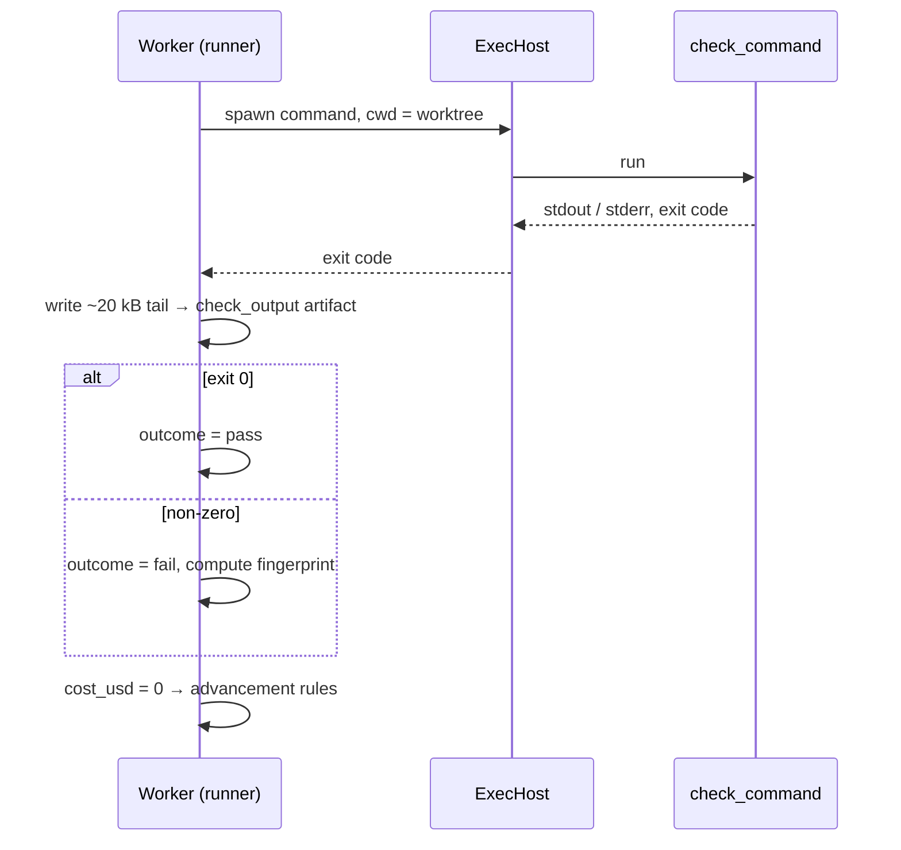

# Shell Step Execution

What happens at run time when a step has `kind = 'shell'`. Designing check steps is covered in [[Check Steps]].

## The rule

> *"A `kind='shell'` step runs no model. The runner executes `step.command` (or the project's `check_command`) in the task's worktree through the same execution host, so it inherits the sandbox. It writes stdout and stderr (tail, ~20 kB) to a `check_output` artifact. The **exit code is the outcome**: 0 sets `pass`, anything else sets `fail`. A non-zero exit here is a result, not a run failure, so it follows the step's edges instead of blocking the task. Shell runs cost nothing and record `cost_usd = 0`."* (PRD §7)

| Field | Source |
|---|---|
| `step_defs.command` | *"kind='shell' only; null = the project's check_command"* (PRD §5) |
| `projects.check_command` | *"e.g. 'pnpm lint && pnpm test'; what a shell check step runs"* (PRD §5) |
| `runs.fingerprint` | *"shell steps: normalized hash of a failing check_output"* (PRD §5) |

## Why it exists

*"`shell` is in v3 scope because it is the only executor whose verdict does not come from a model"* (`02` §3). *"**Shell steps are the sensors.** … The model proposes; the harness runs the check; the exit code decides. No `AgentProvider` is involved, and the run costs nothing."* (`03` §6)

Feature map §2: *"If the command succeeds, the step passed. If it fails, the step failed, and the error output goes to the next attempt word for word. This is how FlowBoard knows the code works instead of taking an agent's word for it."*

## Run time sequence

Assembled from PRD §7–§8. The drawio *Shell executor = the sensor* card: *"runs check_command in a fresh sandbox · exit 0 → pass, else fail · output tail → check_output · fingerprint → runs"*. Its *Check container* card: *"same image and mounts, no model, no API key: runs check_command and exits with its code"*.

## What it feeds

- **The rework prompt.** The failing `check_output` joins the next run's *"read these first"* list (PRD §8).
- **Stuck detection.** Same fingerprint twice escalates. See [[Stuck Detection And Fingerprints]].
- **The review.** *"`/code-review` … reviews the diff … against the raw `check_output`"* (PRD §15).

## Gaps

- **Fresh container or the task's host.** PRD §7 says *"through the same execution host"*; the drawio says *"in a fresh sandbox"* / *"Check container"*. With one container per run (`08`), these may be the same thing.
- **Worker slot.** Whether a shell run counts against `VIBE_MAX_RUNS` is not stated (also [[Worker Slots]]).
- **Timeouts.** A hanging `check_command` has no stated limit other than the sandbox wall clock (`08`).
- **Non-zero for reasons other than test failure** (command not found, out of memory) is still a `fail` outcome under the rule above, so it loops rather than blocks.

## Related

- [[Execution Index]]
- [[Check Steps]]
- [[Run Outcomes]]
- [[Stuck Detection And Fingerprints]]
- [[Rework Loop]]
