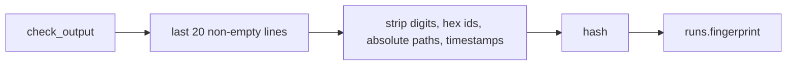

# Stuck Detection And Fingerprints

How the engine stops a check loop early when a redo changed nothing.

## The rule

Feature map §4: *"**Stops early when stuck** — If the tests fail with exactly the same error twice in a row, it doesn't spend a third try. It asks you right away."*

PRD §8: escalate *"when a shell step fails with the **same fingerprint** as its previous failed run, because the redo changed nothing."* `02` §3: *"Stuck detection: a shell check failing with the same output fingerprint as its previous failure escalates immediately, attempts left or not."*

## The fingerprint

> *"**Fingerprint.** For a failing shell step, take the last 20 non-empty lines of its output. Strip digits, hex ids, absolute paths and timestamps, then hash the result. Store it on `runs.fingerprint`. Fewer failing tests or a different error gives a different fingerprint, and the loop continues. Review failures get no fingerprint: model output varies too much to compare, so the review loop is bounded by `max_attempts` alone."* (PRD §8)

Fingerprinting lives in `packages/core` (*"The engine, loop guard, advancement rules, prompt builder, fingerprinting and the port interfaces live there"*, PRD §3). The drawio *Test lane* card lists *"vitest on engine rules, fingerprinting and the prompt builder"*.

## Worked example (illustrative)

| Check run | Output tail | Fingerprint | Engine |
|---|---|---|---|
| 1 | `FAIL rotates token` · `FAIL revokes old token` | A | rework `implement` (attempt 2) |
| 2 | `FAIL revokes old token` | B (one test fewer) | rework `implement` (attempt 3) |
| 3 | `FAIL revokes old token` | B | **escalate**, attempts left or not |

The output lines are invented for illustration. In this example the loop would also have escalated at run 3 on the cap (`max_attempts` 3 on `implement`); the fingerprint matters when `max_attempts` is higher, or when the same error repeats on attempt 2.

> [!question] Does stripping digits defeat "fewer failing tests"?
> The PRD strips digits and then claims fewer failing tests change the fingerprint. A summary line such as `3 failing` → `2 failing` does not change once digits go. Listed in [[Execution Open Questions]].

## Scope

- **Shell steps only.** *"Review failures get no fingerprint"* (PRD §8).
- **Previous failed run of the same step.** The comparison is with *"its previous failed run"*, not across steps. After a rework, `check` and every other step downstream of the target are re-created (*"downstream `done` → `skipped` so they re-instantiate"*, `02` §3). So the previous failed run sits on an *earlier instance* of the same step definition. No source says how the lookup crosses instances ([[Execution Open Questions]] #58).
- **Infra retries.** These never produce a check verdict, so they never fingerprint.

## Related

- [[Execution Index]]
- [[Loop Guard And Escalation]]
- [[Shell Step Execution]]
- [[Check Steps]]
