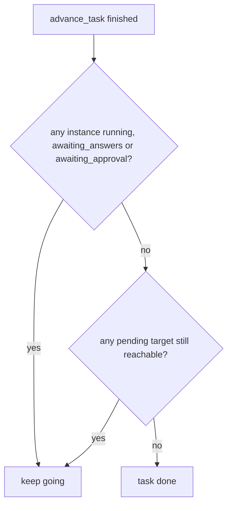

# Task Completion

When the engine decides a task is finished, failed, or still going.

## Done

The PRD does not state a done rule. `02` §3 and backlog 5.2 (**BUG**) fix the one the first build used:

> *"Task-done = "no active instances **and** no reachable pending targets" (not "no edge fired", which strands a task in `running` when a conditional edge never fires)."* (`02` §3)
>
> *"Task‑done condition: "nothing active and no edge fired" strands a task in `running` when a conditional edge never fires. Use "no active instances and no reachable pending targets"."* (backlog 5.2)

Monitor guide, final beat: *"The flow has no step after summarize, so the task is finished."*

*Proposal* for "reachable": a `pending` instance whose join could still be satisfied by some active or pending upstream instance. No source defines it.

## Failed

| Trigger | Source |
|---|---|
| Reject with no `on_fail` edge | *"reject with no `on_fail` edge fails the task"* (`02` §3) |
| Fail task at an escalation gate | *"**Fail task** ends it."* (PRD §8) |
| A missing row | *"Guard `getInstance()!` / `defs.find()!` so a missing row fails the task cleanly instead of throwing."* (`02` §3; backlog 5.2 adds *"three times"*) |

A spent loop does **not** fail the task under PRD §8; see [[Loop Guard And Escalation]] for the sources that still say it does.

## Stranded

The bug the done rule fixes: a conditional edge that never fires left the task in `running` forever. Backlog 5.3 asks for a test: *"conditional edge never fires"*.

> [!example] How a task strands (illustrative)
> A step fans out to branches A and B, which meet again at join C. A finishes with `pass`, but its only route onward is `on_fail`, so nothing fires from A. B is still running, so the task cannot be done at that moment. B then finishes and its edge to C fires. Now nothing is active, but an edge *did* fire, so the old rule (*"nothing active and no edge fired"*) says "not done". If C waits for A's route as well, C never starts, and the task sits in `running` for ever.
>
> Under the fixed rule, C is not a *reachable* pending target, so the task resolves. Whether it should end `done` or `failed` is not stated. The example depends on a join that waits per incoming route, which PRD §8's instance-based wording does not clearly require ([[Execution Open Questions]] #4, #10).

## After done

- **Summary.** In the seeded flow the last step is `summarize`, producing `summary`, which the task detail diffs against `plan` (PRD §13).
- **Memory.** After a successful run, the runner `write()`s salient output (PRD §7, §11.2). Nothing extra happens at task done.
- **Cleanup.** *"offer a "clean up worktree" action; never remove it automatically"* (PRD §11), for a task that reaches `done` or `cancelled`. Backlog 2.1 widens it: *"Cleanup worktree only via explicit action, only when done/cancelled/failed."* The task-detail guide says *"Only offered once the task is finished or cancelled."*

## Related

- [[Execution Index]]
- [[Advancement Rules]]
- [[Task Lifecycle]]
- [[Execution State Machines]]
