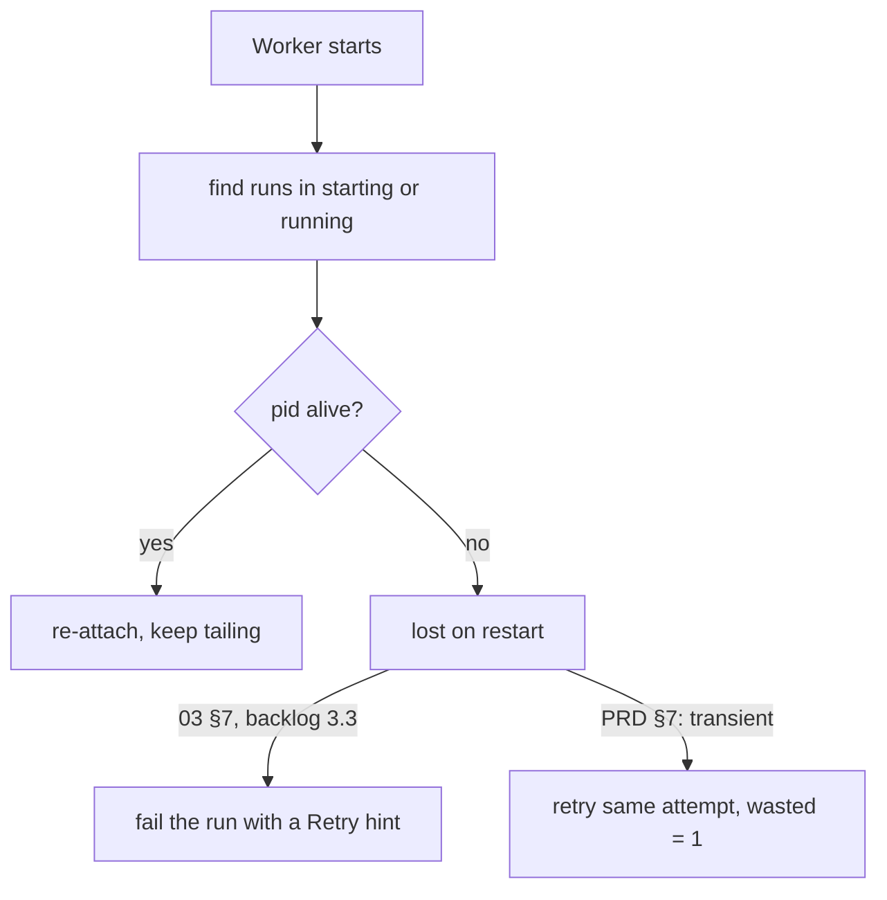

# Worker Lifecycle

The worker is the second Node process, `apps/worker`: *"job loop, runner, ask_user broker, escalation timer"* (PRD §3). The drawio *Harness architecture* page calls it *"Process 2 · apps/worker (Node) the harness proper; its rules come from packages/core"*.

## Starting

- One command starts both processes: *"`concurrently` to run `next dev` and the worker together under `npm run dev`"* (PRD §2). The PRD's package manager is pnpm, and its acceptance check says *"`pnpm dev` starts Next.js and the worker together"* (PRD §16); the drawio host card: *"pnpm dev → concurrently starts both processes"*. See [[Process Topology]].
- It opens the same SQLite file as the web process: *"WAL + `busy_timeout=5000` + `foreign_keys=ON`, opened via `VIBE_DB_PATH` so worker and MCP (foreign cwd) hit the same file."* (`02` §1; backlog 1.1, **FIX**, says the same). See [[Database And Connection]].
- *"Probe for Docker at startup; if absent, fall back to the host tier and disable `bypassPermissions`."* (PRD §11.1). `08` adds *"(or warn)"*; backlog 0.1 probes *"Docker (or Podman)"*.

> [!warning] Does the MCP process open the database?
> `02` §1 and backlog 1.1 have the MCP server open the same SQLite file. The PRD says it never does: *"Only `apps/web` and `apps/worker` open the SQLite file; the MCP shim never does"* (PRD §3), and the shim *"never opens the database and needs no network"* (PRD §9). The drawio *SQLite* card agrees with the PRD. Under the PRD's broker-and-shim design no MCP process opens the database. See [[Execution Open Questions]] #54.

## What it owns

| Responsibility | Source |
|---|---|
| Leasing jobs | PRD §7 |
| Running steps (the runner) | PRD §3 |
| The `ask_user` broker, *"the only writer of the `questions` table"* | PRD §9 |
| The escalation timer | PRD §3 |
| *"the only writer of run lifecycle state"* | `03` §7 |

`03` §7: *"the worker is a **generic executor host** — nothing about it knows the provider. This is the decoupling point that later allows remote executors or a fleet without touching the core."*

As built in run-flow (2026-10-23), one `pnpm run-flow` process stands in for the worker, for one flow. It runs the engine, launches each run, hosts an `ask_user` broker per agent run, and is the only writer of the run folder's `state.json`. The folder's lock, `<folder>/.flowboard/lock`, keeps a second host out. There is no job loop and no escalation timer. See [[Run Flow Reference]].

## Restart recovery

Feature map §8: *"**Survive a restart** — If the background worker restarts, it reconnects to work that was already running instead of losing it."* The drawio *Job loop* card: *"on restart re-attach by pid"*.

The first build lost runs here. Backlog intro: *"**Worker restart kills live runs.** Two real runs in the DB failed with "worker restarted while run was live". Runs in `starting` are never reclaimed at all."*

> *"**Restart recovery: re-attach by pid before failing.** A `starting`/`running` row whose pid is alive → keep tailing; dead → fail with a Retry hint. Pid-liveness is OS-generic."* (`03` §7)

Backlog 3.3 (**BUG**): *"Restart recovery: reclaim `starting` **and** `running`; prefer re‑attach by pid (still alive → keep tailing) over blanket fail; otherwise fail with a Retry hint. Two real runs died this way."*

The two branches for a dead pid come from sources that disagree.

> [!question] Fail with a hint, or retry?
> `03` §7 and backlog 3.3 say a dead pid → *"fail with a Retry hint"*. PRD §7 lists *"lost on restart"* as **transient**, retried automatically up to 3 times. Backlog 10.2 lists *"restart behaviour"* among the README's known constraints. See [[Execution Open Questions]] #30.

> [!check] Answered by run-flow, 2026-10-23
> For the terminal host, retry, as PRD §7 has it, but not automatically: a person runs `--resume`. It first stops whatever the dead host left running (Alex's call, 2026-10-23). It marks every run still recorded as live as cut off (wasted, or `not launched` if it never launched), then reruns each running step at the same attempt and asks each open gate again (the run-flow plan). There is no re-attach. See [[Run Flow Reference]].

> [!question] How to keep tailing
> The worker read the agent's stdout through a pipe. After a restart that pipe is gone. No source says how a re-attached worker reads the rest of the stream (for example, the CLI writing to a file under `data/runs/<id>/`). *Inferred gap*, listed in [[Execution Open Questions]] #31. *Proposal:* for sandboxed runs, `docker logs -f` on the run's container; no source says so, and re-attach by pid is not described for a container at all ([[Sandboxing Open Questions]] #19).

As built in run-flow (2026-10-23), nothing re-attaches: what a dead host left running is stopped instead (Alex's call, 2026-10-23). Each run's log has a `pid` line, `{"kind":"pid","at":…,"pid":…,"started":"Fri Oct 23 19:47:12 2026"}`: the agent CLI's pid, or a check's process group, marked `"group":true`, with the process's start time as `ps -o lstart=` prints it. A run-flow that finds a lock whose process is gone, a host killed with `kill -9` or quit by a second Ctrl+C, looks in that host's run folder, which the lock names. It stops the process of every run whose log has a `pid` line and no `result` line: SIGTERM, then SIGKILL after 2 s. A pid is signalled only while its start time still matches the log, since it may be another process's by now, and a check's group even when its shell has gone, so a server it started in the background stops too (Claude's call, 2026-10-23, open to Alex's review). It warns:

- `-- warning: a run-flow (pid <n>) ended without cleaning up; stopped 2 runs it left running`, ending at "cleaning up" when nothing was still running;
- `…; check that none of its agents or checks are still running` when it has no run folder to look in: the lock names none, as when its host died before making one, or the folder it names is not there;
- `-- warning: pid <n> (<log>) is running but may not be the process its run started; check it yourself` for a pid whose start time no longer matches.

`--resume` also looks in its own run folder, in case the dead host's lock was deleted by hand, and says `-- stopped 1 run the last run-flow left running`. An agent is signalled by its CLI's pid alone, since the adapters give it no process group of its own, so whatever that CLI started and left behind is not reached (a `ponytail:` comment in `cli/src/flow-run.ts`).

## Shutting down

*"Graceful shutdown: SIGTERM children, mark runs `cancelled`, not `failed`."* (`03` §7; backlog 3.3 **GAP**). Whether those runs are re-queued when the worker returns is not stated ([[Execution Open Questions]] #32). See [[Stopping And Cancelling]].

As built in run-flow (2026-10-23), Ctrl+C, SIGTERM or SIGHUP stops every live run and saves the state. Each stopped run is recorded `interrupted` and wasted, and its step stays `running`, so `--resume` reruns it at the same attempt. A run still queued is `not launched` instead. The host exits 130 with `-- continue with: pnpm run-flow --resume <run folder>`. A second Ctrl+C, more than 300 ms after the first, exits at once: it kills (SIGKILL) every run still going, each check's process group and each agent's CLI process, removes the live agent runs' `/tmp/fb-*` folders and leaves the lock, so the next host warns.

## Other fixes recorded against the worker

- *"Session‑id capture: parse once from the `system/init` event, not every line."* (backlog 3.3, **BUG (perf)**). As built, the Claude adapter does this, from the first typed `system/init` message ([[Claude Code Adapter]]).
- *"Per‑run `mcp.json` pointing at `mcp/ask-user.ts` via `tsx --tsconfig <root>/tsconfig.json` (path aliases break when spawned from the worktree cwd)."* (backlog 3.2, **FIX**). The PRD's layout has `apps/mcp-shim` instead, a stdio server that forwards to the worker's broker and never opens the database (PRD §3, §9). As built (2026-10-18), neither: no `mcp.json` is written, the shim is `code/flowboard/packages/ask-user/`, run as `node` with the absolute path of its `main.ts` (no `tsx`, no path aliases), and its broker runs inside `run-agent` or, one per agent run, `run-flow` ([[Ask User MCP Server]]).
- Backlog intro, item 6: *"agents killed port 3000 (moved to 3111)."* That is the web dev server's port: *"Dev server on port 3111; README warns agents kill :3000."* (backlog 0.3, **FIX**)

## Related

- [[Execution Index]]
- [[Job Queue]]
- [[Runner Pipeline]]
- [[Execution Runtime]]
- [[Stopping And Cancelling]]
- [[Process Topology]]
- [[Database And Connection]]
