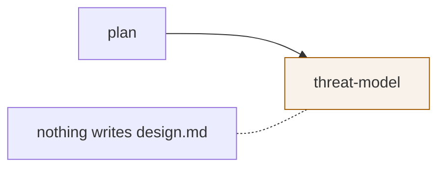

# Adopting And Adapting A Flow

Two ways to start from someone else's work: **adopt** a whole library flow, or **adapt** your own by borrowing one step.

## Preview

Clicking a variant *"draws *that author's* graph on the canvas, ghosted and read-only. You can see its shape, its gates and its costs without touching your own recipe."* (guide)

| While previewing | |
|---|---|
| Steps | Ghosted, dashed; *"can't be selected, dragged or edited until you adopt the flow"* |
| Edges | Dimmed |
| Validation strip | Not run; the mockup shows the green *holds together* line anyway |
| Inspector | *"You are previewing a library flow. Use it, or go back to yours, to edit steps."* |
| Chip | `<name>  <author> v<n>  preview` |
| Preview bar | `previewing  @author/slug vN  <description>  [Use this flow] [Back to yours]` |
| Save, + Step | Disabled |

**Back to yours** (or `esc`) *"Leaves preview and returns to your recipe, exactly as you left it."*

> [!note] Mockup preview is synthetic
> `buildPreview()` draws the preview from the library entry's domain, step count, gate count, cost and shape. Step names come from the role starter pack for that domain. A real preview would load the version's actual graph.

## Adopt: Use this flow

*"Adopts the previewed flow as the one you are editing. Marks it unsaved immediately."* Effect: *"Replaces what is on the canvas."* In the mockup, the adopted copy keeps the original author and version number, `adopted just now`, `0` tasks running, and the first step selected. Saving then makes `v(n+1)`. Whether that version belongs to you or the original author is open — [[Flow Design Open Questions]] #4.

## Adapt: borrow a step — the walkthrough

The guide's walkthrough: *Borrowing a step from `@team-sec/code-review` into `Software delivery v4`*.

| # | Beat | What happens | Rule shown |
|---|---|---|---|
| 1 | Where you start | *Software delivery v4* is adopted, holds together, nothing unsaved. *Three tasks are running on v4.* | **adopted** · chip quiet, strip green |
| 2 | You need a security sweep | Something touches payments. Filter to SDLC: 17 flows narrow to 5. (The guide's picture for this beat highlights the `QA 1` chip, not `SDLC 5`.) | Domains file a flow by **the job it does** |
| 3 | Three recipes, one name | *Code review* by three authors collapses into one entry, `3 authors`. | **Names are not identifiers** |
| 4 | Expand and compare | @alex's fork drops the security sweep; @team-sec's adds it. | Compare **runs**, **gates**, **cost**, **difference line** |
| 5 | Preview before you commit | @team-sec's graph is drawn ghosted. | **preview** · inspector disabled, Save inert |
| 6 | Take the step, not the pipeline | Back on your flow, add only `threat-model`, wired after `plan`. Chip turns amber. | **edited** · any change marks the recipe unsaved |
| 7 | It does not hold together | The borrowed step needs `design.md`; in @team-sec's pipeline an earlier step writes it, in yours nothing does. Save is disabled. | **won't save** · every need must be written upstream |
| 8 | Fix it, two ways | Drop the requirement (*"this step can work from the plan instead"*), or add a design step upstream that writes it. | Clicking a problem selects the step |
| 9 | Save as v5 | Green strip; Save creates v5 and points the project at it. The three running tasks stay on v4. | **saved** · editing always makes a new version |

> [!tip] The lesson
> A step's contract travels with it. Borrowing a step borrows its **needs**, and those were satisfied by the other author's pipeline, not yours. The validator is what catches it.

## How borrowing works

No source defines a *copy step from another flow* action. The walkthrough adds the step by hand. Backlog Story 8.2's *"Reuse… picker (steps or whole flow from other projects, key uniquified)"* is the nearest designed action. The mockup's **+ Step** cannot pick a library step.

## Related

- [[Flow Library]]
- [[Artifact Contract]]
- [[Editing And Saving A Flow]]
- [[Flow Validation]]
