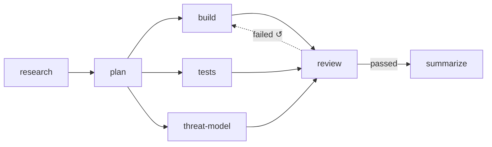

# Branching Joining And Loops

The flow-designer guide: *"Two things the graph says that a list of steps can't"* — fan-out and join. Add the rework loop and the branch, and you have every shape a flow can take.

## The four topologies

| Shape | Feature map §2 | Flow-designer guide | Engine rule (PRD §8) |
|---|---|---|---|
| **Fan-out** | *"Branching — One step can kick off several next steps at once (for example, write code and write tests in parallel)."* | *"one step feeding several — means those steps run *at the same time*, each taking its own worker. It buys wall-clock time at the cost of parallel spend."* | *"If more than one edge fires, create all the target step instances and start them concurrently. This is the fan-out."* |
| **Join** | *"Joining — A step can wait for several earlier steps to all finish before it starts (review waits for both code and tests)."* | *"several steps feeding one — means that step waits for *all* of them. `review` sits behind `build` and `tests`, so it cannot start on a half-finished task however fast one branch is."* | *"A step definition with multiple incoming edges is a join: it starts only once every upstream step instance for this task is `done`."* |
| **Loop** | *"Loops — A failed review can send the task back to an earlier step to try again."* | *"Something can send work back to an earlier step — a failed review, a defect. Cheap to add, expensive when it fires often."* | *"an `on_fail` edge pointing at an earlier step increments that step instance's `attempts` and creates a new run."* |
| **Branch** | — | *"The flow takes one route or another and does not rejoin — a pass path and a failure path that end differently."* | None. PRD §8 has no branch rule; the shape exists only in the mockup and guide (conditional edges with no shared target) |

The monitor guide's four hand-off rules say the same at run time: *Advance*, *Fan out*, *Join*, *Loop back*.

*Software delivery @core v4* as it opens in the flow-designer mockup: a fan-out from `plan`, a join at `review`, and a rework loop from `review` to `build`. `pnpm run-flow --mermaid` labels and draws routes differently; see [[Connections And Routes]].

## Designing a fan-out

- **Shared worktree.** *"Parallel steps within one task share the task's worktree. If two concurrent steps both write code they will conflict — so the seeded default flow puts the test-writing agent on the same worktree but scoped to `tests/` via its prompt and `allowedTools`."* (PRD §11). The PRD calls this a known limitation.
- **Concurrency cap.** Parallel steps compete for workers under the global cap (`VIBE_MAX_RUNS`, drawio *Job loop*).
- **The board.** *"When a task has multiple step instances running in parallel, the card sits in the column of the split point and shows a split badge listing the active branches."* (PRD §4)

## Designing a join

- Joins ignore `on_fail` back-edges: *"join waits for every non‑`on_fail` upstream instance"* (backlog Story 5.2). Without that, the target of a rework loop would be a join waiting on its own downstream step. As built in run-flow (2026-10-23), joins ignore rework routes, not every `on_fail` route: a forward `on_fail` route does make a join (the run-flow plan, Execution #4). A join waits for each step with a forward route into it while that step, or a step that can still reach it, is pending, running or at a gate.
- A join behind a conditional route can wait forever if that route never fires. See [[Flow Design Open Questions]] #19.

> [!check] Answered by run-flow, 2026-10-23
> The join runs once nothing can still feed it (the run-flow plan), so it never waits forever, but it may run without the branch that was cut off. `--check` warns when the conditional route is the join's own (`steps.d: waits for "a", whose route here is conditional; if it does not fire, d runs without it`), and when it lies further up a branch, leaving a step that can reach the join another way (`steps.d: waits for "c", which runs only if the conditional route a → b fires; if it does not, d runs without it`); a condition above the fork, which cuts off every branch at once, gives no warning. See [[Run Flow Reference]].

- A rework that resets a join keeps the routes that steps outside the reset already fired: the join waits again, then runs with its sibling's input (Claude's call, 2026-10-23, open to Alex's review; see [[Run Flow Reference#Rules this command settles]]).

## Designing a rework loop

The rules a designer sets up when adding an `on_fail` back-edge (PRD §8; drawio *Loop guard*):

| Rule | Wording |
|---|---|
| The counter lives on the target | *"The counter lives on the **target** instance, so every loop that sends work back to the same step shares one budget. In the seeded flow, a failed `check` and a failed `review` both spend `implement`'s attempts."* |
| Total runs | *"`max_attempts` counts total runs of the step, first try included (infra retries excluded). The default of 3 means one try and two automatic redos."* |
| Escalate, don't fail | When a rework would pass `max_attempts`, or a shell step fails with the same fingerprint twice: *"start nothing. Set the target step instance to `awaiting_approval` and the task to `blocked`"*. You pick **Retry** (one more attempt, with a note; counter not reset) or **Fail task**. |
| Rework sees the raw failure | The new run also reads *"the artifacts the failing step produced"* |
| Downstream re-runs | *"downstream runs `wasted=1`, downstream `done` → `skipped` so they re‑instantiate"* (backlog Story 5.2). PRD §8 says *"Mark the superseded runs `wasted = 1`"*. |

The feature map (§4): *"Three tries by default — The first attempt plus two redos. Every loop that sends work back to the same step draws from the same three, whether the tests failed or the review did."*

As built in run-flow (2026-10-23), the counter, the escalation and the raw failure work as designed, with these rules besides (see [[Run Flow Reference]]):

- **What counts as a rework route.** An `on_fail` route to its own step, or to a step that reaches it along `always` and `on_pass` routes, is a rework route; every other route is forward, and forward routes may not loop (the run-flow plan, Execution #9). Ancestry follows `always` and `on_pass` routes only, so in `build → check`, `check → report` (`on_fail`), `report → build` (`on_fail`) neither `on_fail` route is rework, and the flow is refused with `routes loop without an on_fail route back: build, check, report`.
- **One rework per failure.** A rework route must be its step's only `on_fail` route: `steps.check: on a failure it would rework "impl" and also take the on_fail route to "notify"; a rework route must be its step's only on_fail route`. When a failure fires `always` routes and a rework route, the rework goes last and its reset removes their targets below its target, so the order edges are written in changes nothing (Claude's call, 2026-10-23, open to Alex's review; see [[Run Flow Reference#Rules this command settles]]).
- **A loop back to the first step names it.** Every step then has a route into it, so the flow names its first step with a top-level `entry:` (`entry: build`); without it: `steps: no entry step: every step has a route into it; name the first one with entry:` (also Claude's call).
- **`max_attempts` goes on the rework target.** On a step no rework route leads back to, it is an error: `steps.review.max_attempts: no rework route leads back to review, so nothing reads it`. It counts every run of the target, gate Retries included, and a person's Retry is never refused at the limit.
- **The failing step should write something.** A step with a rework route out and no `produces` gets a warning: `steps.check: reworks "impl" on a failure but produces nothing, so impl runs again without seeing why`.
- **Downstream is reset, not skipped.** Downstream instances are deleted rather than marked `skipped`: their launched runs count as wasted, a running one is stopped, and they start again at attempt 1 when the work reaches them (the run-flow plan, Execution #17, #18).
- **An escalation stops what lies below its target.** A spent or stuck loop opens an escalation gate on the target and stops and discards the work below it, since Retry and Fail the flow would both discard it. Retry reruns the target with its `requires` plus the failing step's outputs (Claude's call).

The monitor mockup's pipeline view draws the loop as a dashed edge labelled *"↺ sent back ×N today · $X burned"*, with the note *"a thick one means the recipe, not the code, is the problem."*

## Task completion

A branch shape ends on more than one leaf. The backlog BUG in Story 5.2: *"Task‑done condition: "nothing active and no edge fired" strands a task in `running` when a conditional edge never fires. Use "no active instances and no reachable pending targets"."*

As built in run-flow (2026-10-23), the flow ends `done` when no step is pending, running or waiting at a gate, so a conditional route that never fires strands nothing. Only a person's *Fail the flow* ends it `failed` (Alex's call in the run-flow plan).

## Related

- [[Connections And Routes]]
- [[Check Steps]]
- [[Step Guardrails]]
- [[Flow Library]] — the shape glyph
