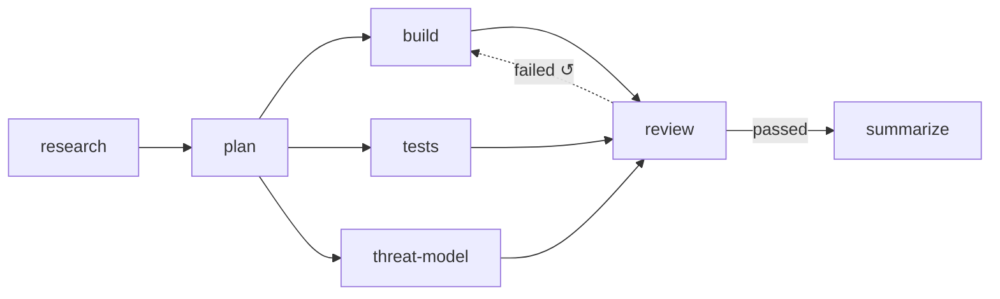

# Branching Joining And Loops

The flow-designer guide: *"Two things the graph says that a list of steps can't"* — fan-out and join. Add the rework loop and the branch, and you have every shape a flow can take.

## The four topologies

| Shape | Feature map §2 | Flow-designer guide | Engine rule (PRD §8) |
|---|---|---|---|
| **Fan-out** | *"Branching — One step can kick off several next steps at once (for example, write code and write tests in parallel)."* | *"one step feeding several — means those steps run *at the same time*, each taking its own worker. It buys wall-clock time at the cost of parallel spend."* | *"If more than one edge fires, create all the target step instances and start them concurrently. This is the fan-out."* |
| **Join** | *"Joining — A step can wait for several earlier steps to all finish before it starts (review waits for both code and tests)."* | *"several steps feeding one — means that step waits for *all* of them. `review` sits behind `build` and `tests`, so it cannot start on a half-finished task however fast one branch is."* | *"A step definition with multiple incoming edges is a join: it starts only once every upstream step instance for this task is `done`."* |
| **Loop** | *"Loops — A failed review can send the task back to an earlier step to try again."* | *"Something can send work back to an earlier step — a failed review, a defect. Cheap to add, expensive when it fires often."* | *"an `on_fail` edge pointing at an earlier step increments that step instance's `attempts` and creates a new run."* |
| **Branch** | — | *"The flow takes one route or another and does not rejoin — a pass path and a failure path that end differently."* | None. PRD §8 has no branch rule; the shape exists only in the mockup and guide (conditional edges with no shared target) |

The monitor guide's four hand-off rules say the same at run time: *Advance*, *Fan out*, *Join*, *Loop back*.

*Software delivery @core v4* as it opens in the flow-designer mockup: a fan-out from `plan`, a join at `review`, and a rework loop from `review` to `build`.

## Designing a fan-out

- **Shared worktree.** *"Parallel steps within one task share the task's worktree. If two concurrent steps both write code they will conflict — so the seeded default flow puts the test-writing agent on the same worktree but scoped to `tests/` via its prompt and `allowedTools`."* (PRD §11). The PRD calls this a known limitation.
- **Concurrency cap.** Parallel steps compete for workers under the global cap (`VIBE_MAX_RUNS`, drawio *Job loop*).
- **The board.** *"When a task has multiple step instances running in parallel, the card sits in the column of the split point and shows a split badge listing the active branches."* (PRD §4)

## Designing a join

- Joins ignore `on_fail` back-edges: *"join waits for every non‑`on_fail` upstream instance"* (backlog Story 5.2). Without that, the target of a rework loop would be a join waiting on its own downstream step.
- A join behind a conditional route can wait forever if that route never fires. See [[Flow Design Open Questions]] #19.

## Designing a rework loop

The rules a designer sets up when adding an `on_fail` back-edge (PRD §8; drawio *Loop guard*):

| Rule | Wording |
|---|---|
| The counter lives on the target | *"The counter lives on the **target** instance, so every loop that sends work back to the same step shares one budget. In the seeded flow, a failed `check` and a failed `review` both spend `implement`'s attempts."* |
| Total runs | *"`max_attempts` counts total runs of the step, first try included (infra retries excluded). The default of 3 means one try and two automatic redos."* |
| Escalate, don't fail | When a rework would pass `max_attempts`, or a shell step fails with the same fingerprint twice: *"start nothing. Set the target step instance to `awaiting_approval` and the task to `blocked`"*. You pick **Retry** (one more attempt, with a note; counter not reset) or **Fail task**. |
| Rework sees the raw failure | The new run also reads *"the artifacts the failing step produced"* |
| Downstream re-runs | *"downstream runs `wasted=1`, downstream `done` → `skipped` so they re‑instantiate"* (backlog Story 5.2). PRD §8 says *"Mark the superseded runs `wasted = 1`"*. |

The feature map (§4): *"Three tries by default — The first attempt plus two redos. Every loop that sends work back to the same step draws from the same three, whether the tests failed or the review did."*

The monitor mockup's pipeline view draws the loop as a dashed edge labelled *"↺ sent back ×N today · $X burned"*, with the note *"a thick one means the recipe, not the code, is the problem."*

## Task completion

A branch shape ends on more than one leaf. The backlog BUG in Story 5.2: *"Task‑done condition: 'nothing active and no edge fired' strands a task in `running` when a conditional edge never fires. Use 'no active instances and no reachable pending targets'."*

## Related

- [[Connections And Routes]]
- [[Check Steps]]
- [[Step Guardrails]]
- [[Flow Library]] — the shape glyph
