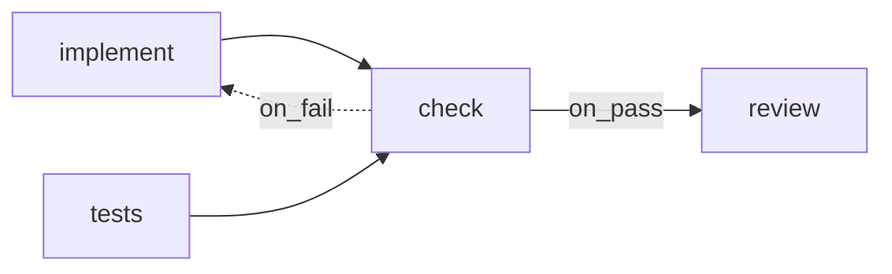

# Check Steps

> **Check steps** — A step can also run a plain command, like your linter and test suite, with no AI involved. If the command succeeds, the step passed. If it fails, the step failed, and the error output goes to the next attempt word for word. This is how FlowBoard knows the code works instead of taking an agent's word for it. — feature map §2

In the schema a check step is `kind='shell'`. The feature map and the drawio call it a *check*; the PRD and architecture call it a *shell step*, though the PRD also says *"shell check step"* in places (§5 `projects.check_command`, §14 M5). No mockup has one.

## The rules

From PRD §7 *Shell steps*:

- *"A `kind='shell'` step runs no model."*
- It runs *"`step.command` (or the project's `check_command`) in the task's worktree through the same execution host, so it inherits the sandbox."*
- *"It writes stdout and stderr (tail, ~20 kB) to a `check_output` artifact."*
- *"The **exit code is the outcome**: 0 sets `pass`, anything else sets `fail`."*
- *"A non-zero exit here is a result, not a run failure, so it follows the step's edges instead of blocking the task."*
- *"Shell runs cost nothing and record `cost_usd = 0`."*

`03-execution-substrate.md` §6: *"The model proposes; the harness runs the check; the exit code decides. No `AgentProvider` is involved, and the run costs nothing."*

As built in run-flow (2026-10-23), a step with `shell: <command>` is a check, and it costs nothing:

- `sh -c <command>` runs in the run's one folder (`--folder`), not a task worktree. It is spawned directly in its own process group, not through `ExecHost`, so a stop reaches everything it started; a `ponytail:` comment marks the way back once the sandbox tier can kill a process group (the run-flow plan). When its shell exits, whatever it left running in the background is stopped too.
- Exit 0 is `pass` and any other exit `fail`, except 126, 127 and a death by a signal (`exit code 127: command not found`, `killed by SIGKILL`): those are setup failures, which wait at a *run failed* gate instead of following a route (Claude's call, 2026-10-23, open to Alex's review; see [[Run Flow Reference#Rules this command settles]]).
- The last 20,000 characters of stdout and stderr, in order of arrival, go to the step's one declared output (`produces[0]`, whatever its name), and always to the `result` line of its run log. The last non-empty line is printed: `-- check: last output: <line>`.

## Designing with checks

| Design choice | Effect | Source |
|---|---|---|
| `command` left null | Runs the project's `check_command`, e.g. `'pnpm lint && pnpm test'`. If that is null too, nothing is stated ([[Projects Open Questions]] #6; [[Project Check Command]]) | PRD §5 `projects`, `step_defs` |
| Produces `check_output` | The raw log becomes an artifact the next step can require | PRD §6, §15 |
| `on_pass` → review | *"the model never gets reviewed on code that doesn't pass"* | PRD §15 |
| `on_fail` → implement | The *mechanical loop*; the rework reads the raw `check_output` | PRD §8, §15 |
| Two identical failures | Escalate early: same **fingerprint** twice → gate, attempts left or not | PRD §8 |

As built in run-flow (2026-10-23), there is no project `check_command`: the command is the step's `shell:`. A check with a rework route and no `produces` hands its target nothing to read, so `--check` warns: `steps.check: reworks "impl" on a failure but produces nothing, so impl runs again without seeing why`. Two failures count as the same when their last 20 non-empty lines match once absolute paths are cut to their file name and UUIDs, hex ids, durations with their unit (`980ms`, `2 min`), day and month names, and digits are removed; a failing check that prints nothing is never stuck.

The feature map's ready-made recipe: *"The development pipeline runs your tests before code review, so the reviewer never looks at code that doesn't pass."* (§2)

The seeded check step (PRD §15): key `check`, name *Lint & test*, `shell (project check_command)`, no model or effort, `auto`, requires nothing, produces `check_output`.

## The sensor idea

The drawio *Harness architecture* page calls the shell executor *"the sensor"* (concept 4, *Sensors before autonomy*): *"Check steps run real commands. The exit code is the verdict, and the raw output feeds the next attempt. Later: semgrep, gitleaks and linters as more $0 sensors."* Its *Check container* card: *"same image and mounts, no model, no API key: runs check_command and exits with its code"*. It also shows a dashed *Deterministic gates (later)* card: *"semgrep · gitleaks · trivy · eslint / ruff as extra shell steps: $0 catches before any model reviews"*.

As built in run-flow (2026-10-23), until the check container exists, a check runs on the host with the host's environment minus every variable whose name ends in `_KEY`, `_TOKEN`, `_SECRET` or `_PASSWORD`, in any case. The removed names are printed at start (`-- shell steps run without: …`). Credentials under other names stay reachable: `SSH_AUTH_SOCK`, a `DATABASE_URL` with a password, files such as `~/.npmrc` (the run-flow plan: *"the sandbox is the real fix"*). A check also gets `FLOWBOARD_ARTIFACTS`, the folder of earlier steps' outputs, `FLOWBOARD_NOTE` when a person typed a note for the run, and an empty stdin.

Scheduled shell-step flows are also the proposed way to refresh knowledge assets (drawio *Knowledge assets (later)*, *Schedule trigger (later)*).

## Gaps

- The flow-designer mockup has no check step and no `command` field. Its sample *Software delivery* flow has no check. See [[Flow Design Open Questions]] #29.
- A check step's real input is the worktree, which `requires` cannot express. See [[Flow Design Open Questions]] #33.

> [!check] Answered by run-flow, 2026-10-23
> Validation ignores dependencies the contract cannot see: only `requires` is checked (Claude's call, 2026-10-23, open to Alex's review). A check reads the folder as earlier steps left it, and their outputs through `$FLOWBOARD_ARTIFACTS`; a `requires` input that was never written is said aloud (`-- check: missing input notes; it runs without it`). See [[Run Flow Reference#Rules this command settles]].

- Fingerprinting is defined only for shell steps. *"Review failures get no fingerprint"* (PRD §8).

## Related

- [[Step Kinds]]
- [[Branching Joining And Loops]]
- [[Artifact Contract]]
- [[Seeded Flows]]
