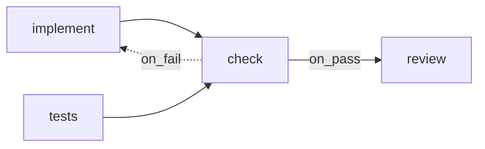

# Check Steps

> **Check steps** — A step can also run a plain command, like your linter and test suite, with no AI involved. If the command succeeds, the step passed. If it fails, the step failed, and the error output goes to the next attempt word for word. This is how FlowBoard knows the code works instead of taking an agent's word for it. — feature map §2

In the schema a check step is `kind='shell'`. The feature map, the drawio and the mockups call it a *check*; the PRD and architecture call it a *shell step*.

## The rules

From PRD §7 *Shell steps*:

- *"A `kind='shell'` step runs no model."*
- It runs *"`step.command` (or the project's `check_command`) in the task's worktree through the same execution host, so it inherits the sandbox."*
- *"It writes stdout and stderr (tail, ~20 kB) to a `check_output` artifact."*
- *"The **exit code is the outcome**: 0 sets `pass`, anything else sets `fail`."*
- *"A non-zero exit here is a result, not a run failure, so it follows the step's edges instead of blocking the task."*
- *"Shell runs cost nothing and record `cost_usd = 0`."*

`03-execution-substrate.md` §6: *"The model proposes; the harness runs the check; the exit code decides. No `AgentProvider` is involved, and the run costs nothing."*

## Designing with checks

| Design choice | Effect | Source |
|---|---|---|
| `command` left null | Runs the project's `check_command`, e.g. `'pnpm lint && pnpm test'` | PRD §5 `projects`, `step_defs` |
| Produces `check_output` | The raw log becomes an artifact the next step can require | PRD §6, §15 |
| `on_pass` → review | *"the model never gets reviewed on code that doesn't pass"* | PRD §15 |
| `on_fail` → implement | The *mechanical loop*; the rework reads the raw `check_output` | PRD §8, §15 |
| Two identical failures | Escalate early: same **fingerprint** twice → gate, attempts left or not | PRD §8 |

The feature map's ready-made recipe: *"The development pipeline runs your tests before code review, so the reviewer never looks at code that doesn't pass."* (§2)

The seeded check step (PRD §15): key `check`, name *Lint & test*, `shell (project check_command)`, no model or effort, `auto`, requires nothing, produces `check_output`.

## The sensor idea

The drawio *Harness architecture* page calls the shell executor *"the sensor"* (concept 4, *Sensors before autonomy*): *"Check steps run real commands. The exit code is the verdict, and the raw output feeds the next attempt. Later: semgrep, gitleaks and linters as more $0 sensors."* It also shows a dashed *Deterministic gates (later)* card: *"semgrep · gitleaks · trivy · eslint / ruff as extra shell steps: $0 catches before any model reviews"*.

Scheduled shell-step flows are also the proposed way to refresh knowledge assets (drawio *Knowledge assets (later)*, *Schedule trigger (later)*).

## Gaps

- The flow-designer mockup has no check step and no `command` field. Its sample *Software delivery* flow has no check. See [[Flow Design Open Questions]] #29.
- A check step's real input is the worktree, which `requires` cannot express. See [[Flow Design Open Questions]] #33.
- Fingerprinting is defined only for shell steps. *"Review failures get no fingerprint"* (PRD §8).

## Related

- [[Step Kinds]]
- [[Branching Joining And Loops]]
- [[Artifact Contract]]
- [[Seeded Flows]]
