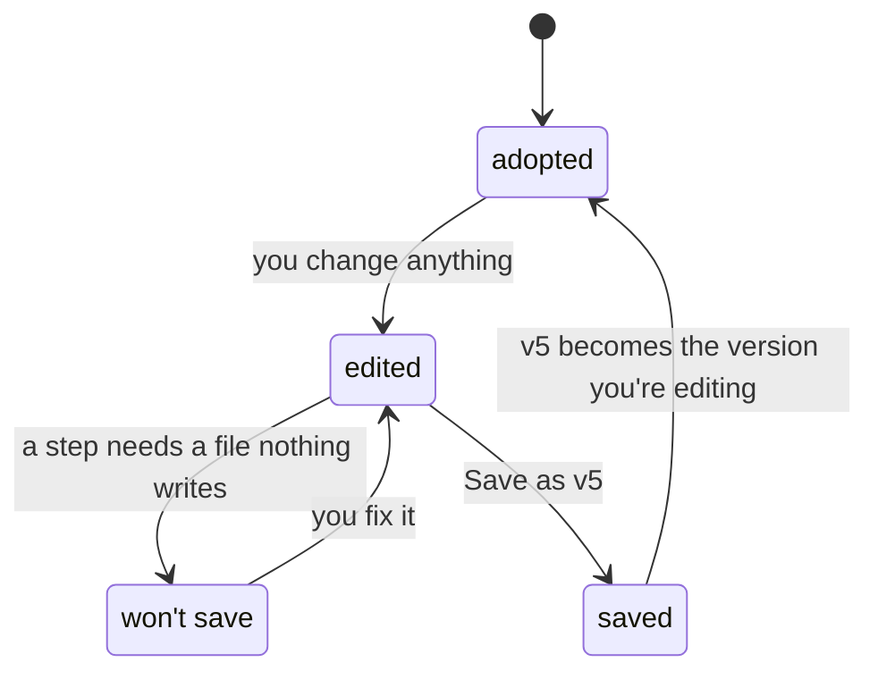

# Editing And Saving A Flow

The flow-designer guide: *"You never edit a recipe in place. Editing produces a *new version*, and tasks already running keep the one they started on — which is why the status bar tells you how many are still on v4 while you're building v5."*

## Lifecycle



States and edge labels from the guide's *Versions* diagram.

| State | Chip | Strip | Save |
|---|---|---|---|
| **adopted** — *v4, unchanged* | `adopted 12 Sep`, quiet | Green | Inert: *"there is nothing to save"* |
| **edited** — *saving makes v5* | `edited — saving makes v5`, amber | Green | Enabled |
| **won't save** — *doesn't hold together* | Amber | Amber, *won't save — n problems* | Disabled |
| **saved** — *v5, new version* | `adopted just now` | Green | Inert |

## What counts as an edit

*"**edited** · any change — even dragging a step — marks the recipe unsaved."* (guide walkthrough). In the mockup these set the unsaved flag:

- dragging a step;
- changing any inspector field;
- dropping a need (`×`);
- **+ Step**, **Delete this step**;
- **Use this flow** (adopting a library flow marks it unsaved immediately).

Not an edit: **draft mode** (*"never makes a new version and never shows as unsaved"*), previewing, filtering or searching the library, selecting a step. Whether a drag alone should make a version is open — [[Flow Design Open Questions]] #6.

## When Save is disabled

**Save as v*n*** *"Writes a new version and points the project at it. Disabled while the recipe has problems, while previewing, and when nothing has changed."* (guide, *Every control*). The mockup's code is exactly that:

```js
$('#save').disabled = !dirty || !!preview || problems.length > 0;
```

The label always reads `Save as v(current + 1)`.

## What saving does

- Creates a new version; never overwrites (*"Saving does not overwrite v4 — it creates v5 and points your project at it."*).
- Points the project at it (adopted).
- Leaves running tasks on their version (see [[Version Pinning]]).
- In the API: `PUT /api/flows/:id -- creates a new version` (PRD §12). Backlog Story 8.2 BUG: *"Save as new version; redirect from a slug prop, not `location.pathname`."*

## Leaving without saving

No source designs a discard or *unsaved changes* prompt. In the mockup, **Use this flow** replaces the canvas without asking (its effect column says *"Replaces what is on the canvas"*).

## Related

- [[Flows And Flow Versions]]
- [[Flow Validation]]
- [[Flow Design Controls]]
- [[Adopting And Adapting A Flow]]
