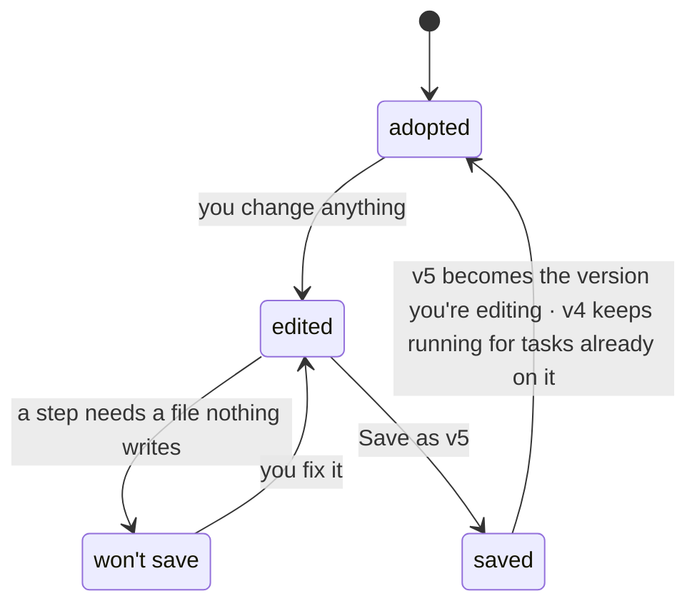

# Editing And Saving A Flow

The flow-designer guide: *"You never edit a recipe in place. Editing produces a *new version*, and tasks already running keep the one they started on — which is why the status bar tells you how many are still on v4 while you're building v5."*

## Lifecycle



States and edge labels from the guide's *Versions* diagram.

| State | Chip | Strip | Save |
|---|---|---|---|
| **adopted** — *v4, unchanged* | `adopted 12 Sep`, quiet | Green | Inert: *"there is nothing to save"* |
| **edited** — *saving makes v5* | `edited — saving makes v5`, amber | Green | Enabled |
| **won't save** — *doesn't hold together* | Amber | Amber, *won't save — n problems* | Disabled |
| **saved** — *v5, new version* | `adopted just now` | Green | Inert (inferred) |

The **saved** row comes from the guide's beat 9, which shows *"Green strip, Save enabled."* before you save. The mockup's Save button has no click handler, so the state after saving is not built.

As built in the flow designer (2026-10-24), the chip names the file (`flows/delivery.yaml`) and reads `saved`, or `edited — not saved` in amber. "Edited" means the draft differs from the file as last read or saved, so undoing a change by hand clears it.

## What counts as an edit

*"**edited** · any change — even dragging a step — marks the recipe unsaved."* (guide walkthrough). In the mockup these set the unsaved flag:

- dragging a step;
- changing any inspector field;
- dropping a need (`×`);
- **+ Step**, **Delete this step**;
- **Use this flow** (adopting a library flow marks it unsaved immediately).

Not an edit: **draft mode** (*"never makes a new version and never shows as unsaved"*), previewing, filtering or searching the library, selecting a step. Whether a drag alone should make a version is open — [[Flow Design Open Questions]] #6.

As built in the flow designer (2026-10-24), a drag is not an edit: positions are not saved ([[Canvas Layout And Board Order]]). Drawing, relabelling or deleting a route is.

## When Save is disabled

**Save as v*n*** *"Writes a new version and points the project at it. Disabled while the recipe has problems, while previewing, and when nothing has changed."* (guide, *Every control*). The mockup's code is exactly that:

```js
$('#save').disabled = !dirty || !!preview || problems.length > 0;
```

The label always reads `Save as v(current + 1)`.

As built in the flow designer (2026-10-24), **Save** is disabled when nothing has changed, while the check of the latest edit is still running, while that check finds a problem, and while the file has changed on disk since it was opened. The check is `run-flow --check`'s own: the designer posts the draft to `/api/flows/<name>/check`, which runs the same loader on it, so the strip shows run-flow's lines (`steps.plan: requires "brief", and no step before it produces that`). The button reads **Save**, as there are no versions. `⌘S` saves too. By hand, `pnpm run-flow --check <flow.yaml>` still checks a recipe on its own, printing `-- flow ok: N steps, starting at <entry>`, or the problems with exit 2. See [[Flow Validation]].

## What saving does

- Creates a new version; never overwrites (*"Saving does not overwrite v4 — it creates v5 and points your project at it."*).
- Points the project at it (adopted).
- Leaves running tasks on their version (see [[Version Pinning]]).
- In the API: `PUT /api/flows/:id -- creates a new version` (PRD §12). Backlog Story 8.2 BUG: *"Save as new version; redirect from a slug prop, not `location.pathname`."*

As built in the flow designer (2026-10-24), a save writes the recipe file in place: there are no versions, and no project to point at one. What versions protect is kept another way. A run pins its own copy of the flow (`flow.json` in its run folder), so a save never changes a run already started, as the status bar says. The save writes the edit into the file's own YAML. Lines whose meaning did not change are written back as they were, comments and spacing included, so a save changes only the lines it must; a no-op save leaves the file byte for byte. The server checks the result again before writing. It refuses a recipe that fails the check (HTTP 422, with the problems) and a file that changed on disk since it was opened (409); the designer then offers to load the file from disk (Claude's call, 2026-10-24, open to Alex's review).

## Leaving without saving

No source designs a discard or *unsaved changes* prompt. In the mockup, **Use this flow** replaces the canvas without asking (its effect column says *"Replaces what is on the canvas"*).

As built in the flow designer (2026-10-24), opening another flow or starting a new one with unsaved edits asks first (*Discard your changes to delivery.yaml?*), and so does leaving the page. A file edited by hand while open is read again when the window regains focus, if there are no unsaved edits to lose.

## Related

- [[Flows And Flow Versions]]
- [[Flow Validation]]
- [[Flow Design Controls]]
- [[Adopting And Adapting A Flow]]
