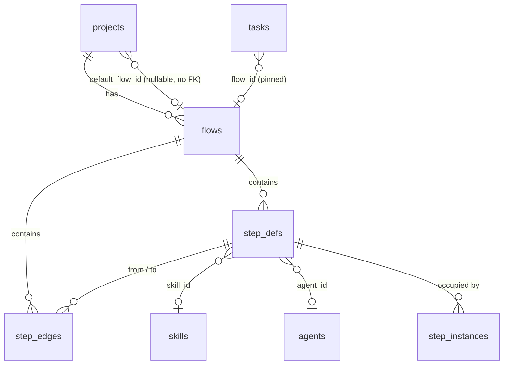

# Flow Data Model

Three layers exist in the sources: the **v1 PRD schema**, the **architecture's changes**, and the **record shape the mockup implies**. They are not yet reconciled.

## v1 PRD schema (SQLite)

```sql
CREATE TABLE flows (
  id          TEXT PRIMARY KEY,
  project_id  TEXT NOT NULL REFERENCES projects(id) ON DELETE CASCADE,
  name        TEXT NOT NULL,
  version     INTEGER NOT NULL,
  is_archived INTEGER NOT NULL DEFAULT 0,
  created_at  INTEGER NOT NULL,
  UNIQUE (project_id, name, version)
);

CREATE TABLE step_defs (
  id             TEXT PRIMARY KEY,
  flow_id        TEXT NOT NULL REFERENCES flows(id) ON DELETE CASCADE,
  key            TEXT NOT NULL,          -- stable slug, e.g. "code_review"
  name           TEXT NOT NULL,          -- column header, e.g. "Code review"
  kind           TEXT NOT NULL,          -- 'ai' | 'shell' | 'manual'; an 'ai' step sets skill_id, agent_id or both
  command        TEXT,                   -- kind='shell' only; null = the project's check_command
  skill_id       TEXT REFERENCES skills(id),
  agent_id       TEXT REFERENCES agents(id),
  extra_plugin_ids TEXT NOT NULL DEFAULT '[]', -- JSON array of plugins.id mounted alongside the skill's plugin
  prompt_template TEXT,                  -- appended to the invocation, supports {{placeholders}}
  model          TEXT NOT NULL DEFAULT 'sonnet',   -- passed to --model
  effort         TEXT NOT NULL DEFAULT 'medium',   -- low|medium|high|xhigh|max
  permission_mode TEXT NOT NULL DEFAULT 'bypassPermissions',
  allowed_tools  TEXT,                   -- JSON array, null = unrestricted
  max_turns      INTEGER,
  max_budget_usd REAL,
  max_attempts   INTEGER NOT NULL DEFAULT 3,
  advance_mode   TEXT NOT NULL DEFAULT 'auto',  -- 'auto' | 'approval'
  requires       TEXT NOT NULL DEFAULT '[]',    -- JSON array of artifact type keys
  produces       TEXT NOT NULL DEFAULT '[]',    -- JSON array of artifact type keys
  board_order    INTEGER NOT NULL,
  is_entry       INTEGER NOT NULL DEFAULT 0,
  UNIQUE (flow_id, key)
);

CREATE TABLE step_edges (
  id          TEXT PRIMARY KEY,
  flow_id     TEXT NOT NULL REFERENCES flows(id) ON DELETE CASCADE,
  from_step   TEXT NOT NULL REFERENCES step_defs(id) ON DELETE CASCADE,
  to_step     TEXT NOT NULL REFERENCES step_defs(id) ON DELETE CASCADE,
  condition   TEXT NOT NULL DEFAULT 'always'  -- 'always' | 'on_pass' | 'on_fail'
);
```

From PRD §5. The tables that point *at* a flow:

| Column | Meaning |
|---|---|
| `projects.default_flow_id` | No comment in the PRD. Read as the project's default recipe (*"Each project remembers which recipe to use"*, feature map §1), which the mockup calls the **adopted** version and PRD §13 the *"active flow"*. That these are one column is an inference. See [[Project Default Flow]] |
| `projects.check_command` | *"e.g. 'pnpm lint && pnpm test'; what a shell check step runs"* |
| `tasks.flow_id` | *"null while in backlog, pinned on promotion"* |
| `tasks.capability_pins` | *"JSON {plugins:{id:commit_sha}, agents:{id:<agent row>}}, set when the task starts"*. The plugin commits and agent rows a task's steps run ([[Capability Library Decisions\|D10]]) |
| `step_instances.step_def_id` | A task's occupancy of a step definition |
| `artifacts.type` | *"artifact type key, e.g. 'research_brief'"* |



## Changes from the architecture and backlog

| Change | Source |
|---|---|
| Step `model` holds a **logical id** (`reasoning-high`, `fast-cheap`, `default`) | `01-ports.md`. For v1, D20 keeps the Claude aliases (`opus` / `sonnet` / `haiku`) as the logical ids — see [[Models And Effort]] |
| `step_defs.extra_plugin_ids`, `tasks.capability_pins` | D14, D10, D23; now in PRD §5 |
| Optional `step_defs.sandbox_profile` override; `runs.sandbox` records the tier that ran | backlog Story 1.1; PRD §11.1 (*"overridable per step"*) |
| `runs.model`, `runs.effort` so draft mode can't corrupt cost views; `step_instances.reason` | backlog Story 1.1; `02` §1 |
| Persisting positions *"needs a layout column"* | backlog Story 8.2 (**DEC**) |
| Stable edge ids, not array index | backlog Story 8.2 (BUG) |
| Flows are *"immutable JSON"*, exportable, keys uniquified on import | `02` §2; architecture README |
| At most one edge from one step to another, so `from_step` and `to_step` identify an edge: `UNIQUE (flow_id, from_step, to_step)`, and the pair is the stable edge id | the run-flow plan (Alex's call) |
| `is_entry` derived: the step no edge points to, unless the flow names its first step (`entry:`), which it must when every step has an edge into it | the run-flow plan (Alex's call); `entry:` is Claude's call, 2026-10-23 |

`02` §1 lists *"flow immutability, version pinning, guarded loops"* as the schema's invariants.

As built in run-flow (2026-10-23), a flow is a YAML file, not rows; [[Step Definitions#Fields across the sources]] maps its keys onto `step_defs`. Its defaults differ from the schema's: `model` is required, `effort` optional, and `permissions.mode` defaults to `acceptEdits`, not `bypassPermissions`. The file has keys with no column: a per-step `adapter`, the flow's `defaults` (a step's own key replaces the default whole), `write_roots`, `timeout_minutes`, `guards`, `skills` and `plugins` folders, and the flow's `budget_usd` and `entry`. The folder and the task are not in the file: a flow is a reusable recipe, and each run gives them with `--folder` and `--task` (Alex's call, 2026-10-23). Positions, display names, an agent reference and sandbox fields have no key yet (Claude's call, 2026-10-23, open to Alex's review; see [[Run Flow Reference#Rules this command settles]]).

## Shape implied by the mockup

The mockup's library entry and step records (field names from `flow-designer.html`):

```js
// library entry
{ name, author, ver, domain, desc, shape, steps, gates, cost, runs, last,
  open, golden, forkOf, diff }
// open flow
{ name, author, ver, domain, adopted, running, steps: [...], edges: [[from, to, cond]] }
// step
{ id, label, agent, model, effort, budget, gate, needs, produces, x, y, retries, sandbox }
```

### Proposal: where the mockup's fields would live

| Mockup field | Proposed home | Stored or derived |
|---|---|---|
| `name`, `ver` | `flows.name`, `flows.version` | stored |
| `author` | new `flows.author` | stored — needs identities ([[Flow Design Open Questions]] #2) |
| `domain`, `desc` | new `flows.domain`, `flows.description` | stored |
| `golden` | new `flows.is_default` or a per-name pointer | stored |
| `forkOf`, `diff` | new `flows.forked_from_id`, `flows.difference` | stored |
| `shape`, `steps`, `gates` | — | derived from the graph |
| `runs`, `last` | — | derived from `tasks` |
| `cost` (~$/task) | — | derived from the cost ledger |
| `adopted` | `projects.default_flow_id` (which version) plus a **new** adoption timestamp column, e.g. `projects.default_flow_adopted_at`. PRD §5 `projects` has only `created_at` | stored — new column, proposal ([[Flow Design Open Questions]] #36) |
| `running` | — | derived: count of non-terminal tasks with `flow_id` = this version |
| step `id`, `label` | `key`, `name` | stored |
| step `agent` | `agent_id` / `skill_id` | stored |
| step `budget` | `max_budget_usd` | stored |
| step `gate` | `advance_mode = 'approval'` | stored |
| step `needs` | `requires` | stored |
| step `retries` | `max_attempts − 1` | stored |
| step `sandbox` | backlog 1.1's `step_defs.sandbox_profile` override (not a PRD §5 column); value mapping is a proposal ([[Step Guardrails]]) | stored |
| step `x`, `y` | layout column, if positions persist | open |
| edge `pass` / `fail` | `on_pass` / `on_fail` | stored |

Every **new** column above is a proposal. See [[Flow Design Open Questions]] #3 and #36. The mockup has no field for the step's egress allowlist, its `extra_plugin_ids` or its kind, so the proposal has nothing to map them from.

## Related

- [[Flows And Flow Versions]]
- [[Step Definitions]]
- [[Flow Storage]]
- [[Capability Data Model]]
