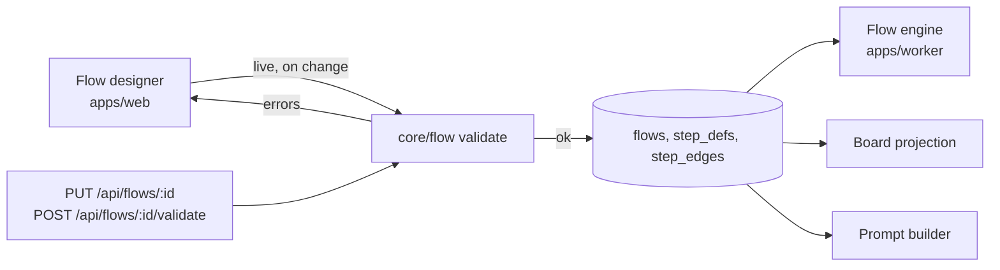

# Flow Definition Internals

How a flow definition is structured in code, and who reads a flow version once it is saved.

## Component #2 — Flow definition & validation

From `docs/old/architecture/02-core-and-engine.md` §2:

| Aspect | Text |
|---|---|
| **Role** | *"DAG of `step_defs` + `step_edges`; immutable versions; artifact-contract check; `board_order` topological sort."* |
| **Seam** | *"pure functions over graph JSON — no I/O, no provider. The most reusable piece in the system."* |
| **Genericize** | *"validation stays provider-independent *if* it validates against **capability descriptors** (…) rather than hardcoded knobs. Two design-time checks share one engine"*: the artifact contract and the capability contract. |
| **Composes with** | *"feeds the engine (3), the editor (greys invalid edges *and* unsupported knobs), and the board's column order (4)."* |
| **Idea** | *"flows are already immutable JSON — make them **exportable across projects** … A flow becomes a shareable artifact; keys uniquified on import."* |

As built in run-flow (2026-10-23), core's `validateFlow` (`core/src/flow/flow.ts`) is pure, as the seam says, but checks only the graph and the artifact contract. The step rules stay in the CLI loader, `loadFlow` (`cli/src/flow-config.ts`), beside its file reads: the name rule, no `START` or `END`, `an ai step needs prompt, skill or system_prompt`, `a shell step writes one artifact`, launch keys on a shell step, `max_attempts` with no rework route back, `write_roots` inside the folder, and the placeholder and no-limits warnings. They stay there until a second reader, the canvas or the worker, exists; moving them means adding `kind` to `StepDef` (Claude's call, 2026-10-23, open to Alex's review; see [[Run Flow Reference#Rules this command settles]]).

## Where the code lives

The PRD's rule (§3): *"**`packages/core` imports no framework, no database driver and no CLI.**"* The architecture README's module layout:

```
core/flow/     # def, validation, board_order (02)
core/engine/   # advancement, fan-out, join, rework (02)
```

The PRD's layout puts *"DAG traversal, advancement rules, loop guard"* in `packages/core/engine/` and the default flow in `seed/flows/default.json`.

## Who calls validation



- The drawio *Harness architecture* page puts *Flow validation on save* in **Process 1 · apps/web** (*"thin: validates, calls core, enqueues; never spawns agents"*) and the **Flow engine** in **Process 2 · apps/worker** (*"its rules come from packages/core"*).
- API handlers are thin: *"validate with zod, call a function in `packages/core`, return JSON"* (PRD §12).
- As built in run-flow (2026-10-23), `pnpm run-flow --check`, `--mermaid` and every start call `loadFlow`, which calls `validateFlow`. The engine, `advance` (`core/src/flow/engine.ts`), assumes a flow that passed.

## Inputs validation needs

| Check | Needs | Note |
|---|---|---|
| Artifact contract | The graph only | *"checks *type-graph reachability*, not bytes"* (`01-ports.md`, ArtifactStore) |
| Known types | The artifact type list | Seed list in PRD §6 (10 types); backlog Story 1.1 says *"the nine PRD types"* — [[Flow Design Open Questions]] #25. run-flow has no list: any lowercase name is a type (Claude's call, 2026-10-23, open to Alex's review) |
| Capability contract | Each step's target provider's capability set | *"Validation (component 2) checks steps against the *target provider's* capability set"* (`01-ports.md`). Not in run-flow: capability-gap warnings are on the run-flow plan's Left out list |
| Provider match | The registry's pack list | Couples pure validation to registry state — [[Capability Library Open Questions]] #6. Moot in v1, which is Claude-only ([[Capability Library Decisions\|D1]]); the build overtook D1 with OpenCode on 2026-10-18 ([[Agent Providers Open Questions]] #38) |

## Consumers of a saved flow version

| Consumer | Reads | Source |
|---|---|---|
| Flow engine | Edges and conditions, `advance_mode`, `max_attempts`, joins | PRD §8; `02` §3 |
| Board projection | `board_order`, step names | PRD §13; `02` §4 |
| Runner / prompt builder | `kind`, `agent_id`, `skill_id`, `extra_plugin_ids` (with the task's `capability_pins`), model, effort, limits, tools, `requires`, `produces`, `prompt_template` | PRD §7 |
| Artifact scanner | `produces` | PRD §6 |
| Cost views | Step definition and flow version ids | PRD §13 |
| Memory recall | The step's agent or skill as a scope | PRD §11.2 |

As built in run-flow (2026-10-23), there is no saved flow version. The engine reads core's `FlowDef`: the steps, the edges, and an optional `entry`. The host reads the CLI's `FlowConfig.steps`: each step's kind, and an agent step's launch settings or a shell step's command. The run pins both in `flow.json`, prompt texts included, in place of a saved version (the run-flow plan, §7.2).

The engine *"Depends only on the AgentProvider port's `RunResult`, never on how the run happened."* (`02` §3). `RunResult.outcome` is documented as: *"Drives conditional edges; read from the produced JSON or set_outcome. Unset is NOT 'pass': the engine parks the step at a human gate."* (`agent-provider.ts`)

## Types

The reference tree (`docs/old/reference/`) has no `StepDef`, `FlowDef`, `Edge` or `FlowVersion` type. `StepDef` appears only as an undeclared name, in three places: `02-core-and-engine.md` (`run(step: StepDef, …)`), `07-ports-in-practice.md` (`runStep`) and `docs/old/design/README.md` (`columns: StepDef[]`). The nearest typed shapes are `RunSpec`, `PromptParts` and `RunResult` in `agent-provider.ts`.

As built in run-flow (2026-10-23), core defines `FlowDef`, `StepDef` and `FlowEdge` (`core/src/flow/flow.ts`), holding only what the engine reads: a `StepDef` is `id`, `requires`, `produces`, `approval` and `maxAttempts`; an edge is `from`, `to` and `condition`; `FlowDef.entry` names the first step when the routes cannot. The CLI's `FlowConfig` (`cli/src/flow-config.ts`) wraps the `FlowDef` with the rest: the flow's name, the run's `folder` (from `--folder`), the flow's `budgetUsd`, the warnings, and `steps`, which maps each step to an `AiStep` (a `run-agent` `RunConfig`) or a `ShellStep` (its command and timeout).

## Tests

Backlog Story 5.3: *"Keep `tests/flow.test.ts` scenarios (validation, gate, fan‑out, join, rework, cap, approve → done); add: conditional edge never fires, cancel mid‑fan‑out, retry after failure, downstream attempts."* The drawio *Test lane*: *"vitest on engine rules … ReplayProvider drives whole flows at $0"*. Story 0.2 adds a Playwright lane including *"flow canvas connect"*.

## Related

- [[Flow Validation]]
- [[Flow Data Model]]
- [[Flow Design API And Routes]]
- [[Flow Design Overview]]
