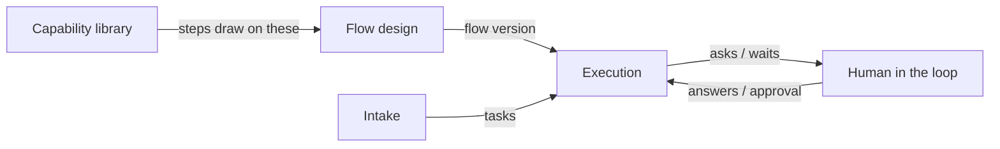

# Flow Design Overview

## Purpose

The feature map (§2 *Flows*) defines a flow as *"the recipe a task follows — an ordered set of steps, each one an agent doing a single job."* The PRD (§4) is more exact: *"a versioned DAG of step definitions belonging to a project. Editing a flow creates a new version rather than mutating the old one."*

As built in run-flow (2026-10-23), a flow's forward routes form the DAG, and its only loops are rework routes, `on_fail` routes back to the step itself or to an ancestor. `--check` refuses any other loop: `steps: routes loop without an on_fail route back: a, b`. See [[Flow Validation]].

Flow Design is everything up to the moment a task starts on a flow: authoring steps, wiring them, checking the recipe holds together, versioning it, and picking one from the library. Running a flow belongs to the execution engine.

The flow-designer field guide puts the screen's two jobs this way: *"On the left you **choose** — and the hard part is that good flows get forked, so three different recipes can share one name. In the middle you **build** — and the screen refuses to save a recipe that can't actually run."*

## Place in the system

Edges and labels from the drawio page *Functional components*. Flow Design has one input (the [[Capability Library Index|Capability Library]]) and one output (a **flow version** that Execution consumes).

Four cards make up the *Flow design* box on that page, all solid (in v1):

| Card | Text |
|---|---|
| Author steps | skill or agent, model, effort, advance mode |
| Wire connections | branches and joins |
| Validate artifact contract | requires / produces, at design time |
| Version the flow | edit = new version; in-flight tasks pinned |

On the *Logical components* page, the **Flow editor** `/p/[slug]/flow` (*edit DAG → new flow version*) feeds the **Flow engine** in Core (*versioned DAG, advance modes, attempts, artifact contracts*). The architecture catalogues it as component **#2 Flow definition & validation** (`02-core-and-engine.md` §2).

Downstream, a flow version decides:

- **The board's columns** — *"Columns come from the recipe"* (feature map §5), ordered by `board_order`. See [[Canvas Layout And Board Order]].
- **What the engine does next** — routes, fan-out, joins, gates and loops (feature map §4).
- **What the runner tells the agent** — the prompt's "read these first" and output paths come from the step's `requires` and `produces` (PRD §7).
- **Cost rollups** — spend per step definition and cost per completed task *"trended by flow version"* (PRD §13).

## Design principles

| Principle | Source wording |
|---|---|
| **Versioned and immutable** | *"editing the graph forks a new version; a task pins its version at start, so in-flight work never shifts under a graph edit."* (architecture README) |
| **A dataflow graph** | *"Artifacts flow along the edges … It is a *dataflow* graph, not a call sequence."* (architecture README) |
| **Fail at design time, not run time** | *"This turns a whole class of runtime failures into design-time errors"* (PRD §6) |
| **The board is a projection** | *"The board is a projection, not the model. The flow is a DAG."* (PRD §4) |
| **Pure and portable** | Validation is *"pure functions over graph JSON — no I/O, no provider. The most reusable piece in the system."* (`02` §2) |
| **Provider-agnostic** | *"the graph references *logical* models and capabilities, so the same agentic graph runs on Claude Code, Codex, or a replay adapter unchanged."* (architecture README) |
| **One agent per step, fresh context** | *"A versioned DAG: one agent per step with a fresh context, parallel branches in the task's own worktree, and an adversarial review only after the check passes."* (drawio *Harness architecture*, concept 7 *Graph layer*) |
| **Contract fixed before generation** | *"requires / produces, budget, turns and tools on the step. Fixed before generation, checked at flow save, injected by the prompt builder."* (drawio concept 1 *Bounded contract*) |
| **Names are not identifiers** | *"A forked flow keeps the name, because it is still code review."* (flow-designer guide) |
| **Canvas is arrangement, not meaning** | *"Dragging a step changes where it sits, never what runs when — that's the edges."* (flow-designer guide) |

As built in run-flow (2026-10-23), two principles hold only in part:

- **Provider-agnostic.** The graph names no provider, but a step's launch settings do: each agent step names an `adapter` and a native model id (`sonnet` on Claude Code, `provider/model` on OpenCode), so moving a step to another provider means editing both (Claude's call, 2026-10-23, open to Alex's review; see [[Run Flow Reference#Rules this command settles]]).
- **Pure and portable.** `validateFlow` is pure, but the step rules sit in the CLI loader ([[Flow Definition Internals]]). The flow file itself is portable: a reusable recipe (Alex's call, 2026-10-23) whose own paths resolve against its folder, so it runs in whatever folder a run names ([[Flow Storage]]).

## What it is not

- **Not the engine.** Advancement, attempts, escalation and infra retries happen at run time (PRD §8). These notes cover them only where a design choice sets them up — see [[Branching Joining And Loops]].
- **Not the library of skills and agents.** Steps *reference* capabilities; the [[Capability Library Index|Capability Library]] holds them. See [[Capabilities In Flows]].
- **Not a board.** The board derives its columns from the flow but never edits it.

## Related

- [[Flow Design Index]]
- [[Flows And Flow Versions]]
- [[Flow Design Screen]]
- [[Flow Definition Internals]]
