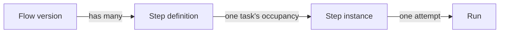

# Flows And Flow Versions

## A flow is a versioned DAG

> **Flow** — a versioned DAG of step definitions belonging to a project. Editing a flow creates a new version rather than mutating the old one. — PRD §4

The architecture README describes the same graph in more detail:

- *"**Nodes** (`step_defs`) are agent or skill invocations, each pinned to its own model, effort, permissions, and tool policy."*
- *"**Edges** (`step_edges`) are *typed transitions* — `always | on_pass | on_fail` — so the graph branches on an upstream node's **outcome**, not merely on completion."*
- *"**Artifacts flow along the edges.**"*
- *"**Topology beyond a chain:** fan-out (one node → many concurrent), join (many → one, waits for all), and loop-back (`on_fail` to an earlier node, guarded by `max_attempts`)."*

## Four layers

The PRD separates design-time from run-time objects. *"Get these three distinctions right; everything else follows."* (PRD §4)

Flow Design owns the first two. The drawio card *Step def → step instance → run* (page *FlowBoard ideation*): *"Rework loops create attempt 2, 3, 4 against the same instance."*

## Versions are immutable

| Rule | Source |
|---|---|
| *"Editing creates a new version. Tasks pin flow_id at start; in-flight tasks never move."* | drawio card *Flow = versioned DAG* |
| *"Editing a recipe creates a new version instead of changing the old one, and any task already running keeps the version it started on — so edits never disrupt work in progress."* | feature map §2 |
| *"You never edit a recipe in place. Editing produces a *new version*"* | flow-designer guide, *Versions* |
| *"Saving does not overwrite v4 — it creates v5 and points your project at it."* | flow-designer guide, walkthrough |
| `PUT /api/flows/:id -- creates a new version` | PRD §12 |
| `UNIQUE (project_id, name, version)` | PRD §5 `flows` |

Old versions can be archived (`flows.is_archived`, PRD §5); no source describes when.

## Adopted version

A project points at one version, the one new tasks start on. The feature map: *"A default recipe per project — Each project remembers which recipe to use"* (§1). Reading that as the PRD's `projects.default_flow_id`, and as the board's *"active flow"* (PRD §13), is an inference: the column has no comment, and the PRD never says what moves it. The mockup shows it in the version chip: `Software delivery  @core v4  adopted 12 Sep`. Saving *"Writes a new version and points the project at it"* (guide, *Every control*). The PRD stores no adoption date ([[Flow Design Open Questions]] #36). How a project gets its first flow (*"choose which recipe new tasks should follow (or start empty)"*, feature map §1; backlog Story 1.3) is in [[Project Default Flow]] and [[Creating A Project]].

## Why versions matter beyond safety

- **Cost by version** — *"Cost per completed task … trended by flow version"* (PRD §13; drawio *Cost per completed task*). The feature map: *"Tracked across recipe versions, so you can tell whether a change made things cheaper or more expensive."* (§18)
- **Portability** — *"Flow versions as immutable JSON, pinned per task → portable, shareable config."* (architecture README, *What the spec already got right*). `02` §2 proposes making flows *"exportable across projects"*. See [[Flow Storage]].

## Who owns a flow

The PRD scopes a flow to one project (`flows.project_id`). The mockups show a shared library where flows have **authors** and a project adopts one. These are not reconciled — see [[Flow Design Open Questions]] #1 and #2, and [[Flow Library]].

## Related

- [[Version Pinning]]
- [[Editing And Saving A Flow]]
- [[Flow Data Model]]
- [[Step Definitions]]
