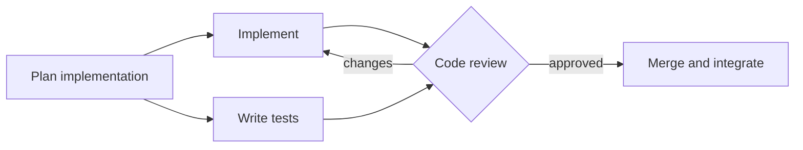
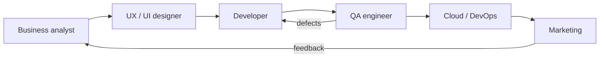

# Role Starter Flows

> **Role starter packs** — ship a ready-made recipe per function (UX/UI, business analyst, cloud/DevOps, QA, marketing…), each bundling the skills, tools, and design system that role reaches for, plus sensible default models and guardrails. Assign a task or step to a function and its workflow is already wired instead of a blank page. — feature map §2 ideas

The feature map's *Appendix: Role starter flows* develops the idea. *"A predefined flow is just a **DAG**, and so is the way a role actually works."*

## What makes it more than a template gallery

From the appendix:

- *"**Packs are seed flows, not screenshots.** Each DAG below is a candidate flow FlowBoard seeds — the same engine as the built-in dev pipeline, tuned per role — so it's versioned and editable like any recipe once you adopt it."*
- *"**The arrows *between* roles are the handoffs.** One role's output — a signed-off story, a design spec, a verified build — becomes the next role's inbox item."*
- *"**The pack carries the role's toolbox.** UX gets the design-system skills and tokens; cloud gets the infra-as-code and deploy tools; the business analyst gets the requirements and story-writing skills."*

## The six role flows

| Role | Core responsibilities | Loop |
|---|---|---|
| Business analyst / Product owner | elicit requirements · model the domain · write user stories with acceptance criteria · prioritize the backlog · get stakeholder sign-off | sign-off *changes* → elicit |
| UX / UI designer | user research · IA and flows · wireframes · UI against the design system · prototype and usability-test | usability *issues* → wireframes |
| Software developer | plan the implementation · build · write tests · pass code review · merge and integrate | review *changes* → implement |
| Cloud / DevOps engineer | provision infra as code · CI and CD · deploy · watch health and roll back · monitor and alert | *failing* → roll back → deploy |
| QA / Test engineer | plan the testing · author cases · execute and automate · triage defects · regression and sign-off | defects → triage → execute |
| Marketing / Product marketing | positioning and messaging · create content · plan the launch · run the campaign · measure and iterate | *missed* → content |

The developer flow *"is FlowBoard's own built-in pipeline — a fan-out to build and tests, a join at review, and a rework loop."* The PRD §15 seed differs: its join is at `check`, with `review` after it on `on_pass`.

The appendix draws all six as mermaid diagrams.

As built in run-flow (2026-10-23), each of the six, written as a flow file from the appendix's diagram with the `budget_usd:` every flow file needs, passes `pnpm run-flow --check`, alone and with `--folder` and `--task` (checked 2026-10-23). A run-flow version needs three things:

- **A loop back to the first step names it.** The business analyst's *sign-off changes → elicit* leaves every step with a route in, so the file needs `entry: elicit`; without it, `steps: no entry step: every step has a route into it; name the first one with entry:` (Claude's call, 2026-10-23, open to Alex's review; see [[Run Flow Reference#Rules this command settles]]). The other five start at their one step with no route in.
- **A person's sign-off or test is a no-op shell step with a gate.** There are no manual steps (also Claude's call), so the analyst's sign-off and the designer's usability test are `shell: "true"` with `gate: approval`: a gated shell step, like `draft` in `gate.yaml` ([[Testing The Run Flow CLI]]), with nothing to run. The gate reads `approval needed; it reported pass`, and Reject reruns the loop's target with the person's note. Without `produces`, `--check` warns that the target `runs again without seeing why`; the note is what tells it.
- **A repair step reached only by rework takes the failing step's outputs.** In DevOps's *failing → roll back → deploy* and QA's *defects → triage → execute*, the route into the repair step is a rework route, because the repair step leads back to the step that failed. It gets that step's outputs and can `require` nothing (`steps.rollback: requires "release", and no step before it produces that`). It also owns the loop's attempt budget (`rollback has used 3 of 3 attempts`), so `max_attempts` goes on it; on `deploy` it is an error: `steps.deploy.max_attempts: no rework route leads back to deploy, so nothing reads it`.

## The handoff relay

*"The back-edges are what make it a team, not a conveyor belt."* Cross-role handoffs need the teams features (role-assigned routing, a teammate's inbox) — they are not v1.

## Where the mockup uses them

- **Domains.** The library's domain chips *"come from FlowBoard's role starter packs"*: Analysis, PO / PM, SDLC, QA, Platform, Design, Marketing. The appendix lists six roles; the mockup splits analysis and PO/PM.
- **Preview step names.** The mockup's `STEPNAMES` table holds each domain's steps, e.g. QA: *Test plan, Author cases, Execute and automate, Log and triage, Regression and sign-off*. Previews use them *"so a preview shows that flow's real shape rather than a stand-in"*.
- **Default roles.** `ROLE`: sdlc → `developer`, analysis → `analyst`, po-pm → `product-owner`, qa → `tester`, platform → `sre`, design → `designer`, marketing → `marketer`.

## Relation to bundle packs

A role pack ships a flow *and* its skills and tools, which is what a [[Bundle Packs|bundle pack]] is in the Capability Library. The sources don't say whether role starter packs *are* bundle packs ([[Flow Design Open Questions]] #35).

## Related

- [[Seeded Flows]]
- [[Flow Library]]
- [[Bundle Packs]]
- [[Flow Design Roadmap]]
