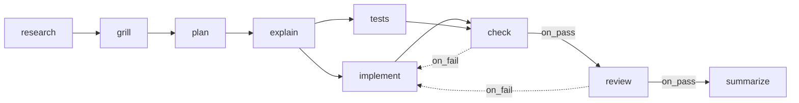

# Seeded Flows

> **Ready-made recipes** — Ships with a couple of complete ones (a full software-development pipeline and a research pipeline) so you're not starting from a blank page. — feature map §2

The sources described three different starter sets (sections 1–3); section 4 is the mockup's sample library, not a seed set. [[Capability Library Decisions|D26]] reconciles them: v1 seeds **one** flow, *Software delivery* — section 1's nine steps with section 3's role names. The `researcher` template (section 2) is out of v1 (D31).

## 1. The PRD default flow

*"Seed one project and one flow, **Software delivery**, that reproduces my actual workflow."* (PRD §15, as updated by D26 and D27)

| key | name | agent | skill | model | effort | advance | requires | produces |
|---|---|---|---|---|---|---|---|---|
| `research` | Research | `scout` | — | sonnet | medium | auto | — | `research_brief` |
| `grill` | Grill me | — | `/grill-me` | sonnet | medium | auto | `research_brief` | `questions`, `answers` |
| `plan` | Plan | `architect` | `/plan-implementation` | opus | high | auto | `research_brief`, `answers` | `plan` |
| `explain` | Explain plan | — | `/explain-simply` | haiku | low | **approval** | `plan` | `explainer` |
| `implement` | Implement | `developer` | `/ponytail` | opus | high | auto | `plan` | `implementation_notes` |
| `tests` | Write tests | `tester` | — | sonnet | high | auto | `plan` | `test_notes` |
| `check` | Lint & test | shell (project `check_command`) | — | — | — | auto | — | `check_output` |
| `review` | Code review | `reviewer` | `/code-review` | opus | high | **approval** | `implementation_notes`, `test_notes`, `check_output` | `review` |
| `summarize` | Summarize built | `scribe` | — | sonnet | medium | auto | `review` | `summary` |

The PRD first named the agents `researcher`, `planner`, `test-writer` and `summarizer`, with `implement` and `review` skill-only. `scout` researches the repo only (`Read, Grep`), and `tester` writes the tests that `check` runs. The seeds are exactly what this flow uses — see [[Seeded Capabilities]].

*"the mechanical loop: the model never gets reviewed on code that doesn't pass"* and *"the review loop"* (PRD §15). The seeded `/code-review` *"reviews the diff against the task's acceptance criteria and non-goals and against the raw `check_output`, and must call `set_outcome`. It is told to look for failures, not to confirm the work."*

The milestone proof for M5: *"a deliberately failing test in the scratch repo sends the seeded flow from `check` back to `implement` with the raw log, and a run that sets no outcome stops at a gate instead of passing."* (PRD §14)

As built in run-flow (2026-10-23), the nine steps, written as a flow file with the edges above, pass `--check` (`-- flow ok: 9 steps, starting at research`), and `--mermaid` draws both loops as rework routes. A run-flow version differs from the table in five ways:

- **Keys only.** A step's key is its only name; `name` and `label` are `unknown key`, so *Grill me* and *Lint & test* fit only in YAML comments (Claude's call, 2026-10-23, open to Alex's review; see [[Run Flow Reference#Rules this command settles]]).
- **No agent rows.** A step cannot name an agent (`steps.research.agent: unknown key`; an `agent:` file key is on the run-flow plan's Left out list), so each step carries its agent's text in `system_prompt` and its tool limits in `permissions`. A read-only `scout` still needs a tool that writes its artifact: an output counts only if this run wrote it, so a scout limited to `Read` and `Grep` stops at `did not write: research_brief`. `write_roots: []` keeps its edits to its artifacts folder.
- **`check` is `shell: <command>`.** There is no project `check_command`.
- **Models are native ids.** `sonnet`, `opus` and `haiku` work on Claude Code; an OpenCode step needs `provider/model` (also Claude's call).
- **Skills are paths.** `skill: /plugin:name`, or `/name` from `skills:` folders, read at every launch rather than pinned (also Claude's call).

> [!note] Validation quirk
> `check` requires nothing but runs after `implement` and `tests`. It reads the worktree, not an artifact. A contract-only validator cannot see that dependency ([[Flow Design Open Questions]] #33).

> [!check] Answered by run-flow, 2026-10-23
> Validation ignores dependencies the contract cannot see; only `requires` is checked (Claude's call, 2026-10-23, open to Alex's review). `check` reads the folder as `implement` and `tests` left it, and their outputs through `$FLOWBOARD_ARTIFACTS`. See [[Run Flow Reference#Rules this command settles]].

## 2. Backlog flow templates

> [!check] Out of v1 (D31)
> The `researcher` template and its agents are not seeded until open-web research has an egress answer. `backlog-importer` is internal to import, not a seed (D30).

Backlog Story 1.2 now reads: *"Flow template as JSON: *Software delivery* (the 9‑step table, exact agent/skill pairs, models/efforts/gates/edges). The `researcher` web-research template is out of v1 until open-web egress has an answer."* The feature map still promises *"a research pipeline"* (§2), and Story 1.1 still lists the research artifact types *"`sources`, `grounding_report`"*.

The template's shape survives only in the backlog's history. Before commit `8561b85` Story 1.2 read *"`researcher` (scope → web research → summarize → grounding ✋, `on_fail` loop)"* and seeded *"web‑researcher, research‑summarizer, fact‑checker"* without saying which step uses which agent ([[Flow Design Open Questions]] #32). The ✋ marked `grounding` as a gate.

Drawn from that earlier wording. The loop target of the `on_fail` edge was never stated; the diagram's target is a guess ([[Flow Design Open Questions]] #32).

## 3. The mockups' Software delivery

Named *Software delivery @core v4* in the flow-designer, task-detail and capability-library mockups; the monitor shows the same steps and `v4` but no name or author (`★ org default`, 182 runs, ~$2.14/task, `fanloop` shape):

| Step | Agent | Model | Effort | Gate |
|---|---|---|---|---|
| research | scout | haiku | low | |
| plan | architect | opus | high | |
| build | developer | opus | high | |
| tests | tester | sonnet | medium | |
| review | reviewer | sonnet | medium | ✓ |
| summarize | scribe | haiku | low | |

Edges: research → plan → build ∥ tests → review → summarize, and review → build on fail. No check step. The flow-designer mockup opens it with a seventh, borrowed `threat-model` step. The monitor shows it as `research→plan→build∥tests→review→summarize`.

As a run-flow flow file (2026-10-23) it passes `--check` once its file names become type keys (`brief.md` → `brief`), since a dot is refused: `steps.research.produces.0: name may only use lowercase letters, digits, - and _`.

## 4. The mockup library

17 flows from 5 authors in `flow-designer.html`:

| Name | Author | Ver | Domain | Shape | Steps | Gates | ~$/task | Runs | Notes |
|---|---|---|---|---|---|---|---|---|---|
| Software delivery | @core | 4 | SDLC | fanloop | 6 | 1 | 2.14 | 182 | ★ (the open flow; the rail shows `★ org default`, not *open now*) |
| Software delivery | @alex | 2 | SDLC | fan | 5 | 0 | 1.61 | 23 | forked from @core v3; *"No approval gate — it merges itself."* |
| Code review | @core | 7 | SDLC | linear | 3 | 1 | 0.42 | 410 | ★ *"Two reviewers on anything touching auth."* |
| Code review | @alex | 3 | SDLC | linear | 2 | 1 | 0.19 | 64 | forked from @core v5; *"no security sweep"* |
| Code review | @team-sec | 2 | SDLC | fanloop | 6 | 2 | 1.18 | 97 | adds threat-model and secret-scan |
| Discovery to stories | @core | 3 | Analysis | loop | 5 | 1 | 1.87 | 58 | ★ |
| Domain modelling | @alex | 1 | Analysis | linear | 3 | 0 | 0.94 | 7 | |
| Story refinement | @core | 5 | PO / PM | loop | 4 | 1 | 0.71 | 143 | ★ |
| Story refinement | @pm-guild | 1 | PO / PM | loop | 6 | 2 | 1.32 | 11 | adds RICE scoring, second sign-off |
| Backlog triage | @core | 2 | PO / PM | branch | 4 | 0 | 0.38 | 76 | |
| Test and triage | @core | 4 | QA | loop | 5 | 1 | 1.44 | 88 | ★ |
| Release and rollback | @core | 6 | Platform | loop | 5 | 1 | 0.86 | 201 | ★ |
| Incident response | @team-sec | 3 | Platform | branch | 6 | 2 | 2.42 | 14 | |
| Design handoff | @core | 2 | Design | loop | 5 | 1 | 1.96 | 31 | |
| Launch campaign | @core | 2 | Marketing | loop | 5 | 1 | 1.12 | 19 | |
| Launch campaign | @growth | 4 | Marketing | fanloop | 8 | 2 | 3.07 | 42 | fans out per channel; paid-spend gate |
| Positioning sprint | @growth | 1 | Marketing | linear | 4 | 0 | 0.88 | 6 | |

★ = org default. This is sample data for the mockup, not a seed list.

## Related

- [[Role Starter Flows]]
- [[Seeded Capabilities]]
- [[Flow Storage]]
- [[Check Steps]]
