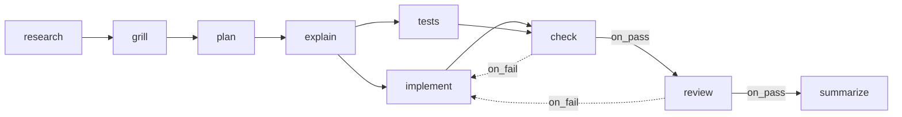

# Seeded Flows

> **Ready-made recipes** — Ships with a couple of complete ones (a full software-development pipeline and a research pipeline) so you're not starting from a blank page. — feature map §2

The sources describe three different starter sets (sections 1–3); section 4 is the mockup's sample library, not a seed set. They are not reconciled — [[Flow Design Open Questions]] #29.

## 1. The PRD default flow

*"Seed one project and one flow that reproduces my actual workflow."* (PRD §15)

| key | name | kind | model | effort | advance | requires | produces |
|---|---|---|---|---|---|---|---|
| `research` | Research | agent `researcher` | sonnet | medium | auto | — | `research_brief` |
| `grill` | Grill me | skill `/grill-me` | sonnet | medium | auto | `research_brief` | `questions`, `answers` |
| `plan` | Plan | agent `planner` | opus | high | auto | `research_brief`, `answers` | `plan` |
| `explain` | Explain plan | skill `/explain-simply` | haiku | low | **approval** | `plan` | `explainer` |
| `implement` | Implement | skill `/ponytail` | opus | high | auto | `plan` | `implementation_notes` |
| `tests` | Write tests | agent `test-writer` | sonnet | high | auto | `plan` | `test_notes` |
| `check` | Lint & test | shell (project `check_command`) | — | — | auto | — | `check_output` |
| `review` | Code review | skill `/code-review` | opus | high | **approval** | `implementation_notes`, `test_notes`, `check_output` | `review` |
| `summarize` | Summarize built | agent `summarizer` | sonnet | medium | auto | `review` | `summary` |

*"the mechanical loop: the model never gets reviewed on code that doesn't pass"* and *"the review loop"* (PRD §15). The seeded `/code-review` *"reviews the diff against the task's acceptance criteria and non-goals and against the raw `check_output`, and must call `set_outcome`. It is told to look for failures, not to confirm the work."*

The milestone proof for M5: *"a deliberately failing test in the scratch repo sends the seeded flow from `check` back to `implement` with the raw log, and a run that sets no outcome stops at a gate instead of passing."* (PRD §14)

> [!note] Validation quirk
> `check` requires nothing but runs after `implement` and `tests`. It reads the worktree, not an artifact. A contract-only validator cannot see that dependency ([[Flow Design Open Questions]] #33).

## 2. Backlog flow templates

Backlog Story 1.2: *"Flow templates as JSON: `software-development` (the 9‑step table, exact models/efforts/gates/edges) and `researcher` (scope → web research → summarize → grounding ✋, `on_fail` loop)."* The same story seeds eight agents in one list (*"researcher, planner, test‑writer, summarizer, backlog‑importer (builtin), web‑researcher, research‑summarizer, fact‑checker"*); it does not say which steps of `researcher` use which agent ([[Flow Design Open Questions]] #32). Extra artifact types: `sources`, `grounding_report` (Story 1.1). The ✋ marks `grounding` as a gate.

The loop target of the `on_fail` edge is not stated; the diagram's target is a guess ([[Flow Design Open Questions]] #32).

## 3. The mockups' Software delivery

Named *Software delivery @core v4* in the flow-designer, task-detail and capability-library mockups; the monitor shows the same steps and `v4` but no name or author (`★ org default`, 182 runs, ~$2.14/task, `fanloop` shape):

| Step | Agent | Model | Effort | Gate |
|---|---|---|---|---|
| research | scout | haiku | low | |
| plan | architect | opus | high | |
| build | developer | opus | high | |
| tests | tester | sonnet | medium | |
| review | reviewer | sonnet | medium | ✓ |
| summarize | scribe | haiku | low | |

Edges: research → plan → build ∥ tests → review → summarize, and review → build on fail. No check step. The flow-designer mockup opens it with a seventh, borrowed `threat-model` step. The monitor shows it as `research→plan→build∥tests→review→summarize`.

## 4. The mockup library

17 flows from 5 authors in `flow-designer.html`:

| Name | Author | Ver | Domain | Shape | Steps | Gates | ~$/task | Runs | Notes |
|---|---|---|---|---|---|---|---|---|---|
| Software delivery | @core | 4 | SDLC | fanloop | 6 | 1 | 2.14 | 182 | ★ (the open flow; the rail shows `★ org default`, not *open now*) |
| Software delivery | @alex | 2 | SDLC | fan | 5 | 0 | 1.61 | 23 | forked from @core v3; *"No approval gate — it merges itself."* |
| Code review | @core | 7 | SDLC | linear | 3 | 1 | 0.42 | 410 | ★ *"Two reviewers on anything touching auth."* |
| Code review | @alex | 3 | SDLC | linear | 2 | 1 | 0.19 | 64 | forked from @core v5; *"no security sweep"* |
| Code review | @team-sec | 2 | SDLC | fanloop | 6 | 2 | 1.18 | 97 | adds threat-model and secret-scan |
| Discovery to stories | @core | 3 | Analysis | loop | 5 | 1 | 1.87 | 58 | ★ |
| Domain modelling | @alex | 1 | Analysis | linear | 3 | 0 | 0.94 | 7 | |
| Story refinement | @core | 5 | PO / PM | loop | 4 | 1 | 0.71 | 143 | ★ |
| Story refinement | @pm-guild | 1 | PO / PM | loop | 6 | 2 | 1.32 | 11 | adds RICE scoring, second sign-off |
| Backlog triage | @core | 2 | PO / PM | branch | 4 | 0 | 0.38 | 76 | |
| Test and triage | @core | 4 | QA | loop | 5 | 1 | 1.44 | 88 | ★ |
| Release and rollback | @core | 6 | Platform | loop | 5 | 1 | 0.86 | 201 | ★ |
| Incident response | @team-sec | 3 | Platform | branch | 6 | 2 | 2.42 | 14 | |
| Design handoff | @core | 2 | Design | loop | 5 | 1 | 1.96 | 31 | |
| Launch campaign | @core | 2 | Marketing | loop | 5 | 1 | 1.12 | 19 | |
| Launch campaign | @growth | 4 | Marketing | fanloop | 8 | 2 | 3.07 | 42 | fans out per channel; paid-spend gate |
| Positioning sprint | @growth | 1 | Marketing | linear | 4 | 0 | 0.88 | 6 | |

★ = org default. This is sample data for the mockup, not a seed list.

## Related

- [[Role Starter Flows]]
- [[Seeded Capabilities]]
- [[Flow Storage]]
- [[Check Steps]]
