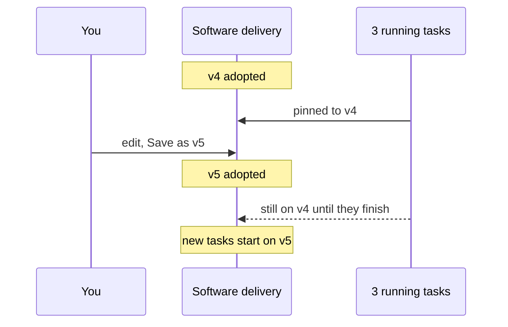

# Version Pinning

> **Flows are version-pinned at task start.** `tasks.flow_id` points at a specific flow version. Editing a project's flow never moves an in-flight task. — PRD §4

## The rule

A task records the flow version it runs on, and keeps it until it finishes. Editing the flow creates a new version for *new* tasks only.

## Where the screens show it

| Screen | What it says |
|---|---|
| Flow designer status bar | `3 tasks still running on v4 — they keep it until they finish` |
| Flow designer guide, walkthrough | *"The three tasks already running stay on v4 until they finish."* |
| Task detail aside | `Software delivery @core v4` and *"v5 exists — this task keeps v4 until it finishes"* |
| Capability-library guide, pinning table | *task — "The flow version it started on. — Nothing happens to it. You can edit the flow freely while it runs."* |

## What is pinned and what is not

| Thing | Pinned? | Source |
|---|---|---|
| A task's flow version | Yes | PRD §4, §5 |
| A task's plugin commits and agent rows | **Yes, at task start** — `tasks.capability_pins`, *"set when the task starts"*; *"an update never reaches a running task; agent rows are pinned the same way"* | PRD §5, §7; [[Capability Library Decisions\|D10]] |
| A flow version's capabilities | **No** — a flow names capabilities, not capability versions. An update reaches every flow on its next *task* (D10) | D10; [[Updating And Removing Capabilities]] |
| Settings such as draft mode and sandbox defaults | No (inference: PRD §13 describes them as settings but does not say when they are read; PRD §11.1 records what actually ran per run, in `runs.sandbox`, `runs.model`, `runs.effort`) | PRD §11.1, §13 |

> [!note] The mockups read capability updates differently
> The capability-library mockup and guide say an update changes behaviour *"for every flow using it **on its next run**"* and that *"flows are not pinned to a capability version the way tasks are pinned to a flow version"*. D10 and PRD §7 narrow that: the update reaches the next **task**, never a running one. [[Capability Library Open Questions]] #4 is resolved by D10.

## When pinning happens

The sources disagree on whether the flow version is pinned at **promotion** (backlog → todo) or at **start** (todo → running).

| Promotion | Start |
|---|---|
| PRD §5: `tasks.flow_id` *"null while in backlog, pinned on promotion"* | PRD §4: *"Flows are version-pinned at task start."* |
| PRD §12: `POST /api/tasks/:id/promote -- backlog -> todo, pin flow, create worktree` | Architecture README: *"a task pins its version at start"* |
| Backlog Story 2.1: *"Pin `tasks.flow_id` at promotion"* | drawio *Functional components* card *Start task / pin flow version*; drawio *FlowBoard ideation* card *Flow = versioned DAG*: *"Tasks pin flow_id at start"* |
| | Feature map §3: *"Kicking off a task gives it a clean, private copy of the code to work in and locks in the recipe it will follow."* |

The capability pins add a twist inside PRD §5 itself: `tasks.flow_id` is *"pinned on promotion"* but `tasks.capability_pins` is *"set when the task starts"*. If promote and Start are separate actions, a task's flow version and its capability versions are fixed at different moments.

Backlog D1's *default recommendation* (not yet decided) is an explicit Start button: *"Explicit Start button on card + sheet; promote stays cheap"*. Story 2.1 still says *"decide auto‑start on promote vs explicit Start"*. See [[Flow Design Open Questions]] #7 and [[Starting A Task]].

## Edge cases

- **Board columns.** The board takes its columns from *"the project's active flow ordered by `board_order`"* (PRD §13). A task pinned to an older version can be on a step the active version no longer has. No source says where that card sits.
- **The monitor shows one version.** The monitor mockup's topbar shows a single `v4`. A mixed fleet of v4 and v5 tasks is not designed.
- **Archived versions.** `flows.is_archived` exists (PRD §5). Archiving a version tasks still pin is not covered.

## Related

- [[Flows And Flow Versions]]
- [[Editing And Saving A Flow]]
- [[Canvas Layout And Board Order]]
