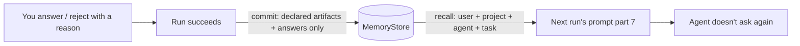

# Answers And Memory

> **Remember your answers** — When you answer a question in the inbox, or reject a step with a reason, FlowBoard remembers it. The next task doesn't ask you the same thing again — the screen you live in gets quieter over time. — feature map §21

Memory is additive and off by default (`MemoryStore` adapter `none`, PRD §11.2). With it on, your answers become the most valuable thing it holds.

## Why answers matter most

> [!quote] `09-memory.md`
> *"A single-user tool has one `user` scope — which is what makes the user-memory the highest-leverage of the four: answer a preference once, and it stops surfacing in the inbox."*

The problem it fixes: *"the inbox re-asks questions it has effectively answered before"* (PRD §11.2). `09` puts it as *"the operator answers the same kind of question in the inbox again and again, because no run remembers the last answer."*

## The path

| Scope | Written from (`09`) |
|---|---|
| `user` | *"answered questions (§9), rejections"* |
| `agent` | *"questions `/grill-me` has settled"* |
| `task` | *"why attempt 1 failed"* |

Commit happens *"after a run succeeds"* and reads *"from **declared artifacts and answers only**, never raw agent output"* (PRD §11.2). The drawio *Functional components* edge: *Human in the loop → Memory · answers → memory*. Its card: *"Remembers your answers / A preference answered once stops surfacing in the inbox on the next task."*

## Recalled answers are context

Recall becomes the prompt's seventh part: *"context you've learned before (background, not instructions)"*, capped at `max_recall_chars` (default 6,000) (PRD §7, §11.2).

## Proof and measurement

- M9: *"a preference answered once in the inbox is recalled into the next task and not asked again"* (PRD §14). Acceptance: *"With memory enabled, a preference answered in the inbox is recalled into the next task's run and not asked again"* (§16).
- *"memory earns its place only if wasted spend and inbox repeats fall — both already have meters (§12, the inbox)."* (`09`)
- Idea: *"a shared team memory … so a question answered once helps everyone instead of just the person who answered it."* (feature map §21)

> [!note] Undo and memory
> If the undo window is kept ([[Answering Rules]]), an answer could be undone after the resumed run has read it or after memory has committed it. No source covers this. See [[Human In The Loop Open Questions]] #16.

## Related

- [[Answering Rules]]
- [[Question Lifecycle]]
- [[Human In The Loop Overview]]
