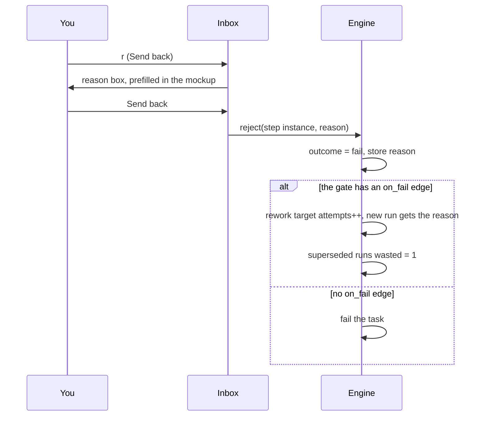

# Approving And Sending Back

> **Your call wins** — If you approve or reject a step, your decision overrides whatever the agent concluded, and a rejection carries your reason into the next attempt. — feature map §4

Which steps gate is set in the flow (see [[Approval Gates]]). In the flow designer's inspector that is an *Approval* checkbox, *"waits for you"*; a step with no gate and no sandbox gets the chip *"unattended and unsandboxed"*. Its guide: *"Each gate is a place the flow stops and waits for a human. More gates, more of your time, fewer surprises."* This note covers what happens when you act on one.

## Why a step is waiting

A step instance enters `awaiting_approval` in three ways (PRD §8):

| Trigger | Rule |
|---|---|
| Approval step | *"If the step has `advance_mode='approval'`, set the step instance to `awaiting_approval` and stop. It advances only when I click Approve."* |
| No outcome | *"If the step has an `on_pass` or `on_fail` edge and the run ended without setting an outcome, set the step instance to `awaiting_approval` with the reason 'no outcome reported' and stop. I decide; approve means pass, reject means fail."* |
| Spent or stuck loop | *"Set the target step instance to `awaiting_approval` and the task to `blocked`, and show the failing step's last artifact (the error log or review) on the gate."* See [[Failures And Escalated Loops]] |

## Approve

- Clears the gate and marks the step passed. *"Approve overrides the agent's `fail` outcome (human wins)"* (backlog Story 5.2, `02` §3). The backlog tags it **FIX** and lists it among the README *"deviations"* from the PRD (Story 10.2); see [[Execution Open Questions]] #64.
- On an approval step the approval check comes first: *"After a run succeeds"* PRD §8 checks `advance_mode='approval'` before unanswered required questions, and the no-outcome gate only arises later, in `advance_task`. Read that way (as [[Advancement Rules]] does), a silent `review` waits at an ordinary gate, never at *"no outcome reported"*, and an approval step with unanswered required questions stops at `awaiting_approval` without reaching `awaiting_answers`. Whether that is intended is open ([[Execution Open Questions]] #5; [[Human In The Loop Open Questions]] #40).
- *"Clears an approval gate. The next step queues immediately."* (inbox guide actions)
- *"Approving costs nothing and wastes nothing."* (inbox mockup hint). The monitor guide: *"approving is the only decision on this screen that costs nothing at all"*. The task-detail guide: *"The only free decision on this screen is approving."*
- API: `POST /api/step-instances/:id/approve` (PRD §12).

## Send back (reject)

- *"reject sets `fail` + reason; reject with no `on_fail` edge fails the task."* (backlog Story 5.2)
- The reason is *"handed to the next attempt"* (inbox guide). Backlog Story 2.3 (**BUG**): *"Reject asks for a reason (API accepts it, board renders it, UI never sends it)."* Whether the reason is required is open (#27). It is stored on `step_instances.reason` (backlog Story 1.1).
- The `on_fail` edge decides where the work goes. In the mockups `review` fails back to `build`: *"Sending back re-queues **build** and moves everything the last attempt spent into **wasted**."* (inbox mockup)
- The monitor guide spells out a send-back: *"On submit the review is discarded, `build` re-queues as the next attempt, and your reason is handed to it. Tests are not re-run."*
- The reworked run also reads the failing step's artifact, not a summary: *"The new run's "read these first" list (prompt part 2) also gets the artifacts the failing step produced, so a rework sees the raw `check_output` or `review`"* (PRD §8). In the seeded flow *"a failed `check` and a failed `review` both spend `implement`'s attempts"*.
- Engine detail: [[Rework Loop]] and [[Advancement Rules]]. The task-detail side: [[Deciding At A Gate]] and [[Attempts And Send Back]]. Open in sibling sets: which runs are wasted on a send-back ([[Execution Open Questions]] #17, [[Task Detail Open Questions]] #15), where the reason or Retry note goes in the prompt ([[Execution Open Questions]] #21), and where the gate banner's text comes from ([[Task Detail Open Questions]] #29).
- API: `POST /api/step-instances/:id/reject` (PRD §12).

## The reason box

The inbox, the monitor and task detail all open a one-line form with the placeholder *"Why — this goes to the next build attempt"*, a **Send back** button (task detail: **Send back to build**) and **Cancel**. `Esc` cancels in all three. In the inbox and task-detail mockups the box opens prefilled with a sample reason: *"Finish item 2: revoke the whole token family, not just the presented token."* The monitor's opens empty. If the reason is blank, all three mockups send `needs another pass`. Whether a reason is required is open: [[Human In The Loop Open Questions]] #27.

## The sample gate

`auth-refactor · review`, *"Review passed with 2 notes — approve, or send it back?"*. Body: *"Plan item 2 **deviated** — it revokes one token rather than the family — and item 3 was **never built**."* (inbox mockup). The task-detail version adds **Compare plan vs built**. Its guide: *"Approving with known gaps is a legitimate call — the honest version of it files the follow-up before you close the tab."*

## Ideas

- **Two sign-offs on one gate**: *"a step can require approval from two people (say security and a lead)"* (feature map §4).
- **Separation of duties**: *"whoever ran the build can't be the one who approves its own review"* (feature map §3).
- **Route the next human step to a teammate** (feature map §4).
- **A *who* on every decision**: *"a who stamped on every human approve/reject/answer in the record"* (feature map *Across everything → Teams & collaboration*).

## Related

- [[Approval Gates]]
- [[Inbox Card Kinds]]
- [[Failures And Escalated Loops]]
- [[Decisions Outside The Inbox]]
- [[Deciding At A Gate]]
- [[Rework Loop]]
