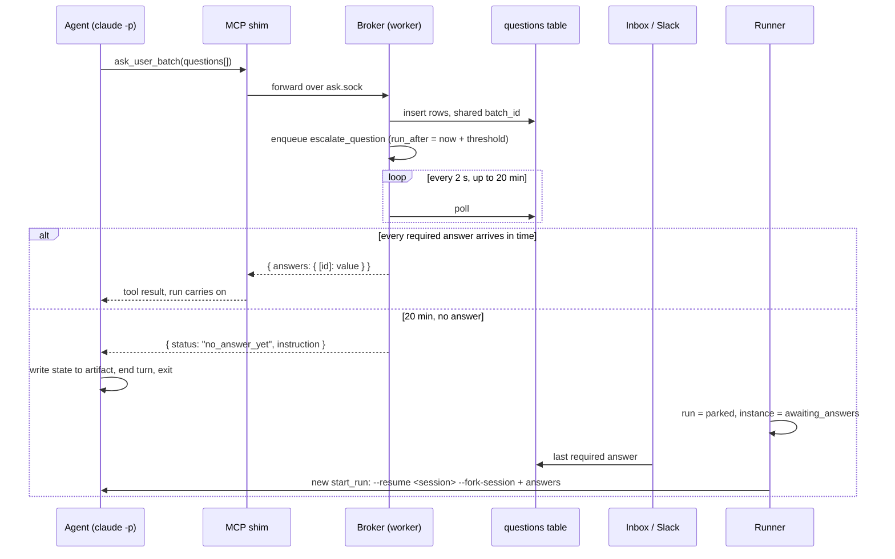

# Ask Park And Resume

> *"agent emits a `questions` artifact → engine **parks** the run → human answers → engine **resumes** with an `answers` artifact in context."* — `04-hitl-and-notify.md` §9

## The sequence

## The rules

| Rule | Source wording |
|---|---|
| Block, then give up cleanly | *"The broker polls the `questions` table every 2 seconds and holds the shim's call open. After 20 minutes with no answer, return a sentinel instead of hanging forever"* (PRD §9) |
| The sentinel | `{ "status": "no_answer_yet", "instruction": "Write your current state to <artifact path> and end your turn. You will be resumed with the answers." }` (PRD §9) |
| Park | *"The runner sees the process exit, sets the run to `parked`, and leaves the step instance in `awaiting_answers`."* (PRD §9). Backlog Story 4.2: *"Exit 0 with required questions pending → run `parked`, instance `awaiting_answers`, task blocked."* |
| Resume | *"When the last required answer arrives, enqueue a new `start_run` that resumes with `--resume <claude_session_id> --fork-session` and a prompt containing the answers."* (PRD §9) |
| Why park at all | *"This is more robust than trying to hold a session alive for hours."* (PRD §9) |
| Required only | `ask_user_batch` *"blocks until every required one is answered"* (PRD §9). Backlog Story 4.1: *"Return only once every required answer is present; ignore `answers.value` null."* |
| The gate after success | *"If the step has unanswered required questions, set `awaiting_answers` and stop."* (PRD §8) |
| Test hook | Timeout *"overridable by `VIBE_ASK_TIMEOUT_MS` for tests"* (backlog Story 4.1) |

## Resume must carry the contract

> [!bug] Backlog Story 3.2
> *"Resume prompt must repeat the requires/produces paths, not only the answers."* `03` §6 repeats it under *Genericize*.

Without fork support (`resume_fork` capability), *"park/resume falls back to **context-replay** (re-inject requires/produces + answers into a fresh prompt — which the spec already does anyway)"* (`01-ports.md`). v1 is Claude-only (Capability Library **D1**, [[Capability Library Decisions]]), so in v1 every resume forks.

## The race

> [!bug] Backlog Story 4.2
> *"Race: answer arrives while the process is still exiting → `maybeResume` sees `running` and skips, then completion marks the step done without the agent ever seeing the answers. Make completion re-check 'answers arrived after last poll' and resume instead."* `04` §9 calls this *"the race fix"*.

## What waiting costs

> [!important] *"a parked run is not billing you."* — inbox guide
> *"When an agent asks, it saves its place and lets go of its worker. Leaving the inbox full costs calendar time and a worker slot's worth of throughput — not money."*

The guide's state strip reads: *asked a batch, or just one* → *parked · slot released · $0/min* → *escalated · posted to chat* (after *10m, no answer*) → *answered · the run resumes*. The monitor guide: *"Answering is free; stopping is not. A run that asks you a question saves its place and stops billing while it waits"*. Task detail logs it as *"? asked you 2 questions — paused, billing stopped"* then *"✓ resumed with your answers"*.

> [!warning] When does the run let go?
> The mockups park the moment the agent asks. The PRD holds the tool call open for up to 20 minutes first, so the process and its worker slot stay busy that long. The feature map agrees with the PRD (*"If you don't answer within a while, the agent saves its place"*). See [[Human In The Loop Open Questions]] #5.

## In a sandbox

The broker path is the same on every tier: the shim talks to the broker over a per-run unix socket, `data/sock/<run_id>.sock`, bind-mounted into a sandbox as `/run/fb/ask.sock` (PRD §9, §11.1). The artifact-file exchange *"remains the fallback for a provider without MCP"*. Backlog decision **D9** still reads *"Artifact-file park/resume by default"*. See [[Ask User MCP Server]] and Open Questions #9.

## Related

- [[Ask User MCP Server]]
- [[Question Lifecycle]]
- [[Question Batches]]
- [[Human In The Loop Runtime]]
