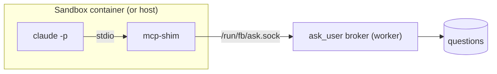

# Ask User MCP Server

The agent-facing half of HITL: how a headless CLI session asks a question, declares an artifact, or sets an outcome.

## Two halves, one path

> [!quote] PRD §9
> *"Questions take **one path on every tier**, host or sandbox."*

| Half | Where it runs | Job |
|---|---|---|
| **Broker** | Inside the worker | *"the only writer of the `questions` table. For each run it opens a unix socket, `data/sock/<run_id>.sock`, which is bind-mounted into a sandbox as `/run/fb/ask.sock`."* |
| **Shim** | `apps/mcp-shim`, launched by the CLI | *"a tiny stdio MCP server … The runner writes a per-run `mcp.json` pointing at it and passes `RUN_ID` and the socket path as environment variables. The shim forwards each tool call over the socket and relays the reply. It never opens the database and needs no network."* |

*"So a host run and a sandboxed run behave identically, and there is one path to test."* (PRD §9). `08-sandboxing.md`: *"decided, host-side broker on every tier."* The architecture README strikes HITL-in-sandbox out of its open decisions: *"~~HITL-in-sandbox~~ (decided: host-side broker on every tier …)"*.

The drawio *Harness architecture* labels this arrow **H**: *"A question goes shim → ask.sock → broker → questions → Inbox, and to Slack after 5 minutes. After 20 minutes the agent parks and resumes later with --resume."*

## The four tools

| Tool | Shape and behaviour (PRD §9) |
|---|---|
| `ask_user_batch(questions[])` | *"the preferred path. Inserts all questions with a shared `batch_id` and blocks until every required one is answered. Each question: `{ id, prompt, help?, kind, options?, required? }`. Returns `{ answers: { [id]: value } }`."* |
| `ask_user(question)` | *"single adaptive question, same blocking semantics."* |
| `declare_artifact({ type, path })` | *"registers an artifact."* |
| `set_outcome({ outcome, reason })` | *"sets `pass` or `fail` for conditional edges. Code review calls this."* |

Backlog Story 4.1 adds the environment: *"env `TASK_ID`, `STEP_INSTANCE_ID`, `RUN_ID`"*.

## Keeping the tool reachable

- *"When `--allowedTools` is set, always append `mcp__vibe__*` so a restrictive list cannot lock out `ask_user`."* (PRD §7; **D28** in [[Capability Library Decisions]])
- `--strict-mcp-config` stops personal MCP config leaking into runs (PRD §7).
- The prompt's sixth part tells the agent to use `ask_user` (PRD §7). The drawio *Dual encoding* concept: *"The prompt says 'stay in scope, ask through ask_user'"*.

## The fallback: questions as a file

Without the `mcp_tools` capability, *"HITL uses the artifact-file fallback (agent writes questions.json, exits)"* (`agent-provider.ts`). `04` §9: *"the engine watches the `produces:questions` path; when the agent writes it and exits, that **is** the batch. … So HITL genericizes to 'MCP where available, file protocol universal.'"*

Under **D1** (v1 is Claude-only) every v1 run has MCP. The fallback matters for a second provider: `01-ports.md` says that if Codex can't take an injected `ask_user`, *"the artifact-file HITL fallback is mandatory, not optional."*

## Old build lessons

> [!bug] Backlog *What went wrong the first time*, item 5
> *"Undo window (10 s) was bolted onto the MCP tool: every answered batch now delays the agent 10 s, and parked resumes are delayed the same way. Not in the PRD."* Decision **D2**: *"Drop from the MCP path; keep web-side undo only while no agent is waiting."* See [[Answering Rules]].

## Related

- [[Ask Park And Resume]]
- [[Human In The Loop Runtime]]
- [[Capability Runtime Mounting]]
- [[Step Guardrails]]
