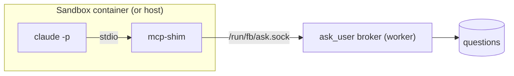

# Ask User MCP Server

The agent-facing half of HITL: how a headless CLI session asks a question, declares an artifact, or sets an outcome.

> [!check] Implemented 2026-10-18, for `run-agent` only
> The rest of this note is the PRD's design. What exists on `dev`:
> - **Shim**: `code/flowboard/packages/ask-user/`, a stdio MCP server named `flowboard` with two tools, `ask_user` and `ask_user_batch` (the agent sees `mcp__flowboard__ask_user`). `declare_artifact` and `set_outcome` are not built. It reads only `FLOWBOARD_ASK_SOCKET`: no `RUN_ID`, no database, no network.
> - **Broker**: `cli/src/ask/broker.ts`, inside `run-agent`, not a worker. It listens on `ask.sock` in the run's `/tmp/fb-*` folder and shows one batch at a time in the terminal, first in, first out. Since 2026-10-22 each batch is numbered and logged when it arrives. There is no `questions` table, Inbox, Slack or park.
> - **Mounting**: no `mcp.json` is written. Each adapter injects the server in memory: Claude through the Agent SDK's `mcpServers` with `strictMcpConfig`, OpenCode through its config's `mcp`. Both lift MCP time limits, so a question waits as long as it takes, and both pre-approve the server's tools; an explicit deny still wins (2026-10-22).
> - **Fallback**: the `questions.json` file protocol is not built; both built providers take an injected MCP server.
>
> Details: [[Run Agent CLI Decisions]], [[Claude Code Adapter]], [[OpenCode Adapter]].

## Two halves, one path

> [!quote] PRD §9
> *"Questions take **one path on every tier**, host or sandbox."*

| Half | Where it runs | Job |
|---|---|---|
| **Broker** | Inside the worker | *"the only writer of the `questions` table. For each run it opens a unix socket, `data/sock/<run_id>.sock`, which is bind-mounted into a sandbox as `/run/fb/ask.sock`."* |
| **Shim** | `apps/mcp-shim`, launched by the CLI | *"a tiny stdio MCP server … The runner writes a per-run `mcp.json` pointing at it and passes `RUN_ID` and the socket path as environment variables. The shim forwards each tool call over the socket and relays the reply. It never opens the database and needs no network."* |

> [!warning] The shipped code differs
> As built (2026-10-18), the shim is `code/flowboard/packages/ask-user/`, and the broker runs inside `run-agent` (`cli/src/ask/broker.ts`), not a worker; it writes no table. No `mcp.json` is written: `run-agent` passes the shim's command to the adapter as a `RunSpec.tools` entry, and the shim reads only `FLOWBOARD_ASK_SOCKET`, not `RUN_ID` ([[Run Agent CLI Decisions]] R18).

*"So a host run and a sandboxed run behave identically, and there is one path to test."* (PRD §9). `08-sandboxing.md`: *"decided, host-side broker on every tier."* PRD §11.1: *"the `ask_user` MCP server cannot open the host SQLite file. It doesn't need to: the shim talks to the host broker over the mounted socket (§9), never to the database or the network."* The architecture README strikes HITL-in-sandbox out of its open decisions: *"~~HITL-in-sandbox~~ (decided: host-side broker on every tier …)"*. The sandbox side is in [[Host-Side Brokers]] and [[Sandbox Mounts]].

> [!warning] Does the MCP side open the database?
> `02` §1 opens the DB *"via `VIBE_DB_PATH` so worker and MCP (foreign cwd) hit the same file"*, and backlog Story 1.1 says the same. That is the first build's design, and it contradicts PRD §3, §9 and `08`. See [[Human In The Loop Open Questions]] #37.
>
> The shipped shim (2026-10-18) follows the PRD: it opens no database and talks only to the broker's Unix socket.

The drawio *Harness architecture* labels this arrow **H**: *"A question goes shim → ask.sock → broker → questions → Inbox, and to Slack after 5 minutes. After 20 minutes the agent parks and resumes later with --resume."*

## The four tools

| Tool | Shape and behaviour (PRD §9) |
|---|---|
| `ask_user_batch(questions[])` | *"the preferred path. Inserts all questions with a shared `batch_id` and blocks until every required one is answered. Each question: `{ id, prompt, help?, kind, options?, required? }`. Returns `{ answers: { [id]: value } }`."* |
| `ask_user(question)` | *"single adaptive question, same blocking semantics."* |
| `declare_artifact({ type, path })` | *"registers an artifact."* |
| `set_outcome({ outcome, reason })` | *"sets `pass` or `fail` for conditional edges. Code review calls this."* |

Backlog Story 4.1 adds the environment: *"env `TASK_ID`, `STEP_INSTANCE_ID`, `RUN_ID`"*.

> [!warning] The shipped code differs
> Only `ask_user` and `ask_user_batch` are built (2026-10-18), with this question shape and return value. `checkQuestions` in `core/src/hitl/question.ts` refuses an empty batch, a repeated id, an empty prompt and a select kind without options. Nothing is inserted: `run-agent` numbers each batch in its run log ([[Run Agent CLI Decisions]] R36) and asks it in the terminal. The shim reads none of these variables, only `FLOWBOARD_ASK_SOCKET`.

## Keeping the tool reachable

- *"When `--allowedTools` is set, always append `mcp__vibe__*` so a restrictive list cannot lock out `ask_user`."* (PRD §7; Capability Library **D28**, [[Capability Library Decisions]]). Backlog Story 3.2 carries it as **PRD/FIX**. `03` §5 puts it in the Claude adapter (*"Always append `mcp__vibe__*` to `--allowedTools` so a restrictive list can't lock out `ask_user`"*); `agent-provider.ts` gives it to the runner (*"The runner always appends the ask-user tools so a restrictive list can't lock out HITL"*).
- Backlog Story 3.2 (**FIX**): *"Per‑run `mcp.json` pointing at `mcp/ask-user.ts` via `tsx --tsconfig …` (path aliases break when spawned from the worktree cwd)"*.
- `--strict-mcp-config` stops personal MCP config leaking into runs (PRD §7).
- The prompt's sixth part tells the agent to use `ask_user` (PRD §7). The drawio *Dual encoding* concept: *"The prompt says 'stay in scope, ask through ask_user'"*.

> [!warning] The shipped code differs
> The server is named `flowboard`, so the agent sees `mcp__flowboard__ask_user` and `mcp__flowboard__ask_user_batch`. Each adapter, not the runner, pre-approves every injected server, with or without an allow list (`mcp__flowboard__*` on Claude, `flowboard_*` on OpenCode); an explicit deny still wins (2026-10-22). No `mcp.json` and no `tsx`: Claude gets the shim as SDK `mcpServers` with `strictMcpConfig`, OpenCode as config `mcp`, and Node runs its `main.ts` by absolute path. See [[Claude Code Adapter]], [[OpenCode Adapter]] and [[Agent Providers Open Questions]] #4.

## The fallback: questions as a file

Without the `mcp_tools` capability, *"HITL uses the artifact-file fallback (agent writes questions.json, exits)"* (`agent-provider.ts`). `04` §9: "the engine watches the `produces:questions` path; when the agent writes it and exits, that *is* the batch. … So HITL genericizes to **"MCP where available, file protocol universal."**"

Under Capability Library **D1** (v1 is Claude-only) every v1 run has MCP. The second provider actually built, OpenCode, takes an injected MCP server too, so the fallback was not needed; whether OpenCode is in v1 is [[Agent Providers Open Questions]] #38. It would matter for a provider that cannot: `01-ports.md` says that if Codex can't take an injected `ask_user`, *"the artifact-file HITL fallback is mandatory, not optional."*

## Old build lessons

> [!bug] Backlog *What went wrong the first time*, item 5
> *"Undo window (10 s) was bolted onto the MCP tool: every answered batch now delays the agent 10 s, and parked resumes are delayed the same way. Not in the PRD."* Backlog decision D2's default recommendation (still open; Story 4.4 is tagged **DEC**): *"Drop from the MCP path; keep web-side undo only while no agent is waiting."* See [[Answering Rules]].

## Related

- [[Ask Park And Resume]]
- [[Human In The Loop Runtime]]
- [[Capability Runtime Mounting]]
- [[Step Guardrails]]
