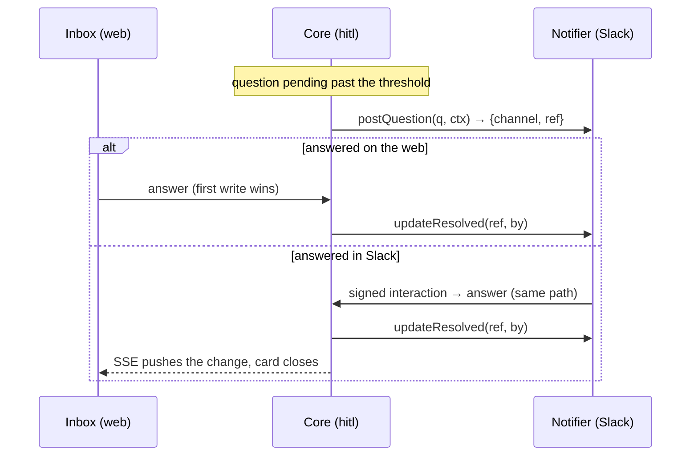

# Escalation To Chat

> **Escalate after a wait** — If a question isn't answered within a set time, it's posted to your chat tool with buttons to answer right there. — feature map §13

The full Notifier component has its own tracker row (*Escalation And Notifications*). This note covers the part the inbox depends on.

## The timer

| Rule | Source |
|---|---|
| *"When a question is inserted, enqueue an `escalate_question` job with `run_after = now + 5 minutes`. If the question is still `pending` when the job runs, post to Slack via `chat.postMessage` using Block Kit"* | PRD §10 |
| *"`escalate_question` at `now + settings.escalation_threshold_ms` (default 5 min); skip if answered or already posted."* | backlog Story 6.1 (`04` §10: *"skip if already answered or posted"*) |
| *"No token configured → log and continue (channel is optional)."* | `04` §10 (PRD §10: *"If the token is absent, log the escalation and carry on — Slack is optional."*) |
| The threshold is a setting: *"escalation threshold (minutes)"*; feature map §19 *"Nudge timing"* | `06` §15, backlog Story 8.3 |

> [!warning] 5 or 10 minutes?
> Every written source says 5 minutes: PRD §10, §14 M6, §16, `04` §10, backlog Story 6.1, the drawio (*"Escalate after 5 min"*, *"escalate at 5 min"*) and the old brief. The inbox mockup uses 10 (`ESCALATE = 10 * MIN`, status bar *"escalation after 10m"*, guide *"Ten minutes without an answer…"*), and so does the monitor mockup. See [[Human In The Loop Open Questions]] #18.

## What the inbox shows

| Waiting time | Card meta (mockup) |
|---|---|
| Below *threshold − 3 min* | `waited 5m 00s` (no chip) |
| In the last 3 minutes | `escalates in 2m 14s · waited …` (grey chip): *"still only here"* |
| Past the threshold | `escalated · waited …` (amber chip): *"also in chat now"* |

The topbar count reads `4 waiting · 2 escalated`. The status bar: *"escalation after 10m · answers sync both ways with chat"*.

The old handoff used colour: *"`#8b8b93` under 2 minutes, amber `#fbbf24` from 2 minutes, and past the threshold … the batch border goes amber-dark and the escalated chip appears"*, and *"Batches past the escalation threshold collapse by default."* Its batch header showed *"`→ Slack in 0m 48s`"*. See Open Questions #23.

## How each kind renders in Slack

| Kind | Block Kit (PRD §10) |
|---|---|
| `yes_no`, `single_select` | *"an `actions` block of buttons, one per option"* |
| `multi_select` | *"a `multi_static_select`"* |
| `text`, `number` | *"a button that opens a modal with a `plain_text_input`"* |

Message content: *"Include the task title and question text in the Slack message, but not artifact bodies or file contents."* (PRD §10). `04` §10: *"Never include artifact bodies or file contents in a notification — only task title + question text"*.

## Both directions

> [!quote] PRD §10 — **Reconciliation**
> *"Answering in Slack must update the open web page (the inbox subscribes to an SSE stream). Answering on the web must repaint the Slack message via `chat.update` to show it is resolved and by whom."*



The guide's two endings: *"Answer here and the chat message updates to show it's handled. Answer in chat and the card closes here."* The walkthrough's chat message reads *"handled by you · just now"*. The mockup's toast reads *"dana answered pdf-import · plan in chat — it's closed here too"*; the guide's walkthrough uses `provider-codex · research`.

## Security

*"Handle interactions at `POST /api/slack/interactions` (verify the signing secret)."* (PRD §10). Backlog Story 6.2: *"v0 HMAC on the raw body, 300 s replay window, `timingSafeEqual`."* `04` §10: *"Security stays in the adapter."* Config: `SLACK_BOT_TOKEN`, `SLACK_SIGNING_SECRET`, `SLACK_CHANNEL_ID` in `.env.local` (PRD §10).

> [!warning] HTTP or Socket Mode?
> The drawio *Harness architecture* has *"Slack Socket Mode + Block Kit, so no public URL"* and *"Socket Mode WebSocket, outbound only"*. That conflicts with the PRD's inbound HTTP endpoint. The drawio's other pages keep an HTTP-style check (*"Signature check on Slack interactions"*, *"Verify inbound / signature check on interactions"*), so the drawio disagrees with itself. See Open Questions #21.

## The Notifier port

```ts
export interface Notifier {
  readonly id: string;
  /** `inline_answer` renders native controls; `link_only` sends a deep link to /inbox. */
  readonly capabilities: ReadonlySet<'inline_answer' | 'link_only'>;
  postQuestion(q: Question, ctx: QuestionContext): Promise<PostedRef>;
  updateResolved(ref: PostedRef, by: string): Promise<void>;
}
```

(`docs/old/reference/core/ports/notifier.ts`). *"Reconciliation (first-write-wins, repaint on answer/undo) is channel-independent and lives in core/hitl; the adapter only renders and verifies signatures."* `07-ports-in-practice.md` shows a `ConsoleNotifier` (`link_only`) and the escalation call site. `link_only` channels *"skip rich UI entirely — the message is a deep link to `/inbox`. New channels cost an adapter, not a bespoke interactive UI each."* (`04` §10).

## Ideas

- **Nudge the right person**: *"escalate a waiting question to the assigned teammate's own DM instead of one shared channel."* (feature map §13)
- **An escalation ladder**: *"if they don't answer in time, bump it up to their backup or lead (an SLA-style hop, reusing the existing nudge timer)."* (feature map §13)
- **More than one channel**: *"chat, email, or other channels can all plug in"* (feature map §13); *"Slack today → Discord, email, webhook, desktop tomorrow"* (drawio).

## Related

- [[Answering Rules]]
- [[Question Lifecycle]]
- [[Human In The Loop Runtime]]
- [[Human In The Loop API And Routes]]
