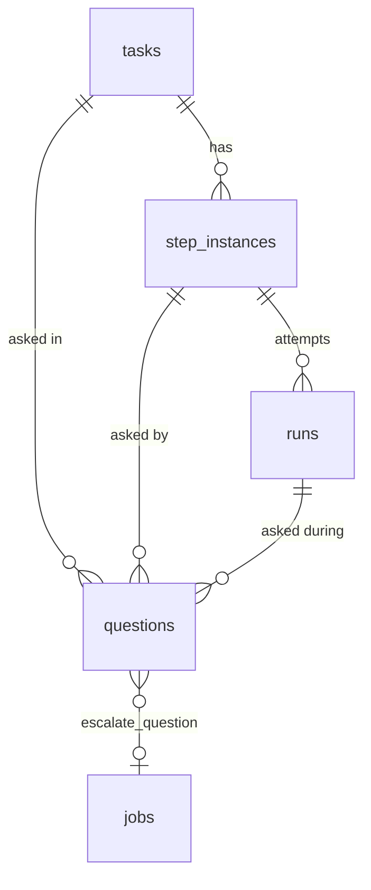

# Human In The Loop Data Model

## `questions` (PRD §5)

```sql
CREATE TABLE questions (
  id               TEXT PRIMARY KEY,
  task_id          TEXT NOT NULL REFERENCES tasks(id) ON DELETE CASCADE,
  step_instance_id TEXT REFERENCES step_instances(id),
  run_id           TEXT REFERENCES runs(id),
  batch_id         TEXT,            -- groups questions asked together
  prompt           TEXT NOT NULL,
  help             TEXT,
  kind             TEXT NOT NULL,   -- 'yes_no'|'single_select'|'multi_select'|'text'|'number'
  options          TEXT,            -- JSON array of {value,label} for select kinds
  required         INTEGER NOT NULL DEFAULT 1,
  state            TEXT NOT NULL,   -- 'pending'|'answered'|'expired'|'cancelled'
  answer           TEXT,            -- JSON
  answered_at      INTEGER,
  answered_via     TEXT,            -- 'web'|'slack'
  escalated_at     INTEGER,
  slack_channel    TEXT,
  slack_ts         TEXT,
  created_at       INTEGER NOT NULL
);
CREATE INDEX questions_pending ON questions(state, created_at);
```

## Columns elsewhere that HITL reads or writes

| Table.column | Values | HITL use | Source |
|---|---|---|---|
| `step_defs.advance_mode` | `'auto' \| 'approval'` | Makes a step a gate | PRD §5 |
| `step_defs.max_attempts` | default 3 | Spent loop → escalation gate | PRD §5, §8 |
| `step_instances.state` | `… 'awaiting_answers' \| 'awaiting_approval' …` | The two waiting states | PRD §5 |
| `step_instances.outcome` | `'pass' \| 'fail' \| null` | Approve sets pass, reject sets fail; null with conditional edges → gate | PRD §5, §8 |
| `step_instances.reason` | text | *"rejection/failure text shown on the card"* | backlog Story 1.1, `02` §1 (not in PRD §5) |
| `runs.state` | `… 'parked' …` | A run that exited to wait | PRD §5, §9 |
| `runs.claude_session_id` | uuid | What a resume continues | PRD §5, §9 |
| `runs.fingerprint` | hash | Stuck-loop detection | PRD §5, §8 |
| `runs.wasted` | 0/1 | Send-back and retry spend | PRD §5 |
| `tasks.status` | `… 'blocked' …` | Escalated loop; non-transient failure; park (backlog 4.2) | PRD §5, §7, §8 |
| `jobs.kind` | `'escalate_question'`, `'start_run'` | Escalation timer; resume | PRD §5 |
| `settings` | `escalation_threshold_ms` (default 5 min) | Chat escalation | `04` §10, backlog Story 6.1 |
| `artifacts.type` | `questions`, `answers` | Seeded artifact types | PRD §6 |

Backlog Story 1.1 also asks: *"`jobs.kind` includes `resume_step` (or drop it, see 4.4)."* (**DEC**). See [[Human In The Loop Open Questions]] #7.

## Relationships



## The question in code

`Question` (`core/hitl/question.ts`) is the row minus storage fields: `{ id, prompt, help?, kind, options?, required? }`. `QuestionContext` (`core/ports/notifier.ts`) adds `taskTitle`, `stepName` and `sessionUrl?` for a channel. The old handoff's client state: `Question = { id, type, text, help?, options?, askedAt, status: 'open'|'answered'|'collapsed', answer?, answeredVia?: 'ui'|'slack' }`.

## Proposed additions

> [!warning] Proposal — not in any source schema
> Each item is listed in [[Human In The Loop Open Questions]].

| Field | Why | OQ |
|---|---|---|
| `questions.default` (JSON), `questions.unit`, `questions.placeholder`, `questions.min` / `max` | The mockup's number default and unit, text placeholder; the old handoff's range hint | #12 |
| `questions.summary` | The card's one-line `sum` for a batch or lone question | #12 |
| `questions.answered_by` (+ an assignee on the item) | *Waiting on me / Everyone*, *"dana answered"*, PRD's *"resolved and by whom"* | #4 |
| `step_instances.escalated_at`, `notify_channel`, `notify_ref` | If gates and failures escalate to chat as the mockup shows | #19 |
| Generic `notify_channel` / `notify_ref` instead of `slack_channel` / `slack_ts` | The Notifier port's `PostedRef { channel, ref }` is channel-neutral | #22 |

## Related

- [[Questions]]
- [[Human In The Loop Storage]]
- [[Question Lifecycle]]
- [[Flow Data Model]]
