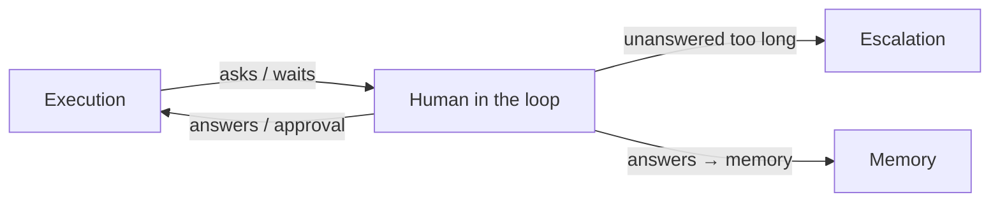

# Human In The Loop Overview

> *Agents run unattended until they need a human. Everything that needs one lands here.* — inbox guide

## What it is for

FlowBoard runs headless agents. A headless agent has no terminal to ask into, so it needs a protocol for stopping, asking a person something, and carrying on with the answer. Human In The Loop (HITL) is that protocol plus the screen where you answer. It covers four things (drawio *Functional components*, group *Human in the loop*):

| Card | What it covers |
|---|---|
| *Answer questions* | *yes/no · select · multi · text · number* — see [[Question Shapes]] |
| *Work a batch* | *5–8 questions from one step, as a group* — see [[Question Batches]] |
| *Approve / reject a step* | the approval gate — see [[Approving And Sending Back]] |
| *Answer from Slack* | *resolves the inbox card* — see [[Escalation To Chat]] |

The PRD calls the inbox *"the most important screen in the app"* and says *"this is the screen I will spend the most time on"* (§10). The old design brief: *"An agent mid-run has stopped and needs an answer to continue, so latency here directly costs money and wall-clock time."*

## Where it sits

These are the drawio *Functional components* edges. On the *Logical components* page the inbox UI calls the **Question service** (*ask · park · resume · answer*). The MCP ask tool feeds it (*ask*), it hands answers to the flow engine (*answers → resume*), and it escalates through the **Notifier** port (*escalate at 5 min*).

The architecture names HITL as one of FlowBoard's three halves: *"a durable workflow engine + human-in-the-loop protocol + cost ledger"* (`docs/old/architecture/README.md`). Component #9 is the HITL protocol and #10 is the Notifier (`04-hitl-and-notify.md`).

## The central reframe

> [!important] The protocol is a file exchange; MCP is sugar
> *"agent emits a `questions` artifact → engine **parks** the run → human answers → engine **resumes** with an `answers` artifact in context."* MCP `ask_user` / `ask_user_batch` *"is sugar that makes this feel synchronous"*. Park and resume are *"the durable primitive"* (`04-hitl-and-notify.md` §9). See [[Ask Park And Resume]] and [[Ask User MCP Server]].

## Design principles

| Principle | Source wording |
|---|---|
| One inbox for every stop | *"Every stop (gate, question, spent or stuck loop) lands in one inbox, then Slack. Your call overrides the agent's."* (drawio *Harness architecture*, concept 8 *Human escalation*) |
| Empty it without the mouse | *"you should be able to empty it without touching the mouse — so one card is open at a time, the number keys always mean the thing in front of you, and answering closes the card and opens the next."* (inbox guide) |
| Ask in a few fixed shapes | *"Agents can only ask in these five shapes, and the same shape looks and behaves the same everywhere you might answer it"* (inbox guide). *"One JSON shape … drives three renderers with zero divergence"* (`04` §9) |
| Batch, don't drip | *"Answering seven questions in one screen is better than a drip feed, and it avoids the blocking problem entirely for most steps."* (PRD §9) |
| Waiting costs time, not money | *"a parked run is not billing you."* (inbox guide) |
| Never hang | *"This is more robust than trying to hold a session alive for hours."* (PRD §9) |
| Answer anywhere, first wins | *"whoever answers first wins"* (feature map §13); *"Idempotent answers. First write wins."* (PRD §10) |
| The queue picks the order | *"the queue decides the order, you decide the answers."* (inbox guide walkthrough) |
| Silence isn't success | *"A missing outcome is never a pass."* (PRD §8) — the step stops at a gate and asks you |
| Your call wins | *"If you approve or reject a step, your decision overrides whatever the agent concluded"* (feature map §4) |

## What you decide, and what it costs

| Decision | Cost | Source |
|---|---|---|
| Answer a question or a batch | Nothing | inbox guide card table |
| Approve a gate | *"Approving is free"*: the next step queues | inbox guide, monitor guide |
| Send a gate back | *"moves the last attempt's spend to wasted"* | inbox guide |
| Retry a failure | *"The failed attempts are already spent. Retrying spends again."* | inbox guide |

## Scope boundaries

- Defining which steps gate is Flow Design's job: [[Approval Gates]].
- The run, the engine and the rework loop are Execution. This set covers only the points where they stop for you.
- Chat escalation is partly here ([[Escalation To Chat]]). The tracker suggests folding *Escalation And Notifications* into this set.

## Related

- [[Human In The Loop Index]]
- [[Human In The Loop Glossary]]
- [[Ask Park And Resume]]
- [[Human In The Loop Screen]]
