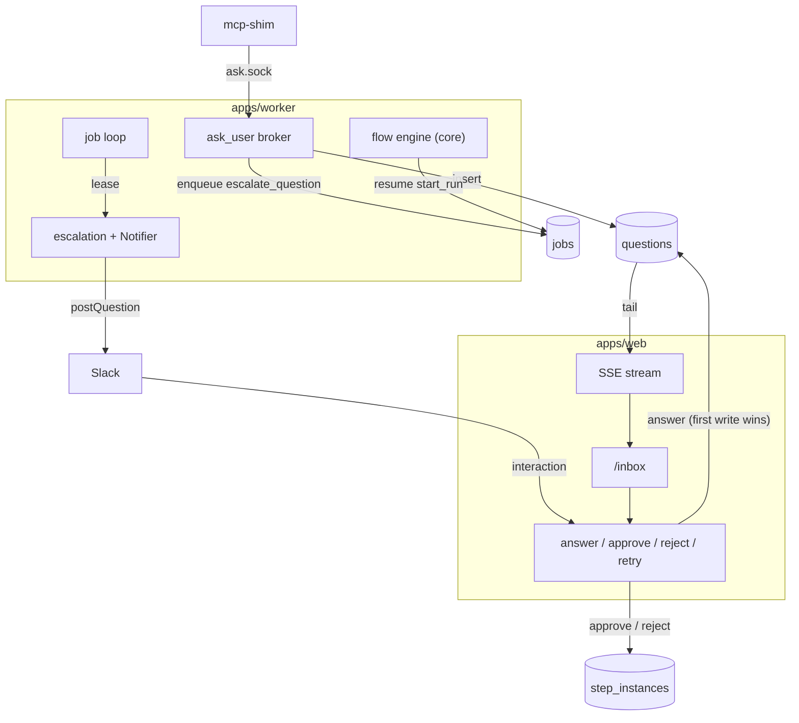

# Human In The Loop Runtime

Where each HITL responsibility lives in the two-process design.

## Placement

| Piece | Lives in | Source |
|---|---|---|
| Question schema, reconciliation rules | `packages/core` → `core/hitl` (*"question protocol, park/resume"*) | architecture README module layout; `notifier.ts` (PRD §3's `core` lists no `hitl/`) |
| Advancement: gates, no-outcome, escalation | `packages/core/engine` | PRD §3, `02` §3 |
| Notifier interface | `core/ports` | PRD §3, `01-ports.md` |
| Slack adapter | `packages/adapters/notify` (`notify/slack/`) | PRD §3, architecture README |
| `ask_user` broker, escalation timer | `apps/worker` (*"job loop, runner, ask_user broker, escalation timer"*) | PRD §3 |
| MCP shim | `apps/mcp-shim` | PRD §3, §9 |
| `/inbox`, SSE, answer routes | `apps/web` (*"Calls core; holds no rules"*) | PRD §3 |

The dependency rule: *"the domain (flow engine, board projection, question protocol, cost ledger) depends only on **ports**"* (architecture README). *"Only `apps/web` and `apps/worker` open the SQLite file; the MCP shim never does"* (PRD §3).

The drawio *Logical components* page draws a **Question service** in core (*"ask · park · resume · answer"*). Edges: *MCP ask tool → Question service* (*ask*), *Question service → Notifier* (*escalate at 5 min*), *Question service → Flow engine* (*answers → resume*), *Inbox → Question service*.

## The paths through the system



## The jobs

| Job | Enqueued when | Does | Source |
|---|---|---|---|
| `escalate_question` | A question is inserted, `run_after = now + threshold` | Posts it if still pending and not already posted | PRD §10, `04` §10 |
| `start_run` (resume) | The last required answer arrives for a parked run | `--resume <session> --fork-session` + the answers | PRD §9 |
| `advance_task` | Approve, or a step done | Resolves outgoing edges | PRD §8 |

## Escalation call site

From `07-ports-in-practice.md`:

```ts
async function escalate(notifier: Notifier, q: Question, ctx: QuestionContext) {
  if (await isAnswered(q.id)) return;                 // skip if already answered
  const posted = await notifier.postQuestion(q, ctx); // Slack | Discord | Console | …
  await saveRef(q.id, posted);                        // slack_channel + slack_ts equivalent
}
// on web answer OR channel answer, the SAME idempotent path repaints the other side:
async function onAnswered(notifier: Notifier, q: Question, by: string) {
  const ref = await loadRef(q.id);
  if (ref) await notifier.updateResolved(ref, by);
}
```

## Correctness items from the old build

| Item | Tag | Source |
|---|---|---|
| Answer arriving while the process exits must resume, not be lost | **BUG** | backlog Story 4.2 |
| Resume prompt repeats requires/produces paths | **BUG** | backlog Story 3.2 |
| Cancel a step's pending questions on run failure | **BUG** | backlog Story 3.2, `04` §9 |
| Return only when every required answer is present; ignore null values | **FIX** | backlog Story 4.1 |
| Undo delay lived inside the MCP tool | lesson | backlog *What went wrong*, item 5 |
| Three overlapping pollers → one stream | **BUG (perf)** | backlog Story 4.3 |
| Restart recovery: re-attach by pid | **BUG** | backlog Story 3.3 |
| Slack never run against a real workspace | **GAP** | backlog Story 6.3 |

## Testing

- *"Verify end to end with a trivial skill that asks three questions of different kinds."* (PRD §14 M4). That skill is `ask-three`, a test fixture (Capability Library **D30**).
- `ReplayProvider`: *"Every engine, park/resume, and cost test runs deterministic and zero-spend."* (`01-ports.md`)
- Backlog Story 0.2: a fake-`claude` integration lane *"so runner/park/resume can be tested without spend"*, and a Playwright lane including *"inbox keyboard"*.
- Backlog Story 6.3: *"Unit tests (signature, shapes, idempotency, modal) exist; run once against a real workspace — never done."*

## Related

- [[Ask User MCP Server]]
- [[Ask Park And Resume]]
- [[Escalation To Chat]]
- [[Human In The Loop API And Routes]]
