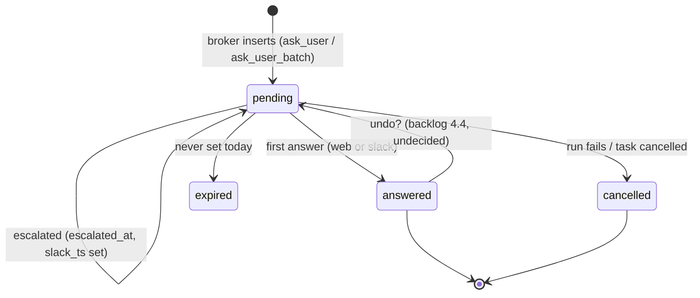

# Question Lifecycle

A question has four states, and the step and run around it move in step with them.

## The question

`questions.state`: `'pending'|'answered'|'expired'|'cancelled'` (PRD §5).

| Transition | Rule | Source |
|---|---|---|
| → `pending` | The broker inserts the row; for a batch all rows share a `batch_id` | PRD §9 |
| escalate | *"When a question is inserted, enqueue an `escalate_question` job with `run_after = now + 5 minutes`. If the question is still `pending` when the job runs, post to Slack"*. The question stays `pending` | PRD §10 |
| → `answered` | *"First write wins via a conditional UPDATE"*; set `answer`, `answered_at`, `answered_via` | backlog Story 6.2, PRD §10 |
| → `cancelled` | *"On any run failure, cancel that step's pending questions so they stop escalating."* Task cancel: *"SIGTERM live runs, cancel pending questions, mark instances skipped."* | `04` §9, backlog Story 2.1 |
| → `expired` | *"Either use `questions.state='expired'` or remove it. Today it is never set."* (**BUG**) | backlog Story 1.1 |
| `answered` → `pending` | `POST /api/questions/:id/unanswer` + `chat.update` on undo (**NEW**), if the undo window is kept | backlog Story 4.4 |

## The step instance and the run

| Moment | Step instance | Run | Task | Source |
|---|---|---|---|---|
| Agent asks, call blocked | `running` | `running` | `running` | PRD §9 (implied: the call is held open) |
| 20 min, no answer → park | `awaiting_answers` | `parked` | `blocked` per backlog 4.2 | PRD §9, backlog Story 4.2 |
| Run exits 0 with required questions still unanswered | `awaiting_answers` | `parked` (backlog 4.2); §8 words it *"after a run succeeds"* | `blocked` per backlog 4.2 | PRD §8, backlog Story 4.2 |
| Last required answer arrives | — | new `start_run` (resume) | — | PRD §9 |
| Run fails | — | `failed` | `blocked` (non-transient) | PRD §7 |

> [!warning] Is the task `blocked` while you answer?
> Backlog Story 4.2 marks the task `blocked` on park. The PRD sets `blocked` only for spent or stuck loops (§8) and non-transient run failures (§7). The board shows awaiting answers as a step-level state dot (*"running / awaiting answers / awaiting approval / failed"*, PRD §13). See [[Human In The Loop Open Questions]] #6.

## What the inbox does with each state

| State | Inbox | Source |
|---|---|---|
| `pending` | A card in the queue, with elapsed time ticking | inbox mockup |
| `pending`, near the threshold | `escalates in Xm Ys` (shown in the last 3 minutes) | inbox mockup `soon` |
| `pending`, escalated | `escalated` chip; also in chat | inbox mockup |
| `answered` here | The card fades out (200 ms) and the next card opens; the answer joins *recently answered* | inbox mockup `resolve()` |
| `answered` elsewhere | The card closes; *"your cursor did not move"*; a toast names who answered and where | inbox guide walkthrough |
| `cancelled` / `expired` | Not shown in any source | — |

The old design handoff showed answered-elsewhere differently. The controls swapped in place for *"Yes — answered in Slack"* plus an `undo` link. *"After 10s the row becomes one line"*, and *"resolution never moves the row the developer is currently on, and never re-sorts the batch."* Backlog Story 4.3: *"Answered-elsewhere row swaps in place, collapses after the window."*

## Related

- [[Questions]]
- [[Ask Park And Resume]]
- [[Answering Rules]]
- [[Escalation To Chat]]
