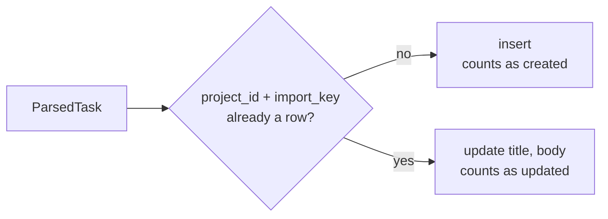

# Idempotent Upsert

How parsed tasks become rows without duplicates.

> *"The import endpoint upserts on `(project_id, import_key)` so re-importing an edited file updates existing tasks instead of duplicating them."* — PRD §15
>
> *"Idempotent upsert on `(project_id, import_key)`; re‑import twice = 0 created, N updated."* — backlog 7.3 (**PRD**)

## The acceptance test

Every source states the same test:

| Source | Wording |
|---|---|
| PRD §16 | *"Importing a markdown backlog twice produces no duplicates and picks up edits"* |
| backlog 10.1 | *"Import twice → no duplicates, edits picked up (both file shapes)."* |
| `01-ports.md` | *"re-import twice = 0 created, N updated."* |
| `05` §14 | *"re-import twice = 0 created, N updated is the *acceptance test* for the whole port — make it a scripted check over both file shapes, since this is the feature that broke repeatedly."* |
| `07-ports-in-practice.md` | *"idempotent upsert — re-import twice = 0 created, N updated (the whole acceptance test)"* |

See [[Intake Testing]].

## The write

From `07-ports-in-practice.md`:

```ts
for (const t of tasks) {
  db.insert(schema.tasks)
    .values({ projectId, importKey: t.import_key, title: t.title, body: t.body, /* … */ })
    .onConflictDoUpdate({ target: [schema.tasks.projectId, schema.tasks.importKey], set: { title: t.title, body: t.body } });
}
```

The conflict target is the table's `UNIQUE (project_id, import_key)` (PRD §5). `05` §14: *"Composes with: upserts into the domain model ([02 §1])"*.



## What the snippet leaves open

> [!question] Gaps in the write
> - **Which fields update.** `07` sets `title` and `body` only. The PRD's importer also returns `acceptance_criteria` and `non_goals`. ([[Intake And Import Open Questions]] #7)
> - **New rows' status.** The `/* … */` hides `status`, `id`, `created_at`, `updated_at`. That a new import lands in `backlog` is an inference from PRD §1 (*"A task enters the Backlog"*) and `tasks.flow_id` being *"null while in backlog"*. ([[Intake And Import Open Questions]] #6)
> - **Tasks already moving.** Nothing says whether a re-import may rewrite the title and body of a task that is `todo`, `running` or `done`. Prompt part 1 reads them on every run (PRD §7). ([[Intake And Import Open Questions]] #6)
> - **Removed entries.** No source deletes, archives or flags a task that is no longer in the file. ([[Intake And Import Open Questions]] #5)
> - **Counts.** *"0 created, N updated"* needs the write to tell an insert from an update; the snippet does not. ([[Intake And Import Open Questions]] #9)
> - **One transaction?** Not stated.

## Hand-made tasks

A task made with `POST /api/tasks` has no `import_key` (nothing sets it), so an import never matches it. SQLite lets many rows share a `NULL` in a `UNIQUE` column, so hand-made tasks never collide with each other. Importing an item you already typed in by hand gives two tasks. ([[Intake And Import Open Questions]] #13)

## Related

- [[Intake And Import Index]]
- [[Import Key]]
- [[Import Job Lifecycle]]
- [[Intake Data Model]]
- [[Intake Testing]]
