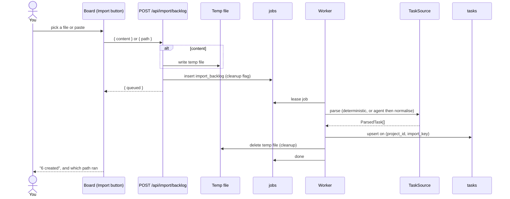

# Import Job Lifecycle

One import, from the click to *"6 created"*.

> *"`POST /api/import/backlog` accepts `path` (server file) or `content` (browser); `content` goes to a temp file, enqueues `import_backlog` with `cleanup`, returns `{queued}`; worker deletes the temp file."* — backlog 7.3 (**NEW (uncommitted)**)

## Why it is a job

The first build tried three designs: *"sync parser → sync agent inside the request → async job with temp file"* (backlog, *What went wrong*, item 2). The third stuck, and it matches the PRD's process rule: *"Next.js route handlers must never spawn a long-lived child process; they enqueue jobs and the worker picks them up"* (PRD §2). `import_backlog` is one of the four job kinds (PRD §5 `jobs.kind`) and appears in the drawio *Harness architecture* job loop: *"start_run, advance_task, escalate_question, import_backlog"*.

## Sequence

Assembled from backlog 7.3, `05` §14 and PRD §5, §7. The sources give the route's half in order (temp file, enqueue, `{queued}`) and say only that the *"worker deletes the temp file"*. The worker's order (lease, parse, upsert, delete, done) is this set's inference. How the board learns the result is not specified.

## Statuses the user sees

Feature map §17: *"The import reports its status (queued → running → "6 created") so you're not left guessing."* Backlog 7.3 (**NEW/GAP**): *"Board button: file picker + paste, busy state, toast; show job progress/result (queued → running → "6 created") so the user is not left guessing."* `05` §14: *"the board's Import button shows job progress (queued → running → "6 created") so the user isn't guessing."*

| Shown | Likely job state (PRD §5 `jobs.state`) |
|---|---|
| queued | `queued` |
| running | `leased` |
| "6 created" | `done` |
| (failure) | `failed`, with `last_error` |

The mapping is a **proposal** ([[Intake And Import Open Questions]] #9): the PRD's job states are `queued`, `leased`, `done`, `failed`, and none of the sources pairs them with the UI words. The `jobs` table has no column for a result such as *"6 created"* or *which path ran*. See [[Intake And Import Open Questions]] #9.

## The job

| Field | Value | Source |
|---|---|---|
| `kind` | `import_backlog` | PRD §5 |
| `payload` | includes `cleanup` when the input was pasted | backlog 7.3 |
| leasing | *"`UPDATE ... SET state='leased' WHERE id = (SELECT ...)` inside a transaction, with a stale-lease reclaim after 10 minutes"* | PRD §7 |

No source gives the rest of the payload. **Proposal:** `{ projectId, path, cleanup }`. See [[Intake Data Model]] and [[Job Queue]].

## Failure

- Agent path fails → *"fall back to the parser on any failure and **report which path ran**"* (backlog 7.3).
- The job itself fails → not specified. Whether the temp file is deleted before a retry, so the retry has nothing to read, is not stated ([[Intake And Import Open Questions]] #11).

## Related

- [[Intake And Import Index]]
- [[Intake API And Routes]]
- [[Idempotent Upsert]]
- [[Backlog Importer Agent]]
- [[Intake In The UI]]
- [[Job Queue]]
