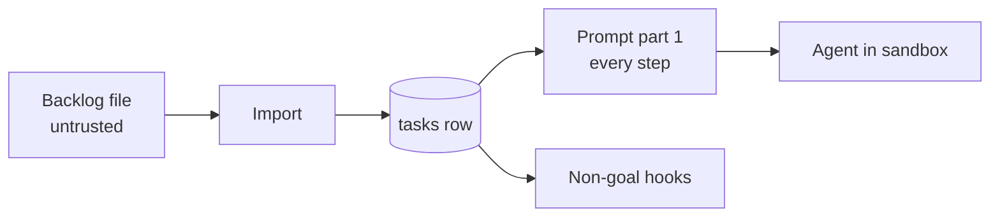

# Import Trust And Isolation

A backlog file is untrusted input, and its text ends up in every prompt the task's agents read.

> *"Those agents then read **untrusted content**: repo files, web pages, the backlog markdown, issue/PR text, prior artifacts. Any of it can carry a **prompt injection** that redirects the agent to exfiltrate secrets, corrupt the repo, or run arbitrary commands."* — `08-sandboxing.md`, *Why — the threat model*

PRD §11.1 lists *"the backlog"* among the untrusted content a `bypassPermissions` agent reads.

## Where imported text goes

Prompt part 1: *"A short preamble naming the task, its title and body, its acceptance criteria ("the task is done when…") and its non-goals ("do not touch…")."* (PRD §7). So title, body, acceptance criteria and non-goals reach every step of the task. Non-goals also drive a hook: the per-run `PreToolUse` hook denies *"any path matching a line of the task's `non_goals` that is written as a path or glob"* (PRD §7).

## Controls the sources name

| Control | Source |
|---|---|
| The deterministic parser runs no model at all | backlog 7.3, D6 |
| The importer agent gets no tools: *"haiku, `--tools ""`"* | backlog 7.3 (**FIX**) |
| *"Isolate the importer from global hooks (see 0.1)."* | backlog 7.3 (**BUG**) |
| The key is never taken from the agent | backlog 7.3, `05` §14 |
| Every route validates with zod | PRD §12: *"All handlers are thin: validate with zod, call a function in `packages/core`, return JSON."* |
| Agents downstream run in a sandbox with an egress allowlist | PRD §11.1, `08-sandboxing.md` |
| *Injection scan (later)*: *"LLM Guard over artifacts before the next step or memory trusts them"* | drawio *Harness architecture* |
| *Check for hidden manipulation*: *"scan the files agents produce (and the untrusted things they read) for prompt-injection before the next step trusts them"* | feature map parking lot |

## Gaps

- **`path` reads any server file.** `POST /api/import/backlog` accepts *"`path` (server file)"* (backlog 7.3). No source limits which paths. FlowBoard is single-user and local (PRD §1), so the caller is the operator, but nothing says so for this route. ([[Intake And Import Open Questions]] #8)
- **Where the importer agent runs.** Not stated: host or sandbox, through the [[TaskSource Port]] or the AgentProvider port. ([[Intake And Import Open Questions]] #12)
- **No scan at import.** The injection scan is *later* and aimed at artifacts. Nothing scans a backlog file before its text enters prompts.

## Related

- [[Intake And Import Index]]
- [[Backlog Importer Agent]]
- [[Import Job Lifecycle]]
- [[Intake And Import Open Questions]]
