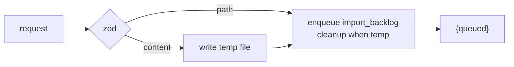

# Intake API And Routes

PRD §12: *"REST route handlers under `apps/web/app/api/`. All handlers are thin: validate with zod, call a function in `packages/core`, return JSON."*

## Routes

| Method | Path | Does | Source |
|---|---|---|---|
| `POST` | `/api/import/backlog` | *"md file -> tasks"*; accepts `path` or `content`, returns `{queued}` | PRD §12; backlog 7.3 |
| `POST` | `/api/tasks` | create a task | PRD §12; backlog 2.1 |
| `GET` | `/api/tasks?project=&status=` | list tasks, e.g. a project's backlog | PRD §12; backlog 2.1 |
| `GET` | `/api/tasks/:id` | one task | backlog 2.1 (not in PRD §12) |
| `POST` | `/api/tasks/:id/promote` | *"backlog -> todo, pin flow, create worktree"* | PRD §12 |
| `POST` | `/api/tasks/:id/start` | todo → running; *"the code added `POST /api/tasks/:id/start` with no button until 2026‑09‑09 (still uncommitted)"* | backlog, *What went wrong*, item 3 (not in PRD §12) |
| `GET` | `/api/projects/:id/board` | *"board projection: columns + cards"*, where the Backlog and Todo columns are read | PRD §12 |
| `POST` | `/api/projects` | create a project | PRD §12 |

Not listed anywhere: a demote route, an edit route (`PATCH /api/tasks/:id`), a delete route, and a route to read an import's progress.

## `POST /api/import/backlog`

Body, from backlog 7.3 and `SourceInput`: `path` (*"server file"*) or `content` (*"browser"*). The route takes no project id in its path, and no source names the body field for it. **Proposal:** `{ projectId, path?, content? }`, exactly one of `path` and `content`. See [[Intake And Import Open Questions]] #8 and [[Projects Open Questions]] #25, which proposes the same `projectId`.

Response: `{queued}` (backlog 7.3, `05` §14). How the client follows progress is not specified (#9).

## `POST /api/tasks/:id/promote`

See [[Promoting A Task]]. No source lists its errors. **Proposal:** refuse when the task is not in `backlog`, when the project has no flow to pin, and when `git worktree add` fails (#14).

## Related

- [[Intake And Import Index]]
- [[Import Job Lifecycle]]
- [[Execution API And Routes]]
- [[Task Detail API And Routes]]
- [[Intake Data Model]]
