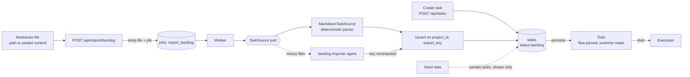

# Intake And Import Overview

> *"Bring an existing backlog into FlowBoard from a document — and, later, from tools like GitHub or Linear."* — feature map §17

Intake And Import is how work gets into FlowBoard before any agent touches it. It has four parts, named on the drawio *Functional components* page under **Intake**:

| Card | Subtitle | Note |
|---|---|---|
| Import backlog | *"markdown headings + bullets → tasks"* | [[Markdown Task Source]], [[Import Job Lifecycle]] |
| Create / edit task | — | [[Creating A Task]] |
| Promote Backlog → Todo | *"the only drag that means anything"* | [[Promoting A Task]] |
| Seed project | *"default flow + sample tasks"* | [[Seed Data]] |

Behind the import sits architecture component **#14, *Ingestion → TaskSource port*** (`docs/old/architecture/README.md`, `05` §14). TaskSource is one of the *"five ports that carry the whole program"*: *"markdown import"* today, *"GitHub Issues, Linear, Jira, webhook"* later (architecture README).

## Place in the system

Drawn from PRD §5, §12, §15; backlog Story 7.3; `05` §14; drawio *Logical components* (edge *TaskSource → Task & run state*, labelled *"import tasks"*) and *Functional components* (edge *Intake → Execution*, labelled *"tasks"*). That imported and created tasks land in `backlog` is an inference; see [[Intake And Import Open Questions]] #6. Only the drawio seeds tasks ([[Intake And Import Open Questions]] #19).

What it hands on:

- **To [[Execution Index|Execution]]**: tasks, through promote and Start. See [[Starting A Task]].
- **To [[Task Detail Index|Task Detail]]**: the task record (title, body, acceptance criteria, non-goals). See [[Task Record]].
- **To [[Flow Design Index|Flow Design]]**: nothing directly, but promotion pins a flow version. See [[Version Pinning]].

## Design principles

The sources state these rules in their own words.

1. **One parser contract.** *"A deterministic parser handles both shapes — `##` heading = task, and heading-as-category with `- **Title** …` bullets = tasks. The agent path exists for genuinely messy files only, and its output is normalized through the *same* function."* (`05` §14). Decision D6: *"Deterministic parser supports headings **and** bullets; agent optional"* (backlog).
2. **The server owns the key.** *"Server-derived `import_key`. `frontmatter/inline id` → else `slugify(title)`. **Never trust the agent's key** — it drifted between runs"* (`05` §14). See [[Import Key]].
3. **Re-import is safe.** *"Re-importing an edited file updates the existing tasks instead of making copies, because each task gets a stable identity worked out the same way every time."* (feature map §17). See [[Idempotent Upsert]].
4. **Show progress.** *"The import reports its status (queued → running → "6 created") so you're not left guessing."* (feature map §17).
5. **Routes stay thin.** Import is a job the worker runs, not work inside the request: `content` *"goes to a temp file, enqueues `import_backlog` with `cleanup`, returns `{queued}`"* (backlog 7.3). The drawio *Harness architecture* puts it the same way for every route: *"zod-validated input → write rows → enqueue a job → return"*.
6. **The backlog is free.** *"The task exists and has a title, and nothing else. No workspace, no agent, no spend."* (monitor guide). *"Nothing runs until you promote it."* (monitor guide).
7. **Drag only where it's honest.** *"Drag is enabled only between Backlog and Todo — everything downstream is driven by the engine, and dragging there would lie about what the system does."* (PRD §13).
8. **Room for other sources.** *"Built so future sources (issue trackers, webhooks) can plug into the same path."* (feature map §17). See [[TaskSource Port]], [[Future Task Sources]].

> [!important] Why this component has a history
> *"Backlog import was rewritten three times in one session (sync parser → sync agent inside the request → async job with temp file). Each rewrite was a reaction to the user re‑testing, not a design. Root causes: two parsers with different task shapes (`##` headings vs bullets), and the agent‑derived `import_key` is not stable across runs (`filter-list-by-status` vs `filter-the-list-by-status`), so re‑import can duplicate."* (backlog, *What went wrong the first time*, item 2). The pitch names *"one deterministic import contract"* as one of the ways v3 differs (`docs/pitch.md`).

There is no mockup for this component in `docs/mockups/`. The board (`/p/[slug]`), where the Import button, the Backlog and Todo columns and the drag live, has no v3 mockup either; only the old v1 design handoff (`docs/old/design/`) draws it, with Backlog and Todo columns but no Import button. See [[Intake In The UI]].

## Related

- [[Intake And Import Index]]
- [[Intake And Import Glossary]]
- [[TaskSource Port]]
- [[Intake And Import Roadmap]]
- [[Starting A Task]]
