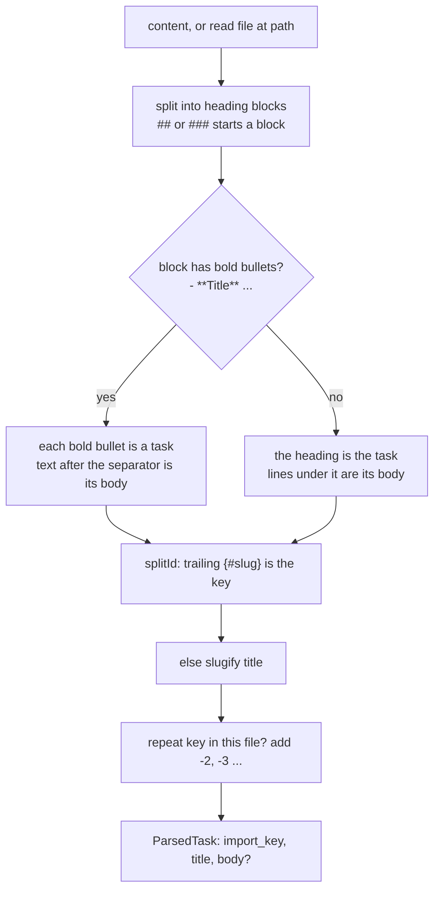

# Markdown Task Source

The v1 [[TaskSource Port]] adapter: a deterministic parser that turns a markdown backlog into tasks. Its runnable reference is `docs/old/reference/adapters/source/markdown/markdown-source.ts`.

> *"The whole point is the two rules the old build got wrong three times (backlog Story 7.3): 1. ONE parser, BOTH shapes — `##`/`###` heading-as-task, and a category heading whose `- **Title** …` bullets are the tasks. 2. `import_key` is ALWAYS server-derived (explicit `{#slug}` wins, else slugify(title)). Never trust an upstream/agent key — an unstable key is what duplicated tasks across runs."* — `markdown-source.ts` header

Backlog Story 7.3 (**BUG**): *"**One parser contract.** Deterministic parser handles both shapes: `##` heading = task, and heading‑as‑category with `- **Title** … ` bullets = tasks. Agent path exists for messy files only."*

## How it reads a file



Step by step, from the code:

1. **Input.** `input.content ?? (input.path ? await readFile(input.path, 'utf8') : '')`. Pasted content wins over a path.
2. **Blocks.** A line matching `^(#{2,3})\s+(.*)$` opens a block. *"ponytail: lines before the first heading are ignored (no ambiguous parent)"*.
3. **Shape choice per block.** If any line matches `^\s*[-*]\s+\*\*(.+?)\*\*\s*(?:[-–—:]\s*)?(.*)$`, the block is a *category* and each such bullet is a task. Otherwise the heading is the task and its lines, trimmed, are the body.
4. **Key.** `splitId` takes an explicit `{#slug}` off the end of the title (`[a-z0-9][a-z0-9-]*`). Otherwise `slugify(title)`.
5. **De-dupe in one file.** *"de-dupe within one file so a repeated title can't collide on its key"*: the second `Same` becomes `same-2`.
6. **Empty body.** `body.trim() || undefined`.

`slugify`: *"Stable across runs: lowercase, non-alphanumeric runs → '-', trimmed."* `s.toLowerCase().replace(/[^a-z0-9]+/g, '-').replace(/^-+|-+$/g, '')`.

Both shapes are in [[Backlog File Shapes]]. Behaviour on unusual input is in [[Parser Edge Cases]].

## Using it

From `07-ports-in-practice.md`:

```ts
const source = new MarkdownTaskSource();
const tasks = await source.fetch({ content: '## Backlog\n- **Filter list by status** — add a dropdown' });
// [{ import_key: 'filter-list-by-status', title: 'Filter list by status', body: undefined }]
```

(Running the reference gives `body: 'add a dropdown'` for this input, since the text after the em dash is the bullet's body. The `07` comment shows `undefined`.)

## The self-check

`node docs/old/reference/adapters/source/markdown/markdown-source.ts` prints *"MarkdownTaskSource self-check passed"* (verified with Node 24.11). The file's own header, `07` and the reference README still give the path from before the move to `docs/old/`: `docs/reference/…`. It asserts:

| Case | Input | Expected |
|---|---|---|
| Shape A, explicit id | `## Add OAuth login` … `## Fix flaky test {#flaky-cart}` | keys `add-oauth-login`, `flaky-cart`; first body `Support Google + GitHub.` |
| Shape B | `## Backlog` + `- **Filter list by status** — add a dropdown` + `- **Export CSV**: from the table` | titles `Filter list by status`, `Export CSV`; keys `filter-list-by-status`, `export-csv` |
| Stability | `slugify('Filter list by status')`; parsing the same input twice | `filter-list-by-status`; deep-equal results |

The reference README: *"`markdown-source.ts` doubles as the fix for the import bug the first build hit three times (backlog Story 7.3): one parser for both file shapes, and an `import_key` that is always server-derived and stable across runs."* The files run under plain `node` because *"Cross-file imports here are `import type` only"*.

> [!warning] What it does not do
> It reads no front matter, so the PRD's *"front-matter `id`"* is ignored. It does not split out *Acceptance criteria* or *Non-goals*: a `### Acceptance criteria` heading becomes a task of its own. See [[Intake And Import Open Questions]] #1 and #2.

## Related

- [[Intake And Import Index]]
- [[TaskSource Port]]
- [[Backlog File Shapes]]
- [[Import Key]]
- [[Parser Edge Cases]]
- [[Backlog Importer Agent]]
