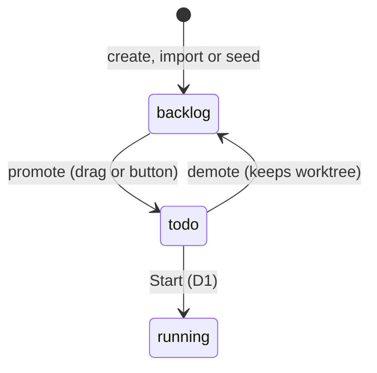

# Promoting A Task

Moving a task from **Backlog** to **Todo**. It is the last step of intake and the first of execution. The drawio *Functional components* Intake card: *"Promote Backlog → Todo / the only drag that means anything"*.

This note covers promote from the intake side. What happens after, including Start, is in [[Starting A Task]].

## What promote does

> `POST /api/tasks/:id/promote` — *"backlog -> todo, pin flow, create worktree"* (PRD §12)

1. **Worktree.** *"Every task gets its own worktree so parallel steps cannot collide on the filesystem. On promotion from Backlog to Todo:"* `git -C <repo_path> worktree add <repo_path>/.vibe-worktrees/task-<id> -b vibe/task-<id>` (PRD §11).
2. **Paths.** *"Store both paths on the task."* (PRD §11): `branch_name`, `worktree_path`.
3. **Housekeeping.** *"pre‑create `.vibe/task-<id>`; append `.vibe-worktrees/` to `<repo>/.git/info/exclude` so the parent repo stays clean"* (backlog 2.1, **PRD/FIX**).
4. **Pin.** *"Pin `tasks.flow_id` at promotion; project flow edits never move in‑flight tasks."* (backlog 2.1). PRD §5: `flow_id` *"null while in backlog, pinned on promotion"*.
5. **Status.** `backlog` → `todo`.

Acceptance (PRD §16): *"Promoting a task creates a git worktree on its own branch"*. Backlog 10.1: *"Promote creates worktree + branch."* The order of these steps is not given in any source. The workspace side is in [[Creating A Workspace]].

The entry into `backlog` is inferred ([[Intake And Import Open Questions]] #6); seeded tasks are drawio-only (#19).

## Promote and Start

> [!question] D1: does promote start the task?
> Backlog decision D1, *"Auto‑start on promote vs explicit Start"*, recommends *"Explicit Start button on card + sheet; promote stays cheap"*. The drawio *FlowBoard ideation* card repeats it, and the *Harness architecture* card *Life of one step* opens with an explicit Start: *"You press Start, or the engine advances a task. A server action validates the request."* Feature map §3 still asks: *"❓ Should starting a task happen automatically when you pull it out of the backlog, or be a separate "Start" button?"*
>
> The mockup guides draw promote as start. Monitor guide beat 2, *"You promote it"*: *"The first step is now in line. It has a private copy of the repo waiting for it, but no worker yet …"*, with rule *"**research** queued · no dependencies to satisfy, so it was eligible immediately."* Task-detail guide: `backlog` → `running`, arrow *"you promote it"*, and no `todo` box.
>
> The sources also split on **what happens when**:
>
> | At promotion | At start |
> |---|---|
> | PRD §5 `flow_id`: *"null while in backlog, pinned on promotion"* | PRD §4: *"Flows are version-pinned at task start."* |
> | PRD §12: *"backlog -> todo, pin flow, create worktree"* | architecture README: *"a task pins its version at start"* |
> | PRD §11: worktree *"On promotion from Backlog to Todo"* | drawio *Functional components*: *"Start task / pin flow version"*; *FlowBoard ideation*: *"Tasks pin flow_id at start"* |
> | backlog 2.1: *"Pin `tasks.flow_id` at promotion"* | feature map §3: *"Kicking off a task gives it a clean, private copy of the code to work in and locks in the recipe it will follow."* §14: workspace *"created when the task starts"* |
>
> While promote and Start were one move, the two columns agreed. If D1 holds, they do not. See [[Version Pinning]], [[Execution Open Questions]] #2, [[Flow Design Open Questions]] #7, [[Task Detail Open Questions]] #10, [[Workspaces Open Questions]] #1, [[Intake And Import Open Questions]] #14.

## Ways to promote

| Way | Source |
|---|---|
| Drag a card Backlog → Todo | PRD §13; backlog 2.2 *"Native HTML5 drag only Backlog ↔ Todo; Todo drop target only while dragging."* |
| A Promote button in the task sheet | backlog 2.3: *"Retry, Cancel, Cleanup, Promote, Start, Demote."* (**PRD/GAP**) |
| A keyboard key | backlog 9.4: *"keyboard equivalent for promote/demote"* (**BUG**), key not named. Feature map §5: *"Keyboard-friendly — Move around and open cards without reaching for the mouse."* |

See [[Intake In The UI]].

## Going back: demote

Backlog 2.1 (**NEW**): *"Demote (todo → backlog) keeps worktree; re‑promote reuses it."* PRD §12 has no demote route.

The task-detail mockup also has a **Send to backlog** button on a task in progress (`task-detail.html`). The guide's action table: *"Returns the task to the backlog, keeping its workspace and everything it produced."* Its lifecycle note: *"**Pause**, **Send to backlog** and **Cancel** are not drawn because they can happen from anywhere."* Whether that is the same action as demote is [[Intake And Import Open Questions]] #16. See [[Task Actions]] and [[Demote And Re-Promote]].

## What promote costs

Nothing. Monitor guide beats 1–2 show `$0` for both *In the backlog* and *You promote it*, and D1's reason is that *"promote stays cheap"*. A worktree is a local git operation.

## Related

- [[Intake And Import Index]]
- [[Starting A Task]]
- [[Task Workspace]]
- [[Creating A Workspace]]
- [[Version Pinning]]
- [[Intake In The UI]]
- [[Life Of A Task]]
