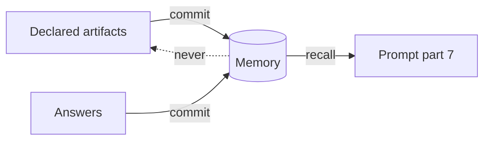

# Artifacts Versus Memory

Both carry context to a later run. They do different jobs, and the architecture insists on keeping them apart.

> [!quote] `05-environment-and-registry.md` §11
> *"**Artifacts vs memory** ([MemoryStore, 09](./09-memory.md)): two different jobs, don't conflate them. An **artifact** is the *verbatim, within-task* output — a real file on disk, git-tracked, diffable, the contract the next step reads. **Memory** is the *cross-task distillation* — the facts worth carrying to the next task, extracted and de-duplicated by Mem0. Artifacts stay the source of truth inside a task; memory is what survives it. The runner *writes* memory *from* declared artifacts and answers (never the reverse, and never from raw agent output), so the artifact contract stays the authority and memory is a downstream, auditable projection."*

| | Artifact | Memory |
|---|---|---|
| Lifetime | One task | Across tasks |
| Form | Verbatim file on disk, git-tracked, diffable | Distilled facts in a store |
| Role | *"the contract the next step reads"* | Background context in prompt part 7 |
| Authority | Source of truth inside the task | A *"downstream, auditable projection"* |
| Required? | Yes: the artifact contract is checked at flow save | No: off by default |
| How a run gets it | Prompt part 2, *"read these first"* paths | Prompt part 7, recalled text, capped |

`09-memory.md` agrees: *"**Artifacts** (§6) carry context *within* one task, as files on disk — the right design for that job, kept. But **nothing crosses the task boundary.**"*

## Direction of flow

Memory is written *from* artifacts and answers, *"never the reverse"*. Nothing in the sources writes a recalled memory back into an artifact.

> [!note] The task scope overlaps
> The `task` scope (*"within a task, across attempts"*) is the one place memory lives inside a task, where artifacts already are. PRD §8 already gives a rework run the failing step's artifacts: *"a rework sees the raw `check_output` or `review`, not a summary of it."* Task memory adds the distilled *why*. See [[Task Memory Scope]].

> [!warning] *"extracted and de-duplicated by Mem0"*
> `05` describes memory as if Mem0 were always the adapter. The `local` adapter, which comes first, does no extraction or de-duplication: *"With `local`, it is stored as written and recall prefers the newest"* (PRD §11.2). See [[Memory Open Questions]] #1.

## Related

- [[Memory Commit]]
- [[Task Artifacts]]
- [[Artifact Contract]]
- [[Memory Overview]]
