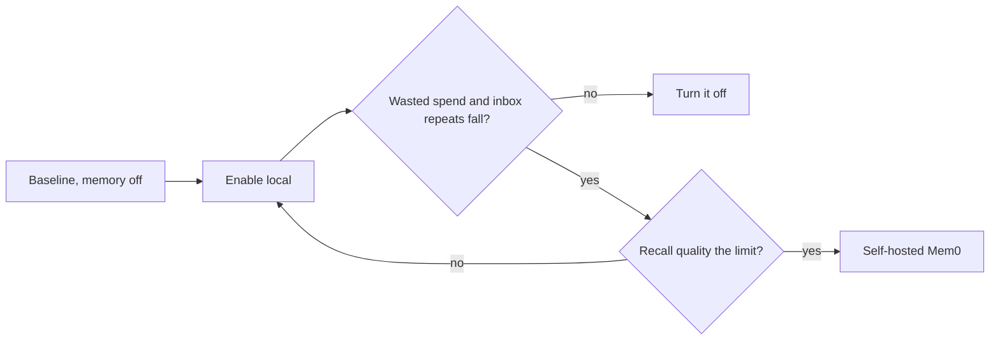

# Measuring Memory Payoff

Memory has to earn its place. *"Pays for itself, or it's off"* is the drawio card's title.

> [!quote] `09-memory.md`, recommendation 5
> *"**Measure it:** memory earns its place only if wasted spend and inbox repeats fall — both already have meters (§12, the inbox). Baseline before enabling, compare after; if it doesn't move them, turn it off."*

## The two meters

| Meter | Why memory should move it | Where it lives |
|---|---|---|
| **Wasted spend** | *"warm-start is a **wasted-spend** lever — fewer rework re-derivations, fewer repeated inbox questions"* (`06` §12) | `/costs`: [[Wasted Spend]] |
| **Inbox repeats** | *"answer a preference once, and it stops surfacing in the inbox"* (`09`) | The inbox. **No such counter exists** in the inbox mockup, which has *answered today* and *from chat*. |

## The net

`06` §12: *"the honest number is *net*: run spend saved minus memory spend added. If that stays negative, the memory posture (09) is wrong, and the same meter says so."* Memory's own spend is tagged apart so it never lands in per-run rollups. The full rules are in [[Memory Cost Accounting]].

The drawio card: *"Warm starts cut wasted spend; memory's own cost is tagged apart, so /costs shows the net."* The feature map §21: *"both show up on the cost view and the inbox, so you can tell whether it's earning its keep."*

## When to upgrade

The same meters gate the move from `local` to Mem0: *"Adopt it only once the cost and inbox views show `local` memory paying off and recall quality is what limits it."* (PRD §11.2)

> [!question] Gaps
> - No inbox-repeats meter is designed, and no rule says what counts as a repeat. #25
> - Part 7's tokens are billed in the run (inferred), so they would land on the run-spend side of the net, not in *"memory spend added"*. #22
> - No baseline period, comparison window or threshold is given. #25
>
> Numbers refer to [[Memory Open Questions]].

## Related

- [[Memory Cost Accounting]]
- [[Wasted Spend]]
- [[Memory Off By Default]]
- [[Memory Index]]
