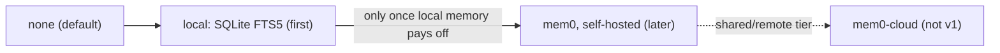

# Memory Adapters

Four adapter ids sit behind the [[MemoryStore Port]]: `id: 'mem0' | 'mem0-cloud' | 'local' | 'none'` (`memory-store.ts`, `01-ports.md`, `09-memory.md`).

## Side by side

| Adapter | What it is | Extraction / contradictions | Extra infrastructure | Status | Note |
|---|---|---|---|---|---|
| `none` | *"a no-op, and the default"* | — | none | v1, default | [[Memory Off By Default]] |
| `local` | *"A `memories` table with an FTS5 index in the same `flowboard.db`. Keyword recall, ranked by scope and recency."* | No: *"stored as written and recall prefers the newest"* | none: *"No embeddings, no extraction model, no extra container."* | v1, *"the first real one"* | [[Local Memory Adapter]] |
| `mem0` | Self-hosted [Mem0](https://github.com/mem0ai/mem0) OSS | Yes: *"Mem0 adds fact extraction and contradiction resolution"* | *"an extraction model's spend and a vector store"*; drawio: a Mem0 OSS server container | Later | [[Mem0 Adapter]] |
| `mem0-cloud` | The Mem0 managed platform | Yes | A hosted service | Out of scope for v1 | [[Mem0 Adapter]] |

Wording from PRD §11.2 unless marked.

## Build order

PRD §11.2: *"Three adapters, in build order: `none` … `local` … Mem0, later and self-hosted. Adopt it only once the cost and inbox views show `local` memory paying off and recall quality is what limits it."*

`09-memory.md` recommendation 1: *"**Adapter = `local` first** (an FTS5 table in `flowboard.db`: no embeddings, no extraction model, no extra container), default `none` until the first flow opts in. Move to self-hosted Mem0 only when the cost and inbox views show memory paying off and recall quality is the limit."*

The drawio *Harness architecture* card agrees: *"adapters: none (default) · local SQLite FTS5 (first) · mem0 (later)"*, and so does its concept 3: *"a memory store (local first, Mem0 later)"*. PRD §3 lists only `adapters/memory/ # none, local`.

> [!warning] Sources that still put Mem0 first
> - `memory-store.ts` header: *"Mem0 (self-hosted OSS by default, managed cloud as the remote tier) is the first adapter"*.
> - Drawio *FlowBoard ideation*: the group is titled *"Memory (Mem0) · additive"*, *D10* reads *"Default self-hosted Mem0 (local-first)"*, and the *Commit after a run* card reads *"Mem0 extracts facts and resolves contradictions — from declared artifacts and answers only."*
> - Drawio *Logical components*: the only adapter card is *Mem0 memory* (*"self-host (default) · managed cloud"*), the only store *"Mem0 vectors + history (self-hosted)"*.
> - Drawio *Functional components*: *Distil after a step* reads *"facts + contradiction resolution (Mem0)"*.
> - `09-memory.md` itself is split. Its opening and recommendation 1 put `local` first, but *The port* names *"Mem0 (self-host / cloud), a trivial `local` SQLite adapter, and a `none` no-op"* as the adapters, and *How it maps to Mem0* says *"**Self-hosted OSS is the default**"*.
> - `03` §6: commit is distilled *"so the adapter (Mem0) can extract facts and resolve contradictions"*.
> - `05` §11: memory is *"extracted and de-duplicated by Mem0"*.
> - `06` §15 lists adapter ids *"`mem0`/`local`/`none`"*, with no `mem0-cloud`.
>
> See [[Memory Open Questions]] #1 and #2.

## Choosing one

The setting is the adapter: *"the adapter (`none` / `local` / self-hosted Mem0 / Mem0 cloud), its endpoint or key ref"* (PRD §13). See [[Memory Settings]]. PRD §13 offers Mem0 cloud, which PRD §17 puts out of scope for v1.

## Related

- [[MemoryStore Port]]
- [[Local Memory Adapter]]
- [[Mem0 Adapter]]
- [[Memory Index]]
