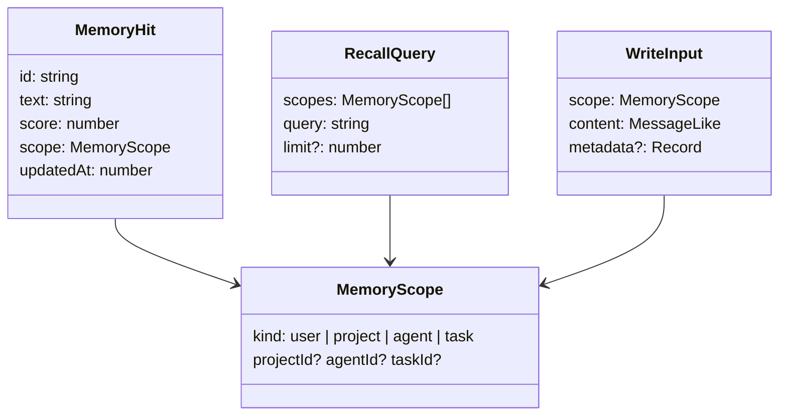

# Memory Data Model

*"Schema — almost nothing new"* (`09-memory.md`). *"Schema — almost nothing."* (PRD §11.2).

## What the sources define

| Thing | Columns / fields | When | Source |
|---|---|---|---|
| `memories` | `scope, scope_id, text, source_run_id, created_at`, with an FTS5 index | `local` adapter only | PRD §11.2 |
| `run_memories` | `run_id, memory_id, scope` | Optional; *"recording what was recalled into each run, for the audit trail"* | PRD §11.2, `09` |
| `settings` memory block | adapter id, endpoint / key ref, enabled scopes, recall limit, `max_recall_chars` | Always | PRD §11.2; see [[Memory Settings]] |
| Memory bucket | Memory's own token/API cost, tagged apart | When memory has spend | `06` §12, PRD §11.2; see [[Memory Cost Accounting]] |

With Mem0: *"Mem0 owns the memories (vector store + history)"* and *"No memory *content* is duplicated into SQLite."* (`09`). Only `settings` and `run_memories` remain on the FlowBoard side.

None of these is in the PRD §5 schema. The drawio *Harness architecture* SQLite card does list them: *"settings (memory, sandbox_profile) · run_memories · memories + FTS5"*.

## Types (port)

From `memory-store.ts`; see [[MemoryStore Port]] for the full listing.



## How the pieces line up

| Port field | `memories` column | Gap |
|---|---|---|
| `MemoryScope.kind` | `scope` | — |
| `projectId` / `agentId` / `taskId` | `scope_id` | `user` has no id |
| `MemoryHit.text` | `text` | — |
| `MemoryHit.updatedAt` | — | Only `created_at` exists; `local` never updates (inferred) |
| `MemoryHit.score` | — | Computed at recall (FTS5 rank, inferred) |
| `WriteInput.metadata` (`runId`, `stepKey`, source artifact type) | `source_run_id` | No step key or artifact type column |

> [!example] Proposal (not in the sources)
> ```sql
> CREATE TABLE memories (
>   id            TEXT PRIMARY KEY,
>   scope         TEXT NOT NULL,   -- 'user'|'project'|'agent'|'task'
>   scope_id      TEXT,            -- NULL for 'user'
>   text          TEXT NOT NULL,
>   source_run_id TEXT REFERENCES runs(id),
>   metadata      TEXT,            -- JSON: stepKey, source artifact type
>   created_at    INTEGER NOT NULL
> );
> CREATE VIRTUAL TABLE memories_fts USING fts5(text, content='memories', content_rowid='rowid');
>
> CREATE TABLE run_memories (
>   run_id    TEXT NOT NULL REFERENCES runs(id),
>   memory_id TEXT NOT NULL,       -- a memories.id, or a Mem0 id
>   scope     TEXT NOT NULL,
>   PRIMARY KEY (run_id, memory_id)
> );
> ```
> `id`, `metadata`, the nullable `scope_id`, the FTS5 external-content form and the keys are all inferred. `run_memories.memory_id` cannot be a foreign key, because under Mem0 the memory lives outside SQLite. See [[Memory Open Questions]] #20.

## Related

- [[Memory Storage]]
- [[Memory Settings]]
- [[Execution Data Model]]
- [[Memory Index]]
