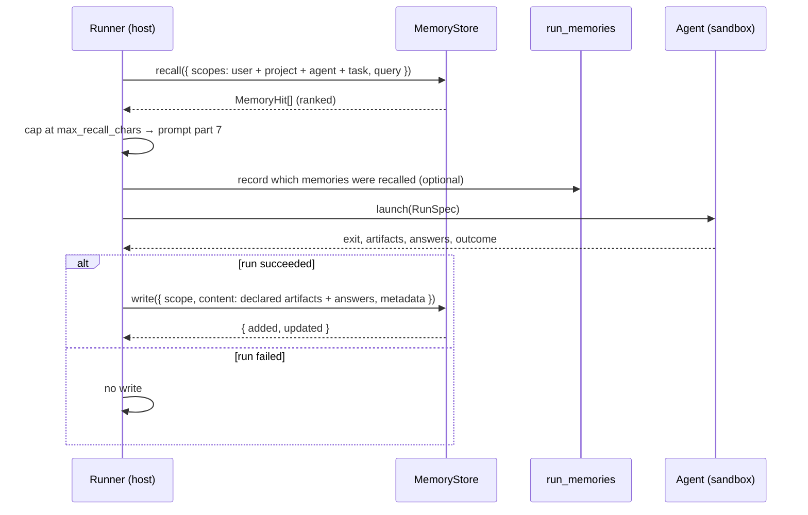
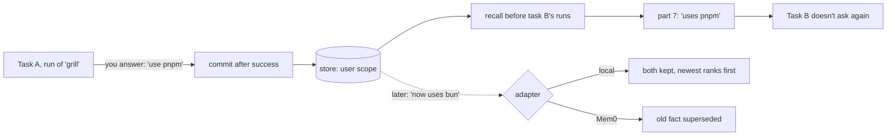

# Memory Lifecycle

*"The lifecycle — recall then commit, both host-side"* (`09-memory.md`). The runner brackets `launch()` with the two calls: *"Neither happens *inside* the agent process — the **runner brokers both**."*

## One run

Where the `run_memories` record falls relative to launch is drawn for illustration; no source fixes it.

The drawio *Life of one step*, letter **D**: *"If memory is on, the runner recalls (capped) before launch and writes after success. Host side only."* The Execution set places these as steps 2 and 10 of the [[Runner Pipeline]].

## One memory, across tasks

The example answer is illustrative, built from `09`'s *"uses pnpm"* and *"now uses vitest, not jest"*.

## States of a memory

The sources give memories no states. A memory is written, recalled, and (under Mem0) superseded. There is no expiry, edit, delete, or review step, and no UI to see them. See [[Contradictions And Freshness]] and [[Memory Open Questions]] #18, #19.

## Edge cases the sources settle

| Case | Rule | Source |
|---|---|---|
| Memory off | *"With the `none` adapter this is a no-op and nothing else changes"* | `03` §6 |
| Run fails | No commit: commit is *"after a run succeeds"* | PRD §7, §11.2 |
| Recall returns too much | Ranked, *"the tail is dropped to fit"* | PRD §7 |
| Sandboxed run | The agent never reaches the store; no allowlist entry | PRD §11.2, `08` |

## Edge cases the sources leave open

| Case | Open question |
|---|---|
| A human rejection, not a run | [[Memory Open Questions]] #12 |
| An infrastructure failure worth remembering | #13 |
| Shell and manual steps | #14 |
| Commit before or after advancement | #15 |
| An answer undone after commit | #16 |
| A parked run that resumes | #10 |

## Related

- [[Memory Recall]]
- [[Memory Commit]]
- [[Life Of One Step]]
- [[Runner Pipeline]]
- [[Memory Index]]
