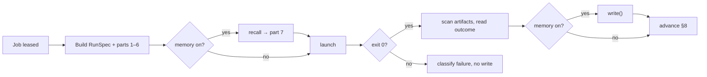

# Memory Runtime

Where memory's code lives and who calls it.

## Code layout

| Source | Layout |
|---|---|
| PRD §3 | `packages/core/ports/` holds *"AgentProvider, ExecHost, MemoryStore, Notifier, TaskSource interfaces"*; `packages/adapters/memory/` holds *"none, local"* |
| Architecture README | `core/memory/ # recall before a run, commit after (09)`; `core/ports/` includes `MemoryStore`; `adapters/memory/mem0/ local/` |
| Drawio harness *Code layout* | *"packages/adapters: agent · exec · notify · memory"* |
| Reference | `docs/old/reference/core/ports/memory-store.ts` (the port only; no adapter) |

The PRD ships `none` and `local`; the architecture README sketches `mem0` and `local`. The PRD rule that matters: *"`packages/core` imports no framework, no database driver and no CLI."* So the `local` adapter, which needs SQLite, lives in `adapters`, not in core (inferred from the rule).

## Who calls it

Only the runner, in the worker process.

| Rule | Source |
|---|---|
| *"the runner brackets `launch()` with the MemoryStore port when it is enabled"* | `03` §6 |
| *"The port is queried by the runner, never from a route"* | `01-ports.md` |
| *"Every port is called from `src/lib/`, **never from a route**"* | `06` §15 |
| The drawio *Logical components* edge: *Run orchestrator → MemoryStore: "recall / commit (host-side)"* | drawio |
| The drawio *Harness architecture* card *MemoryStore port* sits inside the worker | drawio |

## Call sites in the runner

| Pipeline step | Call | Source |
|---|---|---|
| Before launch (where it falls against the prompt and `RunSpec` build: see below) | `recall()`, then render part 7 | PRD §11.2 (*"Recall, before the run"*), `03` §6 (*"**Before:** `recall(…)`"*) |
| After exit 0, with the artifact scan | `write()` | PRD §7 *Completion*, §11.2 |

The sources disagree on where recall falls against building the prompt and the `RunSpec`:

- The drawio *Life of one step* puts it after: **C** *"the runner builds the RunSpec and the prompt: contract, read-first paths, output paths"*, then **D** *"If memory is on, the runner recalls (capped) before launch and writes after success."*
- The Execution set puts it before: [[Runner Pipeline]] stage 2 is *"Recall memory, if enabled (host-side)"*, ahead of stage 3 *"Build the prompt"* and stage 4 *"Build the `RunSpec`"*, and notes *"The drawio puts recall (D) after building the RunSpec and prompt (C); the table puts it first because part 7 goes into the prompt."*

PRD §11.2 and `03` §6 say only that recall comes before the run; PRD §7 says only that part 7 comes *"from `MemoryStore.recall`"*. See [[Memory Open Questions]] #30. The diagram below follows the drawio order.

The Execution set numbers recall and commit as stages 2 and 10 in [[Runner Pipeline]], and notes there that *"Memory `write()` and §8 advancement both follow a success; their order is not stated."* See [[Memory Open Questions]] #15.

The position of `write()` before advancement in this diagram is a proposal, not a source rule.

## Resolving the adapter

Settings pick the adapter id (PRD §13). How the worker builds the adapter from it, and whether a settings change reaches a running worker, is not stated. See [[Memory Open Questions]] #29.

## Related

- [[Runner Pipeline]]
- [[Execution Runtime]]
- [[MemoryStore Port]]
- [[Memory Index]]
