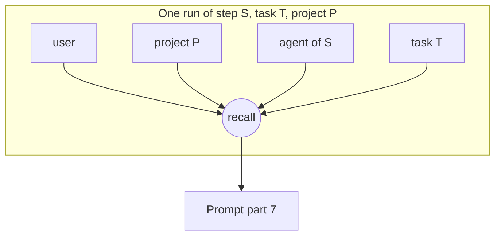

# Memory Scopes

Every memory belongs to exactly one scope. A run recalls from the union of its four.

> **Four kinds of memory** — About *you* (how you like things done), about a *project* (its quirks and layout), about an *agent or skill* (what that role has picked up), and within a *task* (so attempt 2 knows why attempt 1 failed). — feature map §21

## Side by side

| Scope | Key | Holds | Written from | Read into | Note |
|---|---|---|---|---|---|
| `user` | none (one per install) | *"uses pnpm", "rejects speculative abstractions", recurring answers* | *answered questions (§9), rejections* | *every run's prompt preamble* | [[User Memory Scope]] |
| `project` | `projectId` | *build quirks, naming conventions, where things live* | *summaries, review notes, research briefs* | *every run on that project* | [[Project Memory Scope]] |
| `agent` | `agentId` | *what `researcher` learned about this stack; questions `/grill-me` has settled* | *that agent's own run outputs* | *that agent's next run* | [[Agent Memory Scope]] |
| `task` | `taskId` | *why attempt 1 failed, decisions taken mid-task* | *each run in the task* | *the next attempt (rework loop)* | [[Task Memory Scope]] |

The table is `09-memory.md`'s, quoted. *"every run's prompt preamble"* for `user` is read here as part 7, not prompt part 1 (the preamble) (inferred; no source glosses it). Every other source puts recalled memory in part 7. The wording is logged as source drift in [[Memory Open Questions]] #27.

## The scope union

For one run, the runner recalls from *"user + the task's project + the step's agent + the task"* (`RecallQuery.scopes` in `memory-store.ts`; also PRD §7, §11.2, `03` §6, the drawio *MemoryStore port* card).

## Which scopes, when

| Source | Wording |
|---|---|
| `09-memory.md` recommendation 2 | *"Recall the `user` scope into every run; `project`/`agent`/`task` per step. The user scope is the cheapest, highest-leverage win (fewer inbox repeats)."* |
| Architecture README, open decision 4 | *"additive/off by default, `user` scope first"* |
| PRD §13 | The settings section chooses *"which scopes are enabled (user / project / agent / task)"*. |
| Feature map §21 ❓ | *"Which memory to switch on first — just *your* preferences (the cheapest win), or project memory too?"* |

No source gives a default for *enabled scopes*, or a field that selects scopes *"per step"*. See [[Memory Open Questions]] #3 and #4.

## Mapping to Mem0

*"FlowBoard's `user` / `agent` scopes → Mem0's `user_id` / `agent_id`; `project` and `task` → a `run_id`/session or a metadata namespace. One adapter method each way."* (`09-memory.md`). See [[Mem0 Adapter]].

## Writes are scoped

*"every write is **scoped** (a run writes to its own project/agent/task, not another project's)"* (`09-memory.md`). `08-sandboxing.md`: *"a run writes its own project/agent/task, never another's"*. Neither list names `user`, although `user` is written from answers. See [[Memory Open Questions]] #11.

## Related

- [[MemoryStore Port]]
- [[Memory Recall]]
- [[Memory Commit]]
- [[Memory Glossary]]
- [[Memory Index]]
