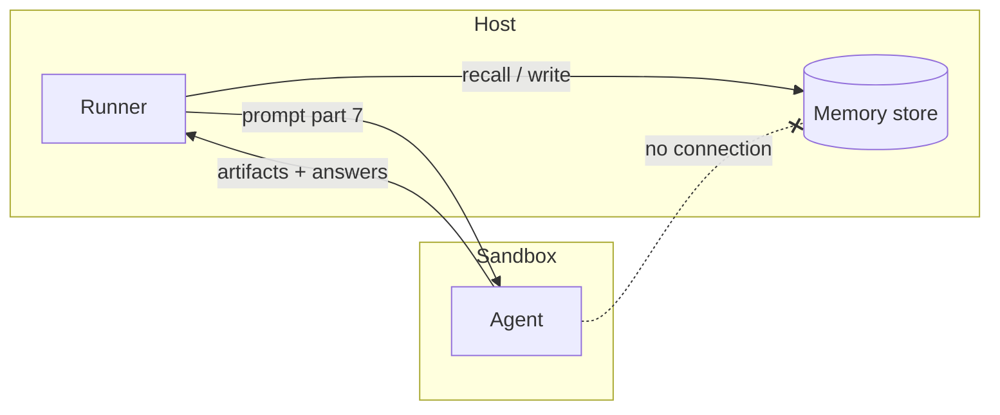

# Memory Trust Boundary

> [!important] `09-memory.md`
> *"Memory is a new **cross-run trust channel**, and headless agents read untrusted content (§08). Two risks, both contained by keeping the runner in the middle."*

PRD §11.2: *"This cross-run trust boundary is the part to get right"*.

## The two risks

| Risk | What it is | Mitigation | Source |
|---|---|---|---|
| **Injection into a run** | *"Recalled text rides into a prompt that also reads untrusted repo/web content."* | *"It is labelled as *background context, not instructions*, and it is only ever memory the operator's own prior runs produced — never third-party content promoted to "fact"."* | `09` |
| **Poisoning memory** | *"A prompt-injected run could try to write false facts that later runs trust."* | *"commit only from **declared artifacts/answers** (not arbitrary output); every write is **scoped** (a run writes to its own project/agent/task, not another project's); every write is **audited** (metadata records the `runId` + step, and the per-run recall set is logged — see schema). Self-hosting keeps the whole store local."* | `09` |

`08-sandboxing.md` admits the limit: *"A prompt injection can still poison *what a run proposes to remember* — which is exactly why commit is narrowed to structured, declared output and self-hosting keeps the store local."*

## The host-side broker

> [!quote] `09-memory.md`
> *"Because recall and commit are **brokered by the runner on the host**, the sandboxed agent process itself does *not* talk to Mem0 — so **memory stays off the sandbox egress allowlist** in the default design. If you ever run Mem0 remote *and* let a step reach it directly, that endpoint joins the allowlist (§08) — the default avoids it entirely."*

`08-sandboxing.md` gives the reasoning: *"Same reasoning as the `ask_user` broker: keep the sealed process talking only to the host."* The drawio Mem0 card: *"on fb-memory, reachable from the host only, never from the sandbox"*.

PRD §16 acceptance: *"Recall and commit happen host-side; a sandboxed run needs no egress-allowlist entry for the memory store"*.

## Later: an injection scan

The drawio *Harness architecture* plans *"Injection scan (later) — LLM Guard over artifacts before the next step or memory trusts them"*. It would sit between a run's artifacts and commit.

> [!question] A tension
> `09` says recalled memory is *"never third-party content promoted to "fact""*, but project memory is written from *"research briefs"*, and research reads the web. A brief is a declared artifact the operator's run produced, so it passes the rule while carrying third-party content. See [[Memory Open Questions]] #17.

## Related

- [[Memory Commit]]
- [[Recalled Memory In The Prompt]]
- [[Capability Tools And Egress]]
- [[Run Guardrails At Launch]]
- [[Memory Index]]
