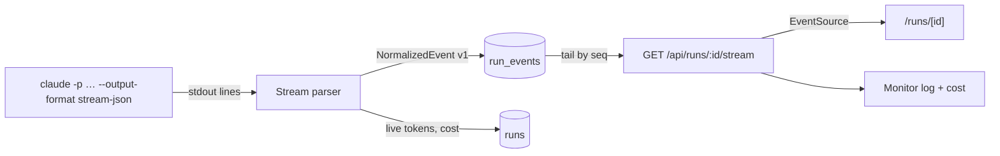

# Event Stream And SSE

Architecture component **#8**, *Event stream & live viewer* (`03` §8):

- **Role:** *"normalized events → `run_events` → SSE tail (worker is a separate process) → `/runs/[id]`."*
- **Seam:** *"the 7 `NormalizedEvent` kinds are the universal contract; SSE replays from `Last-Event-ID`, sends `end` on terminal state. The viewer never parses provider JSON."*
- **Genericize:** *"done by construction once 5 emits `NormalizedEvent`. Adding a provider adds a parser, nothing in the viewer."*
- **Composes with:** *"the runner (6) writes; SSE reads and tails `run_events` (deviation from PRD's in-memory emitter — keep it, the worker is a separate process)."*

## The pipeline



PRD §7: *"Stream stdout line by line, parse each as JSON, write to `run_events` with an incrementing `seq`. The SSE endpoint lives in `apps/web`, a different process, so it cannot share an in-memory emitter: it tails `run_events` by `seq` (with `Last-Event-ID` for catch-up). Normalise each event into one of the `type` values in the schema and produce a one-line `summary` for the viewer."*

PRD §12: *"The SSE endpoint replays existing `run_events` for the run, then streams new ones. Reconnect with `Last-Event-ID`."*

## The seven kinds

From `docs/old/reference/core/ports/events.ts` and `01-ports.md`:

```ts
type NormalizedEvent =
  | { type: 'assistant_text'; text: string }
  | { type: 'thinking'; text: string }
  | { type: 'tool_use'; name: string; input: unknown; summary: string }
  | { type: 'tool_result'; ok: boolean; output: unknown }
  | { type: 'system'; sessionId?: string }
  | { type: 'result'; usage: Usage; outcome?: 'pass' | 'fail' }
  | { type: 'error'; message: string };

interface Usage {
  input: number; output: number; cacheRead: number; cacheWrite: number;
  numTurns: number;
  costUsd?: number;   // absent → PricingService fills it from tokens
}
```

## Rules

- **Versioned.** *"each event carries `v`, starting at 1. A reader handles the versions it knows and falls back to the raw line for the rest."* (PRD §7)
- **Standard names.** *"Name fields after the OpenTelemetry GenAI semantic conventions where one exists … so a tracing backend such as Langfuse can be fed later by a plain OTel exporter."*
- **Keep the raw line.** *"Persist the raw line alongside the normalized event … so a new provider's parser can be debugged against real captures without re-spending."* (`01-ports.md`)
- **Cost is final at the end.** *"Take the final result event's total cost as authoritative for `runs.cost_usd`. Accumulate per-message token usage as you stream so the live view shows a running number before the run ends."*
- **Write against the probe.** PRD §0 asks for `docs/stream-sample.jsonl` before writing the parser: *"Write the parser against what you see, not against what you expect."* The file exists at `docs/old/stream-sample.jsonl`.
- **Dedupe by `seq`** on the client (backlog 3.4 BUG).
- **Send `end`** on a terminal run state (backlog 3.4).

## Other streams

The inbox also subscribes to SSE: *"Answering in Slack must update the open web page (the inbox subscribes to an SSE stream)."* (PRD §10). Backlog 4.3: *"SSE snapshot stream (pending + answered in last 2 min)"*. The drawio SSE card covers *"questions and task state"* too. No source defines a stream for the monitor's whole-board view ([[Monitor Open Questions]] #30).

## Related

- [[Live Run Viewer]]
- [[Monitor Runtime]]
- [[Monitor API And Routes]]
- [[Monitor Storage]]
